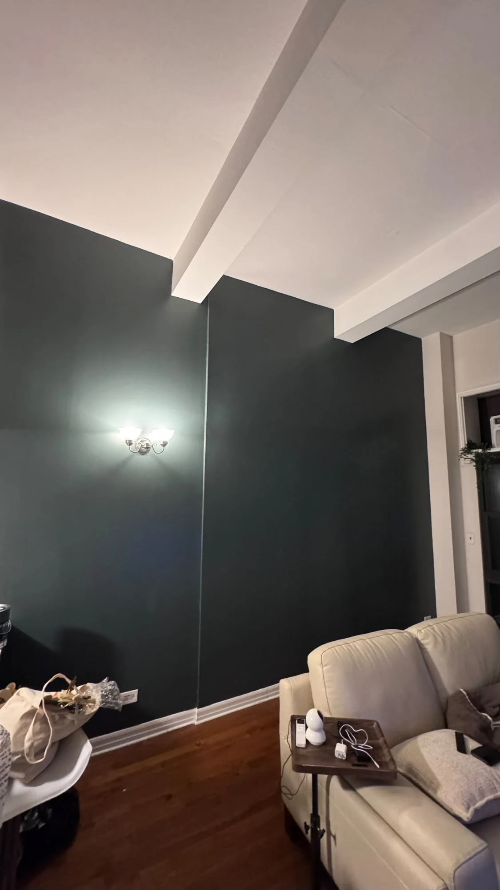
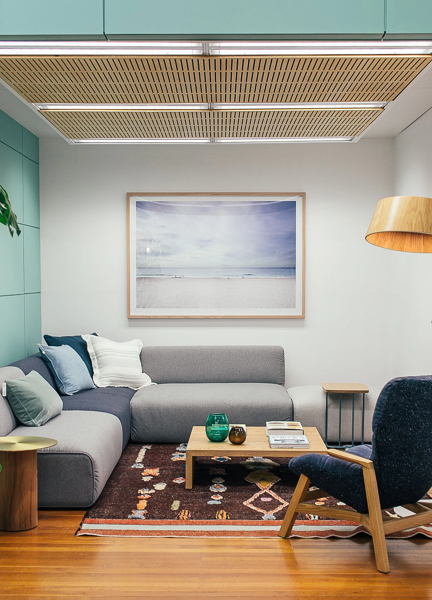
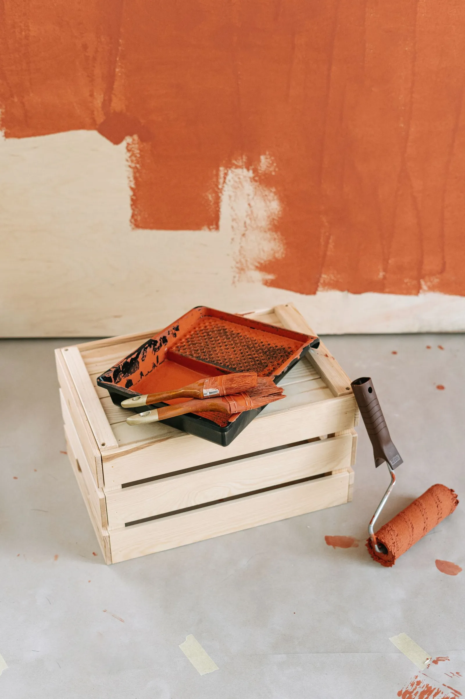
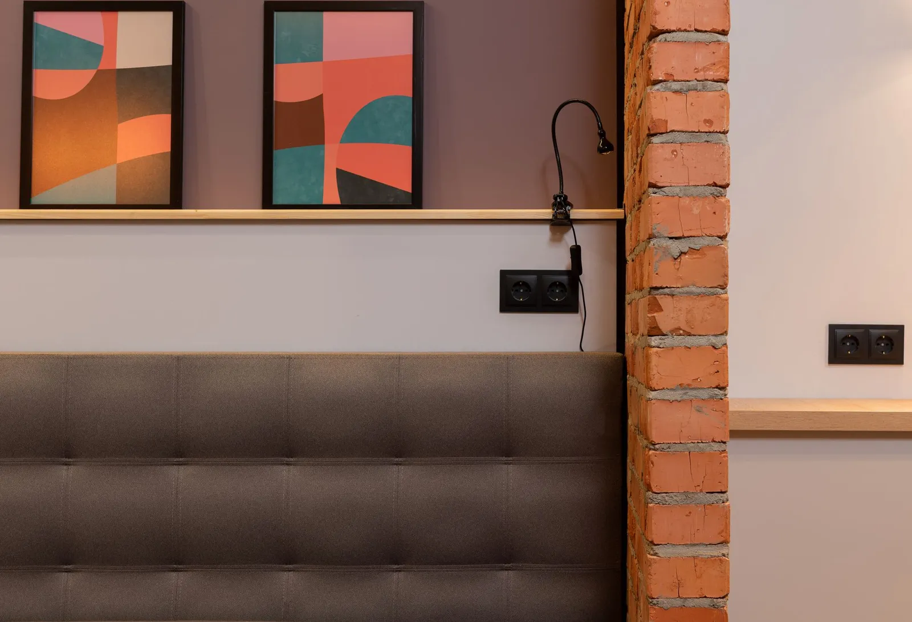
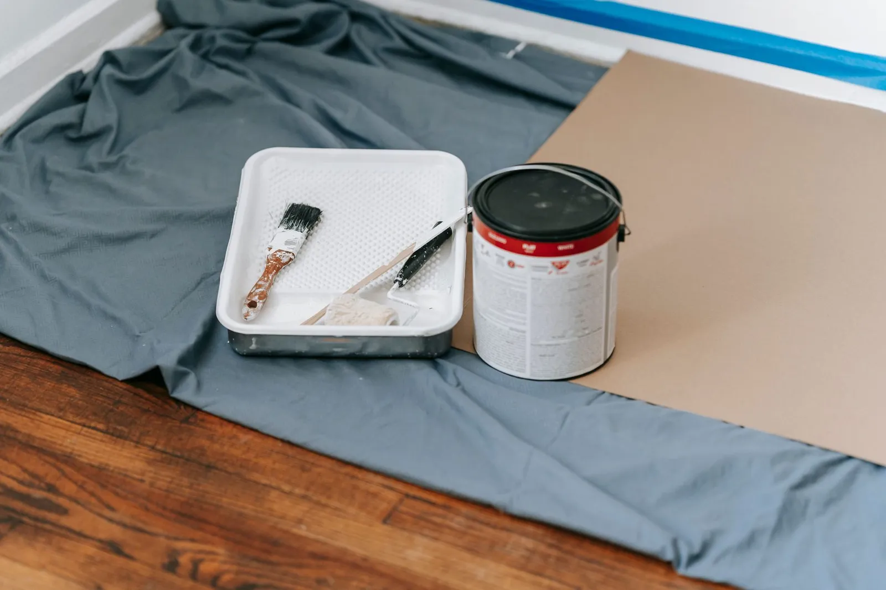
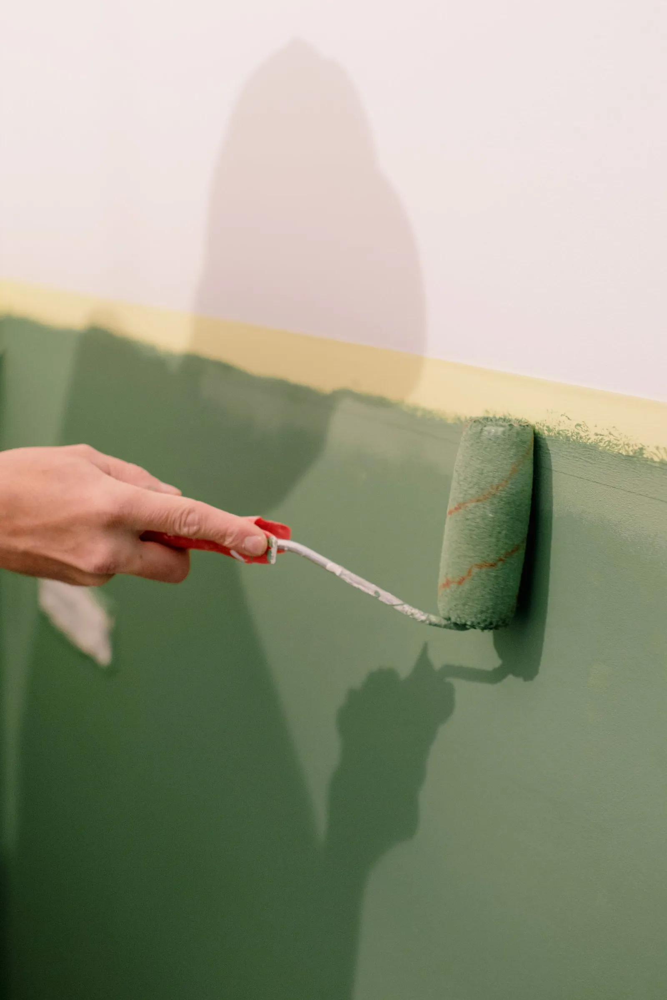

Accent wall painting is the gateway snack of home improvement (it's always "just one wall," right up until you're eyeing the hallway). One wall in a bolder color than the rest gives a room a focal point, more depth and a dose of personality, without repainting everything. It's also cheaper and much faster than doing the whole room.

Below we cover how to choose the wall, the accent wall paint colors that work best, ideas for bedrooms and two-tone walls, and how to paint an accent wall yourself step by step. We also explain where a professional finish makes the biggest difference.

*A deep teal accent wall we painted in a New York apartment. The white beams and trim make the color look even richer. [See the full project](/work/apartment-accent-wall-deep-teal/).*

## Why accent walls with paint work so well

Accent walls with paint are popular for good reasons:

- **They create a focal point.** Your eye goes straight to the colored wall, so it frames whatever sits in front of it: a sofa, a bed, a TV or a piece of art.
- **They add depth.** A darker wall seems to sit a little farther back, which can make a room feel more layered.
- **They let you try a bold color safely.** Committing to deep green on four walls is a big step. One wall is an easy way to test it.
- **They are quick.** One wall is usually a single-day job, even with two coats.

## Which wall should be the accent wall?

Picking the wrong wall is the most common mistake. A few simple rules help:

1. **Choose the wall you see first.** Stand in the doorway. The wall your eye lands on is usually the right one.
2. **Use the wall behind the main piece of furniture.** In a living room that is usually the wall behind the sofa or TV. In a bedroom, it is almost always the wall behind the headboard.
3. **Pick a wall without many interruptions.** A wall split up by two doors and a window turns the color into small, awkward pieces. A solid wall shows it off.
4. **Look for natural boundaries.** The color needs a clean place to stop: an inside corner, a door frame, or a change in ceiling height. A wall that flows into a hallway with no break is hard to finish neatly.

*The accent does not have to be the wall behind the sofa. Here, a sea green side wall adds color while the main wall stays light. Photo: Pexels.*

## The best accent wall paint colors

The right color depends on your light, your floors and your furniture. These families work in most rooms. We have named a few well-known colors from Sherwin-Williams and Benjamin Moore, two brands we use often, as starting points.

| Color family | Mood | Colors to sample |
| --- | --- | --- |
| Deep navy | Calm, classic, works with wood and brass | Hale Navy (Benjamin Moore HC-154), Naval (Sherwin-Williams SW 6244) |
| Dark green and teal | Rich and cozy, great with white trim | Evergreen Fog (SW 9130), October Mist (Benjamin Moore 1495) for a softer sage |
| Warm earth tones | Welcoming and sunny | Cavern Clay (SW 7701), terracotta and rust shades |
| Charcoal and black | Dramatic and modern | Urbane Bronze (SW 7048), Tricorn Black (SW 6258) |
| Soft blush and mauve | Gentle and warm, good in bedrooms | Muted pinks and dusty mauves with a gray undertone |

A few tips before you pick:

- **North-facing rooms** get cooler light, so warm colors such as clay, rust and warm greens feel more balanced.
- **South-facing rooms** handle cool colors like navy and blue-green well.
- **Look at the undertone.** Hold the sample against your floors, trim and sofa. A green with a yellow undertone will fight with a cool gray sofa.
- **Go one shade deeper than you think.** On a single wall, a color that looked bold on a small chip often reads softer once it is on the wall.

*Always test a color on the actual wall before you commit. Light changes it more than you expect. Photo: Pexels.*

**Test before you buy gallons.** Paint two large swatches, about two feet square, on the wall itself, or on poster board you can move around. Check them in the morning, the afternoon and at night under your own lamps.

## Painting an accent wall in a bedroom

Painting an accent wall in a bedroom is one of the most popular versions of this project, and the headboard wall is the natural choice. A few ideas that work well:

- **Go dark and cozy.** Deep navy, forest green or charcoal behind the bed makes a bedroom feel calm and enclosed, in a good way.
- **Keep the other walls soft.** For bedroom paint with an accent wall, pair the bold wall with a warm white or a very light tint of the same color family.
- **Use a matte finish.** Bedrooms do not need a scrubbable wall, and a flatter finish makes deep colors look velvety.
- **Think about the ceiling.** For a dramatic look, carry the accent color onto the ceiling above the bed, or paint the ceiling a soft tint of it.

## Two-tone wall paint ideas

Not every accent has to cover the whole wall. These 2 tone wall paint ideas give you color with a little more design:

- **Half wall.** Paint the lower part of the wall in a deeper color, up to chair rail height or a third of the way up, and keep the top light. It works well in dining rooms and hallways, where the lower wall takes the most scuffs.
- **Upper accent.** The reverse: a deeper color above a shelf or ledge, with a lighter color below.
- **Color drenching on one wall.** Paint the wall, its baseboard and any trim in the same color for a modern, seamless look.
- **Painted shapes.** An arch behind a bed or desk, or a block of color that frames a shelf, adds color without committing to the full wall.

*A two-tone wall: dusty mauve above the ledge and a pale lilac below. The wooden shelf gives the color change a clean place to stop. Photo: Pexels.*

Two-tone walls rely on a perfectly straight, level line between the colors. Measure and mark it with a level or laser, rather than measuring down from the ceiling, because ceilings in older buildings are rarely level.

## How to paint an accent wall, step by step

If you want to paint an accent wall yourself, this is the process we follow on every job.

### What you need

- Paint for the accent color (one gallon covers about 350 to 400 square feet per coat, so one gallon is enough for most single walls with two coats)
- A tinted primer if you are going from light to a very dark or saturated color
- Painter's tape, a 2 to 2.5 inch angled brush, a roller frame with a 3/8 inch nap cover, and a tray
- Drop cloths, spackle, a putty knife and fine sandpaper
- A ladder or step stool

*Set up before you open the paint: floors covered, tape and tools within reach. Photo: Pexels.*

### 1. Prep the wall

Move furniture away and cover the floor. Fill nail holes and dents with spackle, let it dry, and sand it smooth. Wipe the wall down to remove dust. Dark colors show every flaw, so this step matters more on an accent wall than anywhere else.

### 2. Prime if needed

Spot-prime the patched areas so they don't show through as dull patches. If you are going from a light color to a deep one, a gray or tinted primer over the whole wall helps the new color cover in two coats instead of three or four.

### 3. Tape the edges

Tape the edges where the accent wall meets the neighboring walls, the ceiling and the baseboard. Press the tape down firmly with a putty knife or credit card. A pro trick for razor-sharp lines: brush a thin coat of the *neighboring* wall color along the tape edge first. Any paint that seeps under the tape is then the right color, and the edge stays clean once you paint the accent color.

*Tape marks the edge, and the roller fills in the wall. Photo: Pexels.*

### 4. Cut in, then roll

Use the brush to paint a band about 2 to 3 inches wide along the tape, corners and baseboard. Then roll the main wall in sections from top to bottom, keeping a "wet edge" so each section blends into the last. Roll in a loose W pattern, then even it out with straight vertical passes.

### 5. Apply a second coat

Let the first coat dry fully, which usually takes two to four hours, and check the can for your paint. Then cut in and roll a second coat. Deep colors almost always need it.

### 6. Pull the tape

Remove the tape slowly, at a 45-degree angle, once the last coat is dry to the touch. If the paint has hardened over the tape, score the edge lightly with a utility knife first so the paint does not peel.

## DIY or hire a painter?

A single wall is a very doable DIY project. Where people run into trouble:

- **Ceiling lines.** In older buildings, ceilings and corners are rarely straight, and tape does not stick well to textured ceilings. Pros cut these lines freehand with a brush.
- **Deep colors.** Dark and saturated colors show lap marks and thin spots more than light ones. Getting an even finish takes practice.
- **Tall walls.** Double-height walls and stairwells need the right ladders or scaffolding to paint safely.
- **Plaster walls.** Older walls often need more patching and priming than you expect.

If any of those apply, or you simply want it done right in a day, our [accent wall painting service](/services/accent-walls/) covers color advice, prep, primer and two finish coats in one flat-rate price. We paint across [Manhattan](/areas/manhattan/), [Brooklyn](/areas/brooklyn/), [Queens](/areas/queens/) and the rest of New York City and Long Island. If you want texture instead of a solid color, [lime wash](/services/lime-wash-specialty-paint/) also makes a beautiful accent wall.

## The bottom line

Accent wall painting is a small project with a big payoff. Choose the wall your eye goes to first, test your color in your own light, prep the wall carefully and take your time on the edges. Get those right and one wall can change the whole room. (Just don't blame us when you start eyeing the hallway.)
