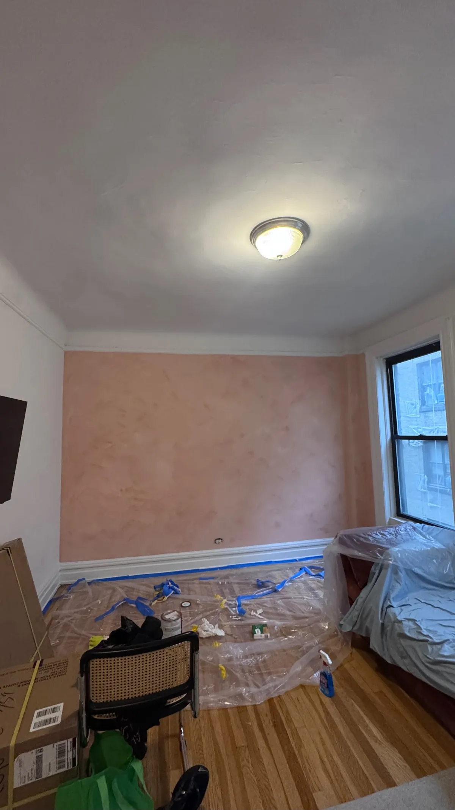

Accent wall painting is the gateway snack of home improvement (it's always "just one wall," right up until you're eyeing the hallway). One wall in a bolder color than the rest gives a room a focal point, more depth and a dose of personality, without repainting everything. It's cheaper and much faster than doing the whole room, too.

Below: how to pick the wall, the accent wall paint colors that work, bedroom and two-tone ideas, and how to paint an accent wall step by step. Grab a brush. Or at least a snack.

*A deep teal accent wall we painted in a New York apartment. White beams, white trim, and a wall that's clearly the main character. [See the full deep teal accent wall project](/work/apartment-accent-wall-deep-teal/).*

## Why accent walls with paint work so well

Accent walls with paint are popular for good reasons:

- **They create a focal point.** Your eye goes straight to the colored wall, so it frames whatever sits in front of it: a sofa, a bed, a TV or art.
- **They add depth.** A darker wall seems to sit a little farther back, which makes a room feel more layered.
- **They let you try a bold color safely.** Deep green on four walls is a commitment. Deep green on one wall is a first date.
- **They're quick.** One wall is usually a one-day job, even with two coats.

*The accent doesn't have to be the wall behind the sofa. A side wall works too, and it still gets plenty of attention. Photo: Pexels.*

## Which wall should be the accent wall?

Picking the wrong wall is the most common mistake. Here's the cheat sheet:

1. **Choose the wall you see first.** Stand in the doorway. Wherever your eyes land, that's your wall. (Your eyes are smarter than paint chips.)
2. **Use the wall behind the main furniture.** In a living room, that's the wall behind the sofa or TV. In a bedroom, it's almost always the headboard wall.
3. **Skip walls full of interruptions.** A wall split by two doors and a window turns your color into awkward little pieces. Think puzzle, but less fun.
4. **Look for a clean place to stop.** The color needs a natural boundary: an inside corner, a door frame, or a change in ceiling height.
5. **Long, narrow room?** Paint the far short wall. It pulls the end of the room in and makes the space feel better proportioned.

*Test on the actual wall. Paint chips are tiny liars. Photo: Pexels.*

## The best accent wall paint colors

The right color depends on your light, your floors and your furniture. These families work in most rooms, with a few colors from Sherwin-Williams and Benjamin Moore, the brands we use, as starting points:

| Color family | Mood | Colors to sample |
| --- | --- | --- |
| Deep navy | Calm and classic, great with wood and brass | Hale Navy (Benjamin Moore HC-154), Naval (Sherwin-Williams SW 6244) |
| Dark green and teal | Rich and cozy, great with white trim | Evergreen Fog (SW 9130), October Mist (Benjamin Moore 1495) for a softer sage |
| Warm earth tones | Welcoming and sunny | Cavern Clay (SW 7701), terracotta and rust shades |
| Charcoal and black | Dramatic and modern | Urbane Bronze (SW 7048), Tricorn Black (SW 6258) |
| Soft blush and mauve | Gentle and warm, good in bedrooms | Muted pinks and dusty mauves with a gray undertone |

**Darker or lighter than the other walls?** Usually darker, because contrast is the whole point. In a room that gets very little light, a brighter accent can work better than a deep one.

**And the other walls?** Keep them calm so the accent can show off. Our favorite white is **White Dove (Benjamin Moore OC-17)**, a soft, warm white that makes almost any accent color look good. Yes, a painter's favorite color is white. We know. Hear us out: it's the best supporting actor in the business.

A few more tips:

- **North-facing rooms** get cooler light, so warm colors like clay, rust and warm greens feel balanced.
- **South-facing rooms** handle cool colors like navy and blue-green well.
- **Check the undertone.** Hold the sample against your floors, trim and sofa. A yellow-green next to a cool gray sofa is a fight waiting to happen.
- **Go one shade deeper than you think.** A whole wall reads lighter and softer than the little chip did.

Test before you buy gallons. Paint two big swatches, about two feet square, on the wall itself. Look at them in the morning, the afternoon and at night under your own lamps. Color is a morning person, an afternoon person and a night person, all at once.

## Painting an accent wall in a bedroom

Painting an accent wall in a bedroom is one of the most popular versions of this project, and the headboard wall is the natural pick. Ideas that work:

- **Go dark and cozy.** Deep navy, forest green or charcoal behind the bed makes a bedroom feel calm and enclosed, in a good way. Like a hug, but for walls.
- **Keep the other walls soft.** For bedroom paint with an accent wall, pair the bold wall with a warm white (hello again, White Dove) or a very light tint of the same color family.
- **Go matte.** Bedrooms don't need a scrubbable wall, and a flatter finish makes deep colors look velvety.
- **Think about the ceiling.** For extra drama, carry the color onto the ceiling above the bed.

*Dusty mauve above the ledge, pale lilac below. The shelf gives the color a clean place to stop, and the art a place to sit. Photo: Pexels.*

## Two-tone wall paint ideas

Not every accent has to cover the whole wall. These 2 tone wall paint ideas give you color with a little more design:

- **Half wall.** A deeper color on the bottom third, light on top. Great for hallways and dining rooms, where the lower wall takes the most scuffs (looking at you, chairs).
- **Upper accent.** The reverse: deeper color above a shelf or ledge, lighter below.
- **Color drenching.** Paint the wall, its baseboard and any trim in one color for a modern, seamless look.
- **Painted shapes.** An arch behind a bed or desk adds color without committing to the whole wall.

Two-tone walls need a perfectly level line. Mark it with a level or laser, not by measuring down from the ceiling, because ceilings in older buildings are about as level as a subway platform.

*One of our jobs in Manhattan: a blush lime wash accent wall, caught mid-cleanup. Floor covered, furniture wrapped, tape coming off. The mess is temporary; the wall isn't.*

## Lime wash: an accent wall with texture

Want something more than a flat color? Lime wash gives a wall soft, cloudy movement, like the Manhattan wall above. Its warm terracotta-pink sits in the same family as Cavern Clay (SW 7701).

Lime wash isn't just regular paint with a fancier brush. The layering and brush movement create the finish, and it should look intentional, not randomly stained. Lighting changes it a lot, so test a large area, not a tiny sample. It also takes more skill than a flat coat, which is why it costs more. More on our [lime wash service](/services/lime-wash-specialty-paint/).

*Set up before you open the paint. Future you will be grateful. Photo: Pexels.*

## How to paint an accent wall, step by step

Want to paint an accent wall yourself? Here's the process we follow on every job.

**What you need:** paint (one gallon covers about 350 to 400 square feet per coat, enough for most single walls with two coats), a tinted primer if you're going dark, painter's tape, a 2 to 2.5 inch angled brush, a roller with a 3/8 inch nap cover, a tray, drop cloths, spackle, a putty knife, fine sandpaper and a ladder.

### 1. Prep the wall

Move the furniture and cover the floor. Fill holes and dents with spackle, let it dry, and sand it smooth. Wipe off the dust. Home built before 1978? Old paint layers may contain lead, so read the [EPA's lead-safe painting guidance](https://www.epa.gov/lead/renovation-repair-and-painting-program) before you sand. Dark colors are honest: they'll show every dent you've been ignoring, so this step matters most.

### 2. Prime if needed

Spot-prime the patches so they don't show through as dull spots. Going from light to deep? A gray or tinted primer over the whole wall helps the color cover properly.

### 3. Tape the edges

Tape where the accent wall meets the neighboring walls, the ceiling and the baseboard. Press it down like you mean it. Pro trick: brush a thin coat of the *neighboring* wall color along the tape edge first. Anything that seeps under is the right color, and your line stays razor sharp.

*Tape marks the line, the roller does the rest. Teamwork. Photo: Pexels.*

### 4. Cut in, then roll

Open a window first: paint gives off fumes, and the [EPA recommends plenty of fresh air](https://www.epa.gov/indoor-air-quality-iaq/volatile-organic-compounds-impact-indoor-air-quality) while you work. Then brush a 2 to 3 inch band along the tape, corners and baseboard. Then roll the wall in sections from top to bottom, keeping a "wet edge" so each section blends into the last. Roll a loose W, then even it out with straight vertical passes.

### 5. Apply the second coat

Let the first coat dry fully (usually two to four hours; check the can), then cut in and roll a second coat. Two coats is our rule on every job, no exceptions. And don't judge the wall while it's wet. Paint looks patchy while drying, especially dark colors, so give it time before you panic.

### 6. Pull the tape

Pull the tape slowly at a 45-degree angle once the last coat is dry to the touch. If paint has hardened over it, score the edge with a utility knife first. Peeling tape is the most satisfying part of the job. You've earned it.

## DIY or hire a painter?

A single wall is a very doable DIY project. Where people run into trouble:

- **Ceiling lines.** In older buildings, ceilings and corners are rarely straight, and tape can't follow a wavy line. Pros cut these freehand with a brush.
- **Deep colors.** Dark colors show lap marks and thin spots more than light ones.
- **Tall walls.** Double-height walls and stairwells need the right ladders or scaffolding.
- **Plaster walls and lime wash.** Old plaster needs more patching than you'd expect, and lime wash takes practice.

Wondering what it costs to hire out? Our [interior painting cost guide](/blog/interior-painting-cost/) breaks it down. If any of those sound familiar, our [accent wall painting service](/services/accent-walls/) covers color advice, prep, primer and two finish coats in one flat-rate price. We paint across [Manhattan](/areas/manhattan/), [Brooklyn](/areas/brooklyn/), [Queens](/areas/queens/) and the rest of New York City and Long Island.

## The bottom line

Accent wall painting is a small project with a big payoff. Choose the wall your eye goes to first, test the color in your own light, prep carefully, do two coats, and take your time on the edges. Get those right and one wall can change the whole room. (Just don't blame us when you start eyeing the hallway.)
