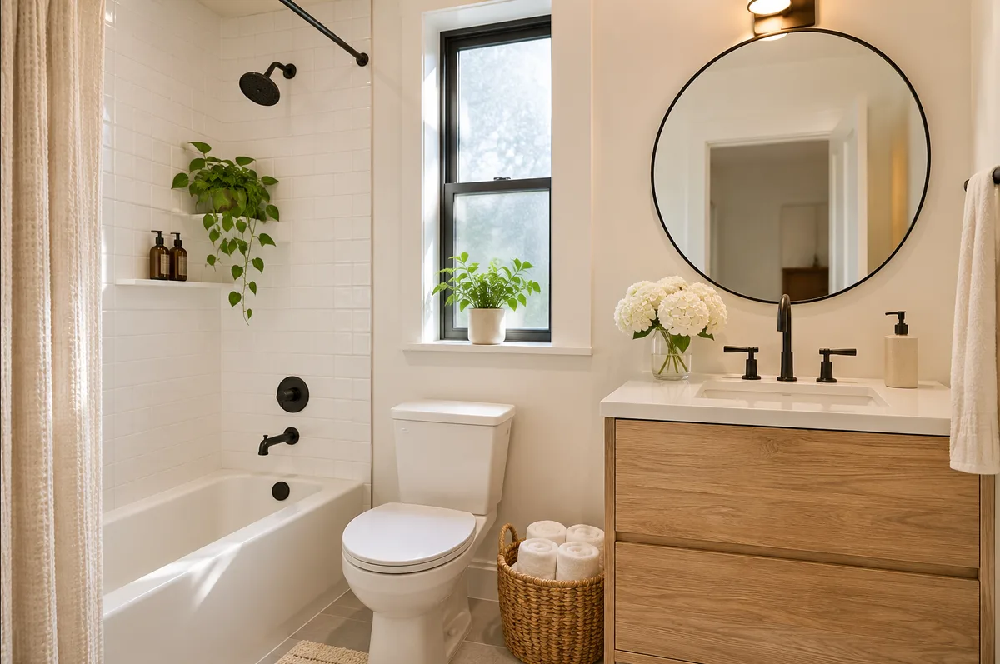
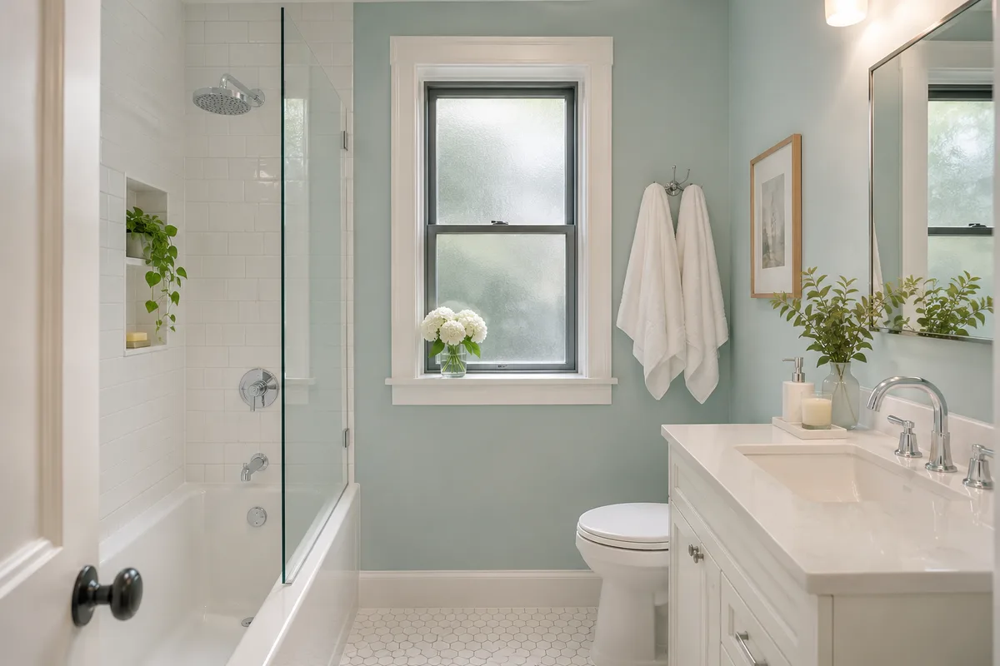
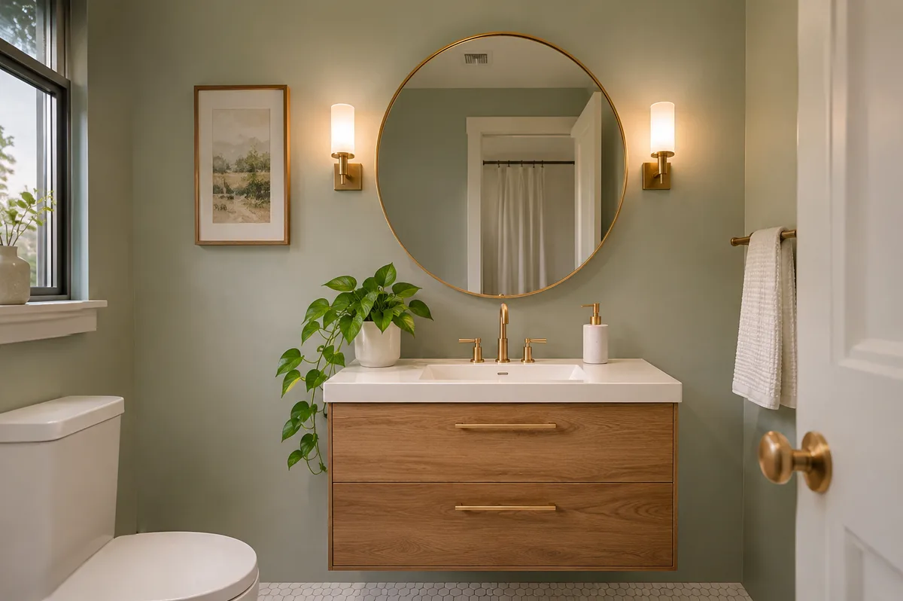
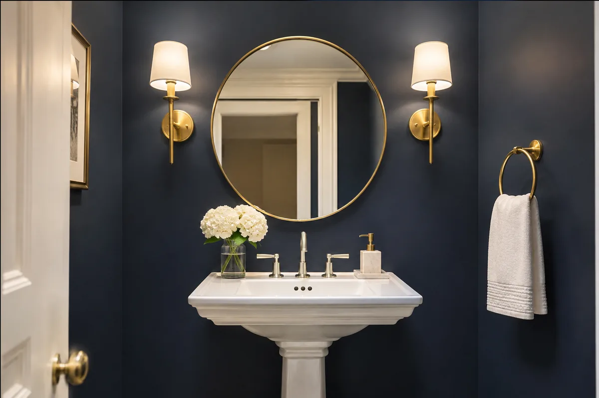
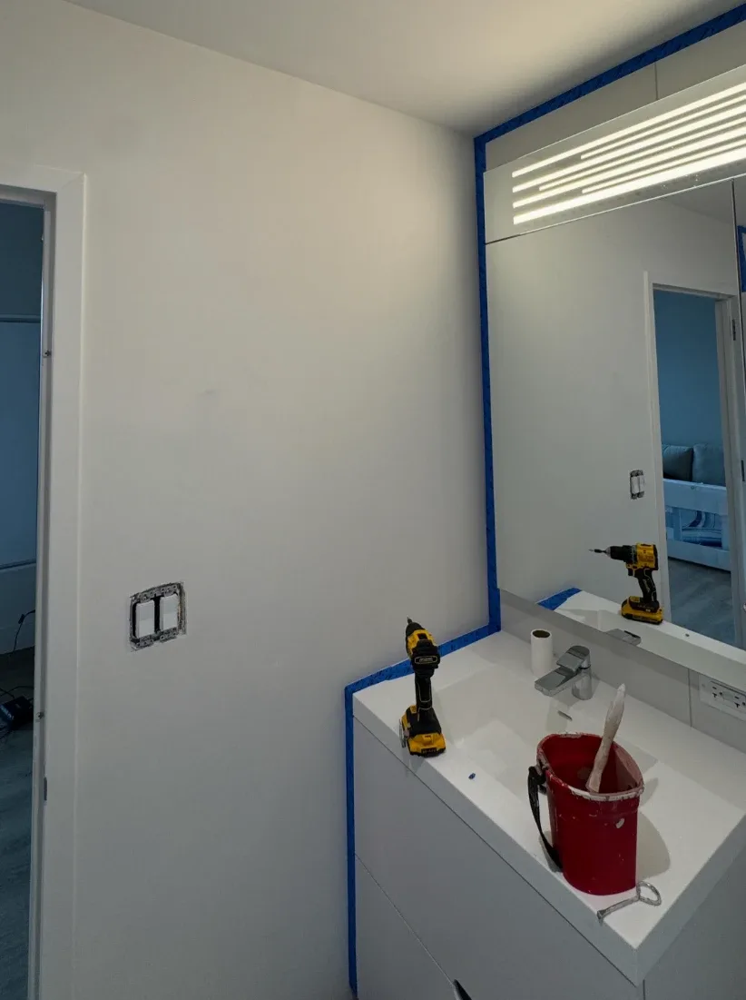
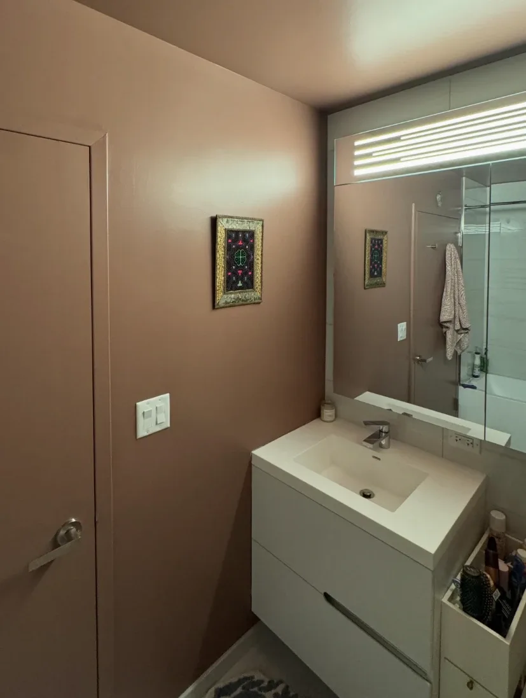
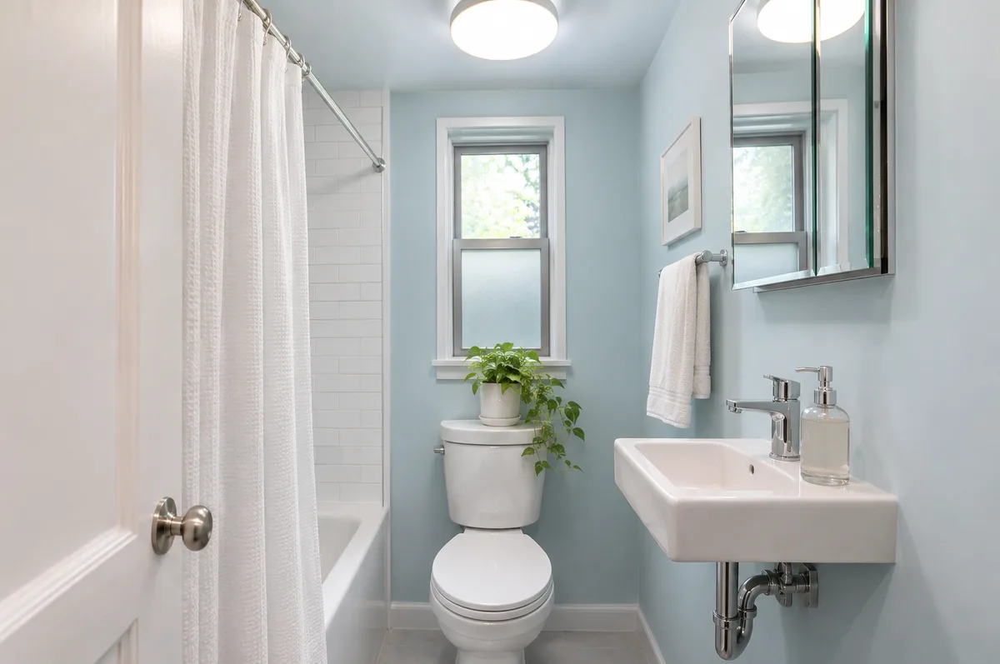

The bathroom is the smallest room in most NYC apartments and the one that gets steamed like a dumpling twice a day, so its color has to work hard. **The best bathroom paint colors are warm whites like White Dove and Alabaster, spa-like blue-greens like Palladian Blue and Sea Salt, soft sage greens like October Mist, and, if you're brave, a deep navy or charcoal.** Light colors keep a small bathroom bright, and the right paint keeps it from peeling.

We've painted bathrooms in apartments and homes across NYC and Long Island (250+ jobs and counting). Below are our favorite bathroom paint colors from **Benjamin Moore and Sherwin-Williams**, plus the paint we actually use in bathrooms and what we've learned about small, windowless and steamy ones. Let's dive in (the water's warm).

## Best bathroom paint colors at a glance

| Color | Brand and code | Style | Best for |
| --- | --- | --- | --- |
| **White Dove** | Benjamin Moore OC-17 | Soft warm white | Any bathroom, any tile |
| **Chantilly Lace** | Benjamin Moore OC-65 | Crisp, pure white | Modern bathrooms with white tile |
| **Simply White** | Benjamin Moore OC-117 | Bright white with a hint of warmth | Small, dark bathrooms |
| **Alabaster** | Sherwin-Williams SW 7008 | Creamy white | Bathrooms that feel cold |
| **Pure White** | Sherwin-Williams SW 7005 | Clean, balanced white | Walls and trim together |
| **Palladian Blue** | Benjamin Moore HC-144 | Soft blue-green | Spa-like bathrooms |
| **Wythe Blue** | Benjamin Moore HC-143 | Muted blue-green | Bathrooms with white tile |
| **Woodlawn Blue** | Benjamin Moore HC-147 | Light, airy blue | Small bathrooms |
| **Sea Salt** | Sherwin-Williams SW 6204 | Pale green-blue | Calm, beachy bathrooms |
| **Rainwashed** | Sherwin-Williams SW 6211 | Fresh aqua | Bathrooms with good daylight |
| **October Mist** | Benjamin Moore 1495 | Soft sage | Bathrooms with wood or brass |
| **Saybrook Sage** | Benjamin Moore HC-114 | Warm muted green | Traditional bathrooms |
| **Evergreen Fog** | Sherwin-Williams SW 9130 | Gray-green | Modern, calm bathrooms |
| **Clary Sage** | Sherwin-Williams SW 6178 | Earthy sage | Bathrooms with natural light |
| **Pale Oak** | Benjamin Moore OC-20 | Warm greige | Beige or cream tile |
| **Hale Navy** | Benjamin Moore HC-154 | Deep navy | A bold small bathroom |
| **Iron Ore** | Sherwin-Williams SW 7069 | Soft charcoal | A moody powder room |
| **Pewter Green** | Sherwin-Williams SW 6208 | Deep gray-green | A cozy, dramatic bathroom |

Paint chips and screens never show colors exactly, so treat this as a shortlist. Your bathroom light (and the one bulb that's been flickering since you moved in) will have the final say.

## White bathroom paint colors

White is the most popular bathroom color, and it earns it: it looks clean, it works with every tile and fixture, and it bounces light around a small room. The catch is the undertone. A white that's too cool can make a bathroom feel like a clinic, and nobody wants to brush their teeth in a waiting room.

- **White Dove OC-17:** our favorite color, period. Yes, a painter whose favorite color is a white. Hear us out: it's soft and warm, and it never fights with tile.
- **Chantilly Lace OC-65:** a crisp, pure white for modern bathrooms with bright white tile.
- **Simply White OC-117:** a bright white with a touch of warmth, great in dark bathrooms.
- **Alabaster SW 7008:** a creamy white that warms up bathrooms with cool tile.
- **Pure White SW 7005:** a balanced white that works on walls and trim.

**Match the white to your tile.** Bright white tile next to a creamy wall can make the tile look blue, or the wall look dingy. Hold the paint chip right against the tile before you buy anything.

*Illustration (AI-generated): warm white with oak and black fixtures. The towels rolled themselves, apparently.*

## Blue and blue-green bathroom colors

Soft blues and blue-greens are the classic spa colors. They feel clean, calm and fresh, and they look great with white tile and chrome. This is the closest most of us get to a day at the spa, so we'll take it.

- **Palladian Blue HC-144:** a soft blue-green that's calm without feeling cold.
- **Wythe Blue HC-143:** a little deeper and more muted, lovely with white tile.
- **Woodlawn Blue HC-147:** a light, airy blue that opens up a small bathroom.
- **Sea Salt SW 6204:** a pale green-blue that changes with the light, a long-time bathroom favorite.
- **Rainwashed SW 6211:** a fresh aqua for bathrooms with good daylight.

Blue-greens shift a lot with light. In a windowless bathroom with cool LED bulbs, they lean blue. With warm bulbs, they lean green. That's not a mood swing, it's just physics.

*Illustration (AI-generated): a soft blue-green with white tile and chrome. So calm, even Monday mornings take a deep breath.*

## Sage and soft green bathroom colors

Muted greens bring a bit of nature into the bathroom, and they pair beautifully with wood vanities, brass fixtures and white tile. Plus, it's the only plant in the bathroom you'll never forget to water.

- **October Mist 1495:** a soft, gentle sage that works almost anywhere.
- **Saybrook Sage HC-114:** a warmer, earthier green for traditional bathrooms.
- **Evergreen Fog SW 9130:** a gray-green that feels modern and calm.
- **Clary Sage SW 6178:** an earthy sage that looks best with natural light.

If your bathroom has beige or cream tile, a warm greige like **Pale Oak OC-20** is a safe bet too. It makes older tile look like it was chosen on purpose.

*Illustration (AI-generated): sage walls, wood and brass. The plant is thriving, which is more than we can say for ours.*

## Dark and bold bathroom colors

Here's where we disagree with a lot of advice online: **dark colors can look great in a small bathroom.** The room is small no matter what, and a deep color makes that feel cozy and intentional instead of cramped. Think of it as a jewel box, not a closet.

- **Hale Navy HC-154:** a classic deep navy, great with white fixtures and brass.
- **Iron Ore SW 7069:** a soft charcoal for a moody powder room.
- **Pewter Green SW 6208:** a deep gray-green that feels rich and calm.

Make it work with **good lighting** (a bright vanity light is a must), white or light fixtures to stand out against the walls, and metal accents like brass or chrome. And bring patience: dark colors usually need extra coats and careful cut lines, because every mistake shows. Going dark is a commitment, like a tattoo, but easier to change your mind about.

*Illustration (AI-generated): navy walls, white sink, brass everywhere. Small room, big personality, like a Chihuahua.*

## Our job: a white bathroom painted dusty rose

Not every great bathroom color is on a "best of" list. On this NYC apartment job, the customer picked a warm dusty rose, and we painted the walls, the ceiling, the door and the door frame all in the same color. Painting everything one color (people call it color drenching) makes a small bathroom feel wrapped and cozy, with no lines to chop it up.

*Before: mirror and vanity taped, switch plate off, tools on standby. The drill is just there for moral support.*

*After: walls, ceiling and door in one warm dusty rose. Even the towel looks like it's blushing.*

See more photos on the [dusty rose bathroom project page](/work/apartment-bathroom-dusty-rose-repaint/).

## Small bathroom paint colors

Most NYC bathrooms are small. Some are "you can sit, shave and shower without moving your feet" small. For a small bathroom:

- **Go light if the room is dark and you want it to feel bigger.** Warm whites and pale blue-greens bounce light around. Light colors for small bathrooms are the safe, classic choice.
- **Or go dark on purpose,** with good lighting, if you want cozy instead of airy (see above).
- **Paint the ceiling the same color as the walls**, or a very pale version of it, so there's no harsh line around the top of the room.
- **Mind your bulbs.** In a windowless bathroom, the light bulb decides what your paint looks like, so test colors with the bathroom light on, not in the hallway.

*Illustration (AI-generated): a tiny bathroom in pale blue that feels twice its size. Square footage not included.*

## Best paint for bathrooms

The right paint matters as much as the right color, because bathroom walls deal with steam every single day. **We usually use Benjamin Moore Aura Bath & Spa in a matte finish.** Benjamin Moore makes it for high-humidity rooms, and it's built to resist mildew on the paint, so you get a soft, low-shine look that still handles moisture.

A few things we've learned about what type of paint to use in a bathroom:

- **Use a paint made for humid rooms.** A bathroom-specific paint or a good-quality satin wall paint both work. Cheap flat paint doesn't hold up to steam.
- **Trim and doors get a harder finish,** usually satin or semi-gloss, so they stand up to wet hands and towel hooks.
- **Paint can't fix a moisture problem.** If there's mold, a leak or peeling paint, fix the cause first.

For more on sheens, see our guide to [paint finishes](/blog/paint-finishes/).

## How to keep bathroom paint from peeling

Peeling bathroom paint almost always comes back to moisture or prep. Here's what helps:

1. **Fix leaks first.** Paint over a wet wall and it'll peel again, no matter what's in the can.
2. **Clean the walls well.** Soap scum, hairspray and body lotion leave a film that paint won't stick to (your bathroom walls have seen things).
3. **Prime stains and bare spots** with a stain-blocking primer, and scrape off any loose paint first.
4. **Run the exhaust fan** during and after every shower. The [EPA's guide to mold and moisture](https://www.epa.gov/mold/brief-guide-mold-moisture-and-your-home) recommends venting bathrooms and keeping indoor humidity low.
If you see mold on the walls, the [EPA's mold page](https://www.epa.gov/mold) explains how to clean it up safely and when to call a professional. Many NYC bathrooms are in older buildings too, and **homes built before 1978 may have lead-based paint**, so don't scrape or sand old paint before you read the [EPA's lead guide](https://www.epa.gov/lead/protect-your-family-sources-lead).

## How to choose your bathroom color

1. **Start with what's staying:** tile, tub, vanity, countertop and floor. Your wall color has to get along with all of them.
2. **Match the undertones.** Cream or beige tile wants warm colors. Bright white or gray tile can handle cooler blues and greens.
3. **Test with the bathroom light on.** Most bathrooms have little or no daylight, so that bulb is the only light that counts.
4. **Paint big swatches**, at least a foot square, next to the tile and the mirror, and look at them morning and night.
For the full process, read our guide on [how to choose a paint color](/blog/how-to-choose-a-paint-color/). Doing it yourself? Our [how to paint a room](/blog/how-to-paint-a-room/) guide covers the steps. Rather hand it off? Our [interior painting service](/services/interior-painting/) covers bathrooms, prep and cleanup included.

## The bottom line

The best bathroom paint colors are warm whites, soft spa blues, muted sage greens and, if you have good lighting, a deep navy or charcoal. Match the color to your tile, test it under your bathroom light, use a paint made for humid rooms and run the fan after every shower.

Your bathroom can finally handle the steam. The singing in the shower is still on you.
