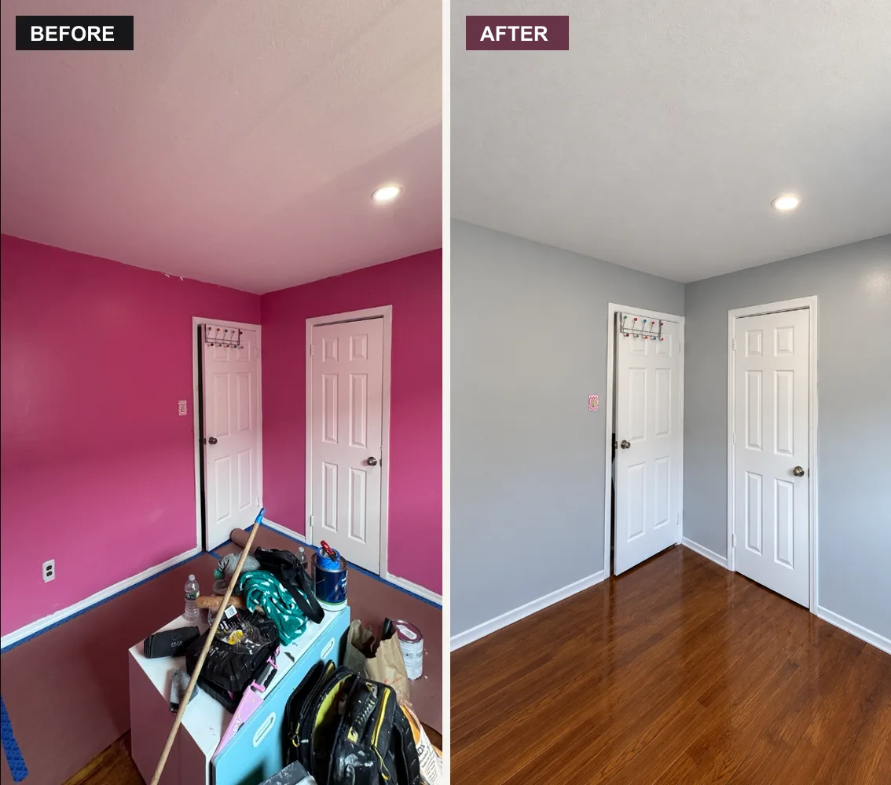
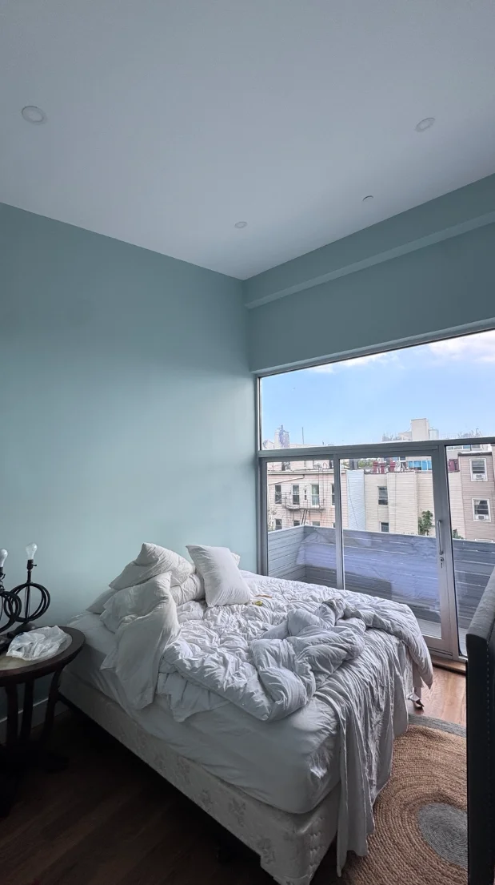
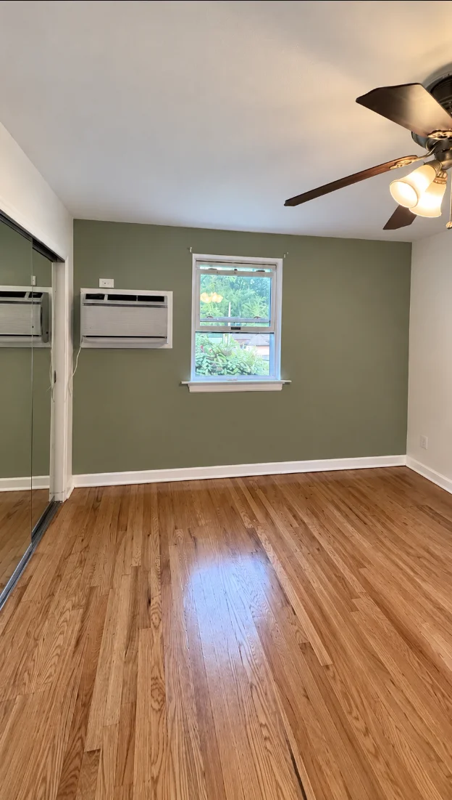
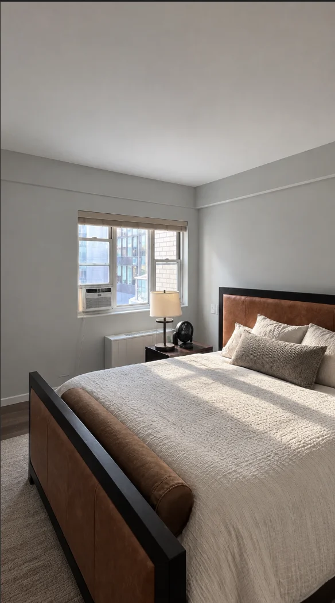
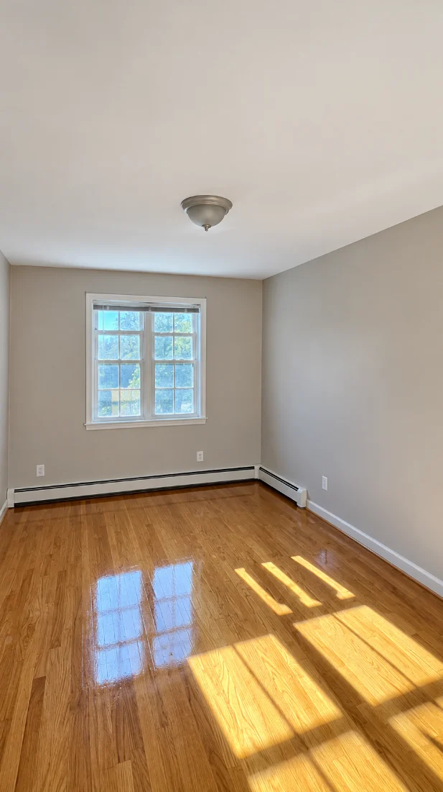
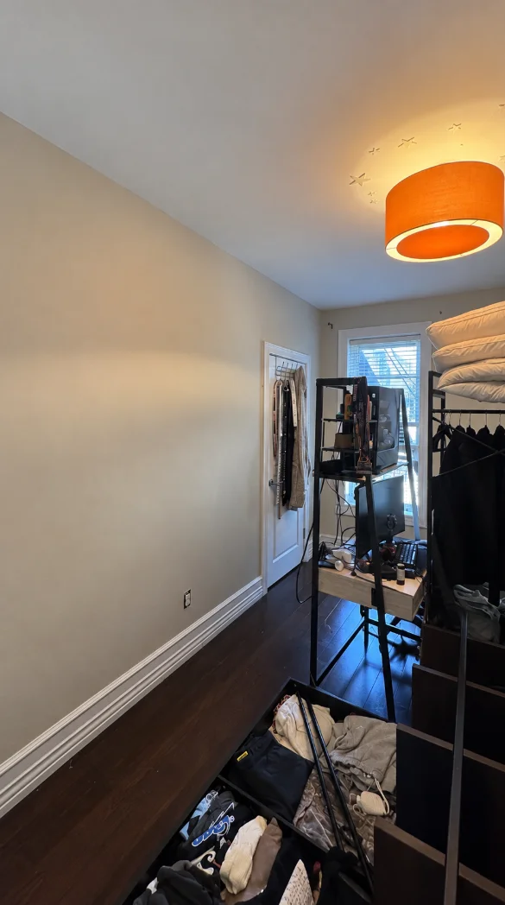
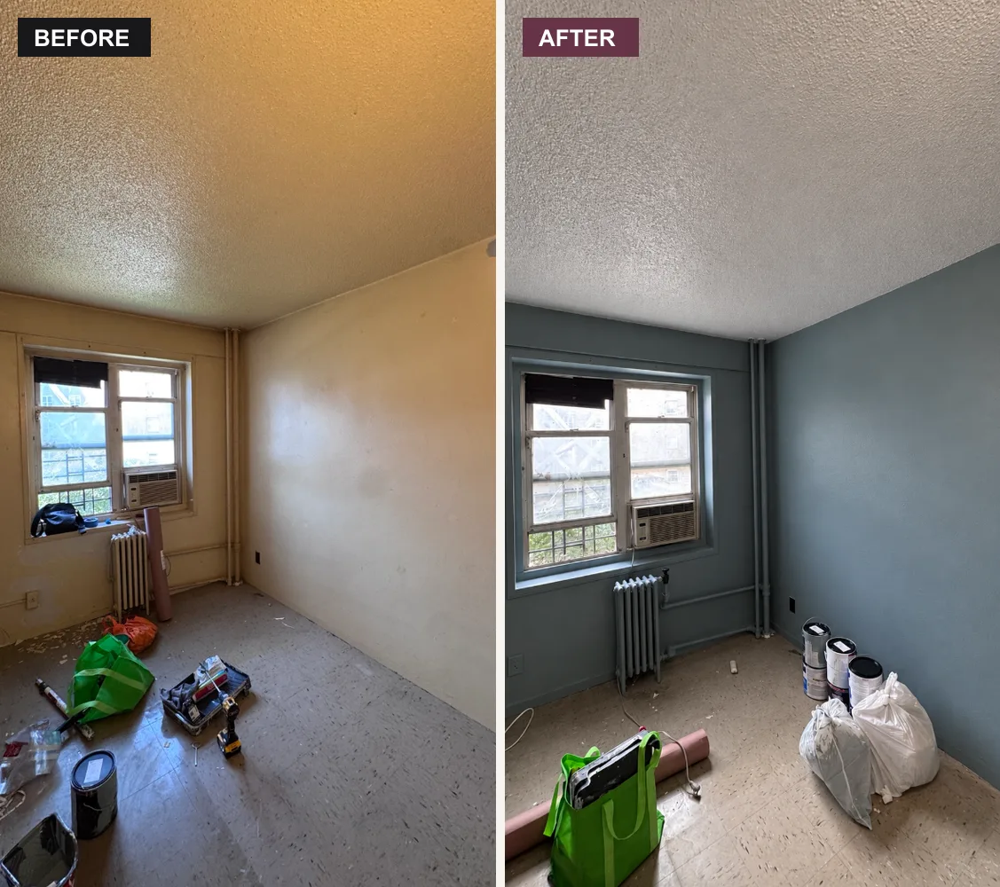
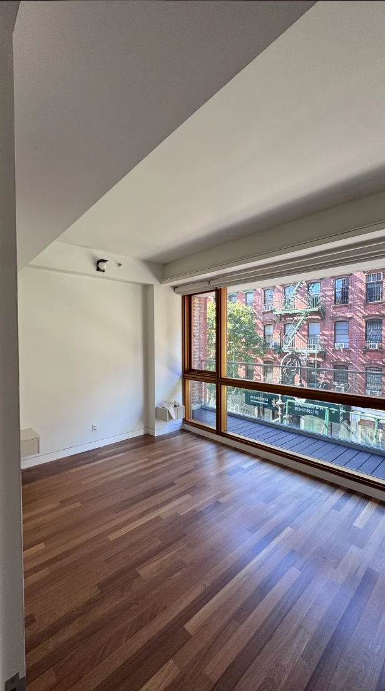

Your bedroom is the one room where you're supposed to do absolutely nothing, so its walls should be extra good at helping you do it (we've been practicing for years). **The best paint colors for bedrooms are soft, calming shades: light blues like Sleepy Blue and Pale Smoke, muted greens like Sea Salt, soft grays like Repose Gray, and warm whites and neutrals like White Dove and Pashmina.** Save darker colors like navy for one accent wall behind the bed.

We paint a lot of bedrooms all over NYC and Long Island. Below are the bedroom paint colors **Benjamin Moore and Sherwin-Williams recommend**, sorted by mood, plus real before and afters from our jobs. Rest assured, there's no wrong answer here (okay, there's one, and you'll see it in a second).

*This one belonged to a teen who grew out of hot pink. Pink was a phase. Gray is a lifestyle.*

## Best paint colors for bedrooms at a glance

| Color | Brand and code | Mood | Best for |
| --- | --- | --- | --- |
| **Sleepy Blue** | Sherwin-Williams SW 6225 | Light, calm blue | Any bedroom that needs to unwind |
| **Pale Smoke** | Benjamin Moore 1584 | Soft blue-gray | Small rooms that should feel bigger |
| **Quiet Moments** | Benjamin Moore 1563 | Gentle blue-green-gray | Calm, spa-like bedrooms |
| **Niebla Azul** | Sherwin-Williams SW 9137 | Dusty blue | Relaxed, cozy rooms |
| **Constellation** | Benjamin Moore AF-540 | Airy blue | Light, open bedrooms |
| **Sea Salt** | Sherwin-Williams SW 6204 | Muted blue-green | Peaceful, beachy rooms |
| **Repose Gray** | Sherwin-Williams SW 7015 | Soft warm gray | Rooms with mixed furniture |
| **Silverpointe** | Sherwin-Williams SW 7653 | Light cool gray | Calm by day, settled by night |
| **Wickham Gray** | Benjamin Moore HC-171 | Pale gray | Classic, timeless rooms |
| **Mindful Gray** | Sherwin-Williams SW 7016 | Warm light gray | Cozy, neutral bedrooms |
| **White Dove** | Benjamin Moore OC-17 | Soft warm white | Any bedroom; our favorite white |
| **Pashmina** | Benjamin Moore AF-100 | Warm, cozy neutral | Bedrooms that need warmth |
| **Simplify Beige** | Sherwin-Williams SW 6085 | Light warm beige | Small bedrooms that shouldn't feel stark |
| **First Light** | Benjamin Moore 2102-70 | Soft pink | A grown-up take on pink |
| **Naval** | Sherwin-Williams SW 6244 | Deep navy | Accent wall behind the bed |
| **Newburyport Blue** | Benjamin Moore HC-155 | Moody blue | Accent wall, cozy rooms |

Screens and paint chips never show colors exactly, so treat this list as a shortlist, not a final answer. Your own light decides the rest.

## Relaxing blue bedroom colors

Blue is the classic bedroom color for a reason. Sherwin-Williams' own color psychology guide says blues are widely considered calming. Finally, a situation where feeling blue is a good thing.

- **Sleepy Blue SW 6225:** a light, easygoing blue. The name does half the work.
- **Pale Smoke 1584:** a soft blue-gray that keeps small rooms feeling open.
- **Quiet Moments 1563:** a gentle mix of blue, green and gray that feels like a spa.
- **Niebla Azul SW 9137:** a dusty blue that's calm without being cold.
- **Constellation AF-540:** an airy blue for bright rooms.

*A soft aqua bedroom we painted. The view does the talking, and the walls just nod along.*

## Calming green bedroom colors

Greens bring a little bit of the outdoors in, which is handy in a city where "nature" can mean one tree and a pigeon. Muted greens like sage are some of the most calming colors for bedrooms.

- **Sea Salt SW 6204:** a soft blue-green that changes with the light, from green to almost gray.
- **Sage greens:** earthy and relaxing, especially with white trim. Our Forest Hills job at the top of this post is a perfect example.

*Sage green on the window wall. Go green, sleep better.*

## Soft gray bedroom colors

Gray is a safe, calm bedroom color that works with almost any furniture. The trick is the undertone: warm grays feel cozy, cool grays feel crisp. Shades of gray, but make it restful.

- **Repose Gray SW 7015:** a soft gray that plays nice with most decor.
- **Silverpointe SW 7653:** a light, cool gray, calm by day and settled at night.
- **Wickham Gray HC-171:** a pale, classic gray.
- **Mindful Gray SW 7016:** a light gray with a warm, cozy feel.

*A soft gray bedroom we painted. Even the pillows look relaxed.*

## Warm whites and neutral bedroom colors

If you want a bedroom that feels fresh and calm without much color, warm whites and soft neutrals are the answer. They also make it easy to change your bedding and decor whenever you like.

- **White Dove OC-17:** our favorite white, soft and warm, never stark.
- **Pashmina AF-100:** a warm, cozy neutral, like a sweater for your walls.
- **Simplify Beige SW 6085:** a light beige that keeps a small bedroom clean and open without feeling cold.

*A warm beige bedroom we painted. That sunlight is free, and it's doing a great job.*

*Warm taupe walls with an orange pendant light. Proof that neutral doesn't mean boring.*

## Dark bedroom colors: save them for the accent wall

Navy, charcoal and deep green look amazing in photos, and they can make a bedroom feel cozy. But here's our honest take: **in most bedrooms, we recommend dark colors on one accent wall, usually behind the bed.** Many NYC bedrooms are small and don't get much light, and painting all four walls dark can make the room feel closed in. One dark wall gives you the drama without the cave.

Good accent wall picks: **Naval SW 6244**, **Newburyport Blue HC-155** and **Shade-Grown SW 6188** (a deep green). Sherwin-Williams even suggests pairing Light French Gray SW 0055 on three walls with Naval on the fourth.

Dark colors are also honest. They show every patch and roller mark, so the prep matters even more. Read our [accent wall painting guide](/blog/accent-wall-painting/) for how we do it.

## Master bedroom paint ideas

The main bedroom is usually the biggest, so it can take a little more color. A few ideas we like:

- **Two-tone walls:** a calm color on three walls and a deeper shade behind the bed.
- **Don't forget the ceiling.** In a bedroom, the ceiling is the wall you actually look at the most. Benjamin Moore suggests painting it a shade lighter than the walls, or a soft tint instead of plain white.
- **Crown molding and chair rail:** crisp white trim against a colored wall, like our Forest Hills sage room, makes the details pop.

*From tired beige to calm blue-gray, pipes and window trim included. The radiator approves.*

## Kids' and teen bedroom colors

Kids love bright colors, and teens love changing their minds. Our pink-to-gray job above is the classic story: a bedroom that fit a kid perfectly, until the kid grew up.

A few tips for children's bedroom paint colors:

- **Pick a color they can grow into**, like a soft blue, green or a muted pink like First Light, then add the bright stuff with bedding and posters.
- **Go bold on one wall** if they really want hot pink or electric blue. It's a lot easier to repaint one wall than four.
- **Choose a washable finish.** Kids treat walls like a canvas, and they never ask for a quote first. See our guide to [paint finishes](/blog/paint-finishes/) for which ones scrub clean.

## Best color for a small bedroom

NYC bedrooms are small. Some of them are "a queen bed fits if you believe hard enough" small. For a small bedroom:

- **Use light colors** that bounce light around, like soft blue-grays (Pale Smoke, Silverpointe), pale greens and warm whites.
- **Keep the ceiling white or lighter** than the walls so the room feels taller.
- **Match the trim to the walls** in a slightly different sheen if you want the walls to feel like they keep going.

*A white bedroom with big windows. Small room, big view, zero complaints.*

## How to pick your bedroom color

Here's the bedroom-specific tip most guides skip: **you use your bedroom mostly at night.** So test your colors with the lamps on, not just in daylight. A blue that looks perfect at noon can look gray and gloomy at 11 pm, and your bedroom's biggest audience is you, at 11 pm.

1. **Narrow it down to 3 to 5 colors** from the list above.
2. **Paint big swatches** (about two feet square) on two different walls.
3. **Look at them morning, afternoon and night**, with your bedside lamps on.
4. **Check them against your bedding** and furniture, since those aren't changing.

For the full process, read our guide on [how to choose a paint color](/blog/how-to-choose-a-paint-color/).

## How much paint for a bedroom?

A typical 12 by 12 foot bedroom with 8 foot ceilings has about **384 square feet** of wall. A gallon of paint usually covers **350 to 400 square feet per coat**, so plan on **about 2 gallons for two coats**, plus extra for the ceiling or trim. Dark colors and big color changes can need more.

Most bedrooms we paint cost **$400 to $1,500**, depending on size, prep and trim. Our [interior painting cost guide](/blog/interior-painting-cost/) breaks it down, or you can send us photos for a free quote through our [interior painting service](/services/interior-painting/).

One more tip: let a freshly painted bedroom air out before you sleep in it, with the windows open if you can. The [EPA explains why fresh paint fumes matter for indoor air](https://www.epa.gov/indoor-air-quality-iaq/volatile-organic-compounds-impact-indoor-air-quality), and low-VOC paint helps a lot in a small room.

## The bottom line

The best paint colors for bedrooms are soft and calming: light blues, muted greens, gentle grays and warm whites. Keep the bold, dark colors for one accent wall behind the bed, test everything with the lamps on, and pick a color you'll love waking up to.

Now go get some rest. Your walls already did their part.
