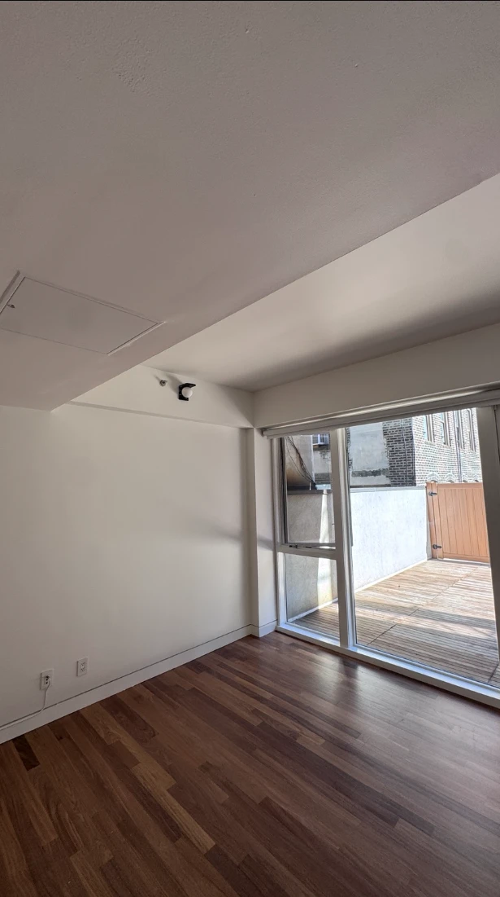
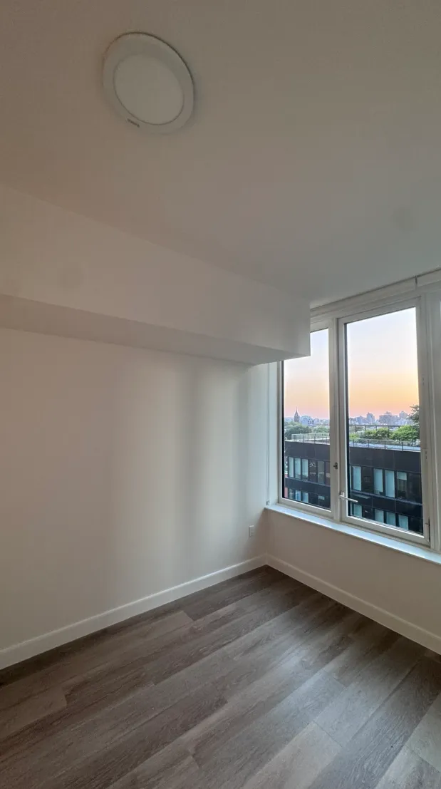
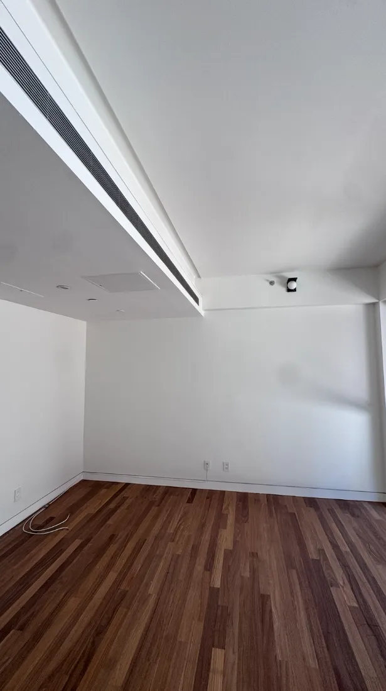
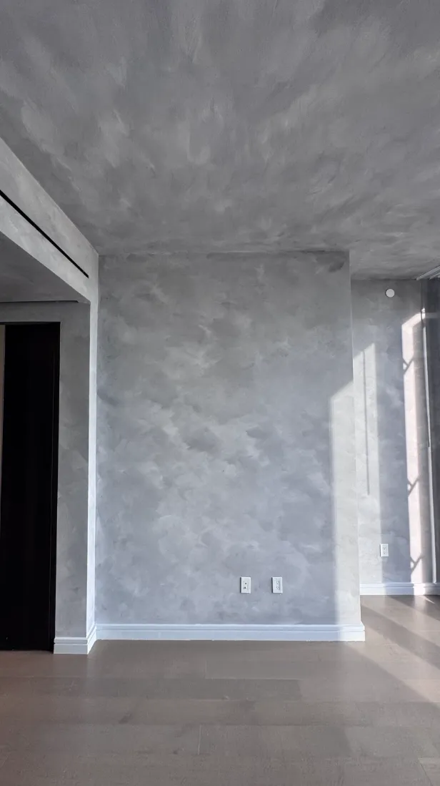
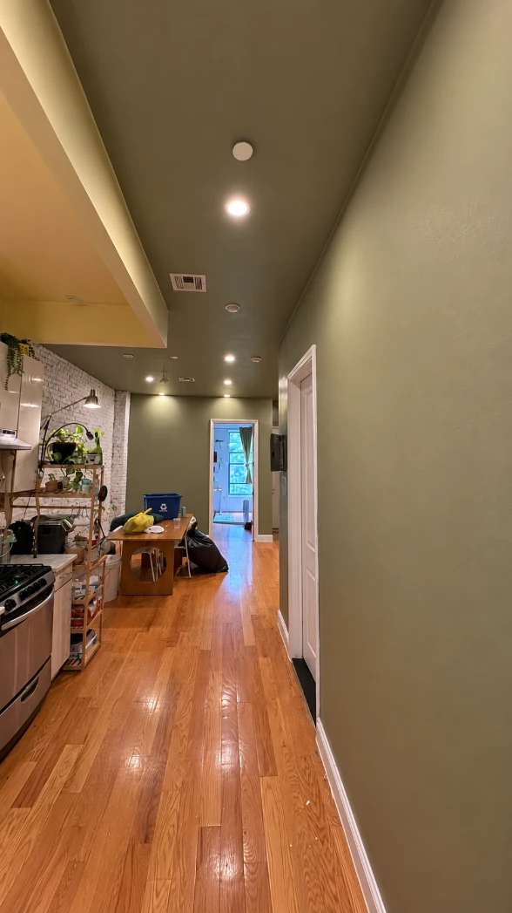
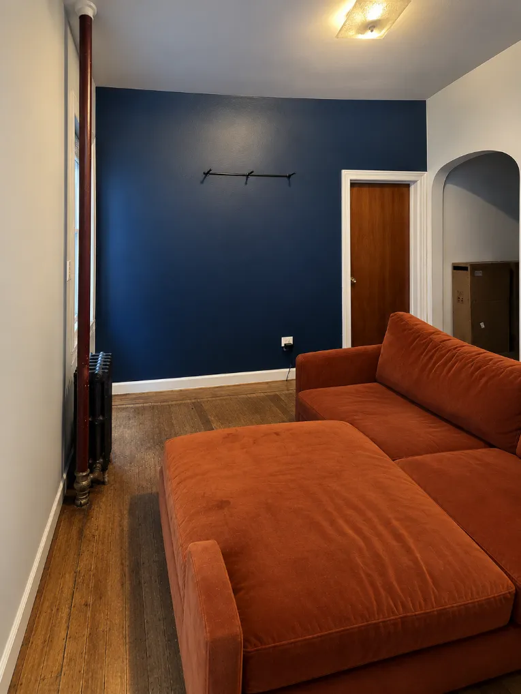
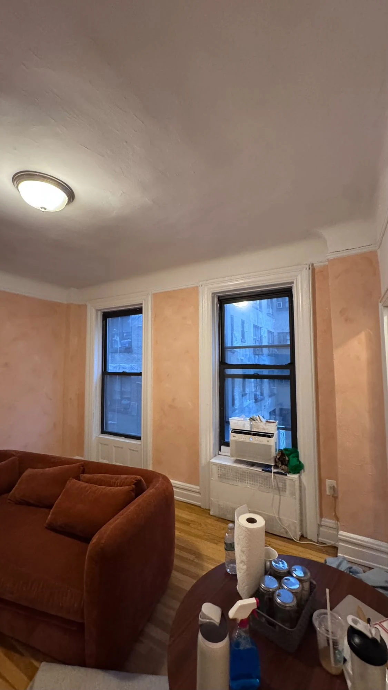
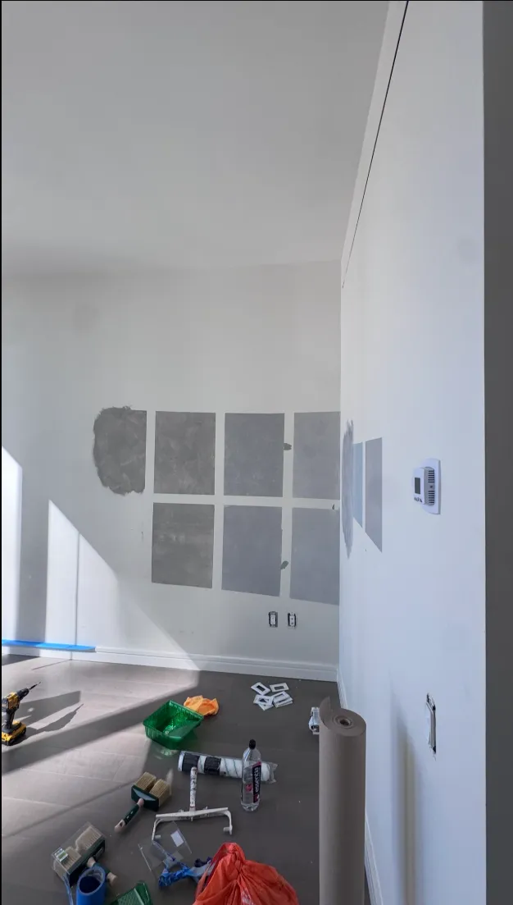

Your living room is where you watch movies, host friends and fall asleep on the couch "just for a minute," so its walls deserve better than beige-by-default (we said what we said). **The best paint colors for living rooms are warm whites, soft greige neutrals and calm greens and blues, like White Dove, Revere Pewter, October Mist and Palladian Blue, with deeper colors like Charcoal Blue for a cozy, dramatic room.** The right one depends on your light, your furniture and the mood you want.

We paint living rooms all over NYC, from tiny walk-ups to high-rises. Below are the living room paint colors **Benjamin Moore and Sherwin-Williams recommend**, plus the ones our customers ask for most, sorted by mood. Let's give your walls something to talk about.

*A bright white open-plan living room we painted. White isn't boring. It's the friend who gets along with everyone.*

## Best paint colors for living rooms at a glance

| Color | Brand and code | Mood | Best for |
| --- | --- | --- | --- |
| **White Dove** | Benjamin Moore OC-17 | Soft, warm white | Any living room; our favorite |
| **Cloud White** | Benjamin Moore 967 | Light and airy | Making a small room feel bigger |
| **Dover White** | Sherwin-Williams SW 6385 | Bright, warm white | Dim rooms that need brightening |
| **Revere Pewter** | Benjamin Moore HC-172 | Classic neutral | Rooms with lots of wood and fabric |
| **Coventry Gray** | Benjamin Moore HC-169 | Medium gray | Modern, calm living rooms |
| **Metropolitan** | Benjamin Moore AF-690 | Soft gray | Clean, minimal spaces |
| **Silver Strand** | Sherwin-Williams SW 7057 | Gray with green undertones | Relaxed, airy rooms |
| **Webster Green** | Benjamin Moore HC-130 | Mid-tone green | Cozy, grown-up living rooms |
| **October Mist** | Benjamin Moore 1495 | Soft green | Calm, nature-inspired rooms |
| **Sweater Weather** | Sherwin-Williams SW 9548 | Warm green-gray | Soft, earthy rooms |
| **Palladian Blue** | Benjamin Moore HC-144 | Soft blue-green | Fresh, breezy rooms |
| **Ocean Air** | Benjamin Moore 2123-50 | Soothing blue-green | Small rooms that need calm |
| **Charcoal Blue** | Sherwin-Williams SW 2739 | Deep gray-navy | Dramatic, cozy rooms |
| **Anonymous** | Sherwin-Williams SW 7046 | Deep brown neutral | Warm, moody rooms |
| **Garrison Red** | Benjamin Moore HC-66 | Muted red | Accent walls and bold statements |

Paint colors on a screen are like dating profile photos: close, but meet in person before you commit. Always test on your own wall.

*A bright white living room we painted, at sunset. Light colors let the view (and the sky) do the talking.*

## Light and bright living room colors

If your living room is small, dark or faces a brick wall (hello, NYC), start here. Light colors bounce light around and make the room feel bigger.

*White walls and a white ceiling in a modern apartment we painted. The wood floor brings all the warmth it needs.*

- **White Dove (Benjamin Moore OC-17):** a soft, warm white and my personal favorite. It looks clean without feeling cold, and it works with almost any furniture. If you can't decide, this is the one.
- **Cloud White (Benjamin Moore 967):** light and airy. Benjamin Moore recommends it for making a living room look larger.
- **Dover White (Sherwin-Williams SW 6385):** a bright, warm white. Sherwin-Williams suggests it for brightening a dim room.

**Tip:** paint the ceiling and trim white too. The whole room becomes one big light reflector, which is the closest thing to a free window.

*A soft gray living room wall from one of our jobs (this one is lime wash, for extra texture). Gray done right looks calm, not gloomy.*

## Warm neutrals and grays

Neutrals are the jeans of living room paint colors: they go with everything and never really go out of style.

- **Revere Pewter (Benjamin Moore HC-172):** one of Benjamin Moore's most popular neutrals. A warm, classic choice that looks great with wood floors and cozy fabrics.
- **Coventry Gray (Benjamin Moore HC-169):** a medium gray that our customers love for modern living rooms.
- **Metropolitan (Benjamin Moore AF-690):** a soft gray and Benjamin Moore's Color of the Year 2019. Calm and polished.
- **Silver Strand (Sherwin-Williams SW 7057):** a gray with cool green undertones. Sherwin-Williams describes it as calming, and it keeps a room feeling light and relaxed.

*An olive green living room we painted. Green makes a long, narrow NYC living room feel warm instead of tunnel-like.*

## Green and blue living room color ideas

Greens and blues are having a moment, and for good reason: they feel calm, fresh and a little bit like bringing the outdoors in (without the mosquitoes).

- **Webster Green (Benjamin Moore HC-130):** a mid-tone green and Benjamin Moore's Color of the Year 2027. It's also one of the colors our customers ask for most.
- **October Mist (Benjamin Moore 1495):** a soft, gentle green. Benjamin Moore lists it among its top living room picks.
- **Sweater Weather (Sherwin-Williams SW 9548):** a warm green-gray, and one of Sherwin-Williams' living room picks. Note: it's part of their designer collection, so ask about availability.
- **Palladian Blue (Benjamin Moore HC-144):** a soft, airy blue-green. Fresh and breezy, great in rooms with lots of daylight.
- **Ocean Air (Benjamin Moore 2123-50):** a soothing blue-green, and another customer favorite. Lovely in smaller living rooms.

*A deep navy accent wall we painted, with a rust-orange sofa in front of it. Navy and orange sit opposite each other on the color wheel, so each one makes the other look richer.*

## Bold and cozy living room colors

Want a living room that feels like a hug? Go deep. Dark colors make a room feel intimate and dramatic, especially in the evening with warm lamps on.

- **Charcoal Blue (Sherwin-Williams SW 2739):** a deep, gray-toned navy. Sherwin-Williams suggests it for a relaxing, subdued mood.
- **Anonymous (Sherwin-Williams SW 7046):** a deep brown neutral. Sherwin-Williams recommends it for a cozy, inviting living room.
- **Garrison Red (Benjamin Moore HC-66):** a muted, grown-up red. Great on an accent wall or in a dining corner.
- **First Light (Benjamin Moore 2102-70):** a soft pink and a former Benjamin Moore Color of the Year. Bold in a quiet way.

*A warm peach living room in [lime wash](/blog/limewash-walls/). Same color family as a terracotta, with a soft, cloudy texture.*

**Our honest take on dark colors:** they're beautiful, but they need planning. Dark colors show every patch, dent and roller mark, so the prep has to be perfect and the coats even. Two coats is our rule on every job, and dark colors sometimes need a tinted primer too. Nervous? Start with one dark [accent wall](/blog/accent-wall-painting/) instead of all four.

*Another bright white living room we painted. With a terrace like that, the walls know their job is to stay out of the way.*

## What color should I paint my living room?

Here's the quick way to decide:

1. **Look at what's staying.** Your floor, sofa, rug and kitchen cabinets (in open layouts) all have undertones. Pick a color that gets along with them.
2. **Check your light.** North-facing rooms get cool light, so warmer colors help. South-facing rooms handle cooler colors well.
3. **Think about size.** Small or dark living room? Go light. Big, bright room? You can go deeper.
4. **Pick the mood.** Calm (soft greens and blues), clean (whites and grays) or cozy (deep navy, brown, green).

For the full process, see our guide on [how to choose a paint color](/blog/how-to-choose-a-paint-color/).

*A deep teal accent wall in a NYC living room. Dark colors look richest next to crisp white trim and beams.*

## 2 tone living room paint ideas

Can't pick one color? Use two:

- **Accent wall:** one deeper wall behind the sofa or TV, with lighter walls around it.
- **Light walls, colored ceiling:** a soft color on the ceiling makes a room feel finished and cozy.
- **Upper and lower:** a deeper color below a chair rail or picture ledge, lighter above.
- **Color drenching:** walls, trim and ceiling all in one color for a bold, modern look.

*How we test living room colors with customers: big swatches, right on the wall. Eight grays walk into a living room…*

## Test before you commit

Living room paint ideas look great on a screen, but your room has its own light. Before you buy gallons:

- **Paint big swatches**, about two feet square, on the wall itself.
- **Look at them morning, afternoon and night,** with your lamps on.
- **Narrow it to two,** then live with them for a day or two.

Two housekeeping tips while you test: open a window, since the [EPA recommends plenty of fresh air](https://www.epa.gov/indoor-air-quality-iaq/volatile-organic-compounds-impact-indoor-air-quality) when you paint indoors, and don't pour leftover sample pots down the drain. NYC's sanitation department explains [how to get rid of leftover paint](https://www.nyc.gov/site/dsny/collection/get-rid-of/harmful-household-products.page).

Ready to paint? Our [interior painting service](/services/interior-painting/) includes help choosing colors, and you can check typical prices in our [interior painting cost guide](/blog/interior-painting-cost/).

## The bottom line

The best paint colors for living rooms are the ones that suit your light, your furniture and how you want the room to feel. Start with a warm white or a soft neutral if you're unsure, try a calm green or blue for personality, and go deep if you want cozy drama. Test big, test in your own light, and then enjoy finally having a living room you actually want to live in.

(Falling asleep on the couch "just for a minute" will still happen. But now it'll happen somewhere beautiful.)
