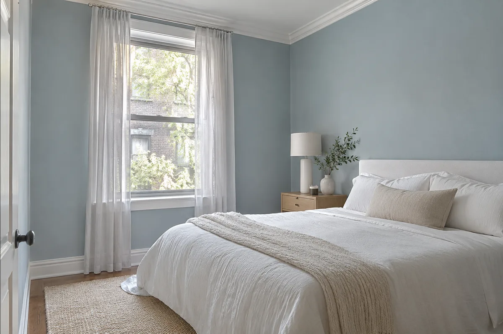
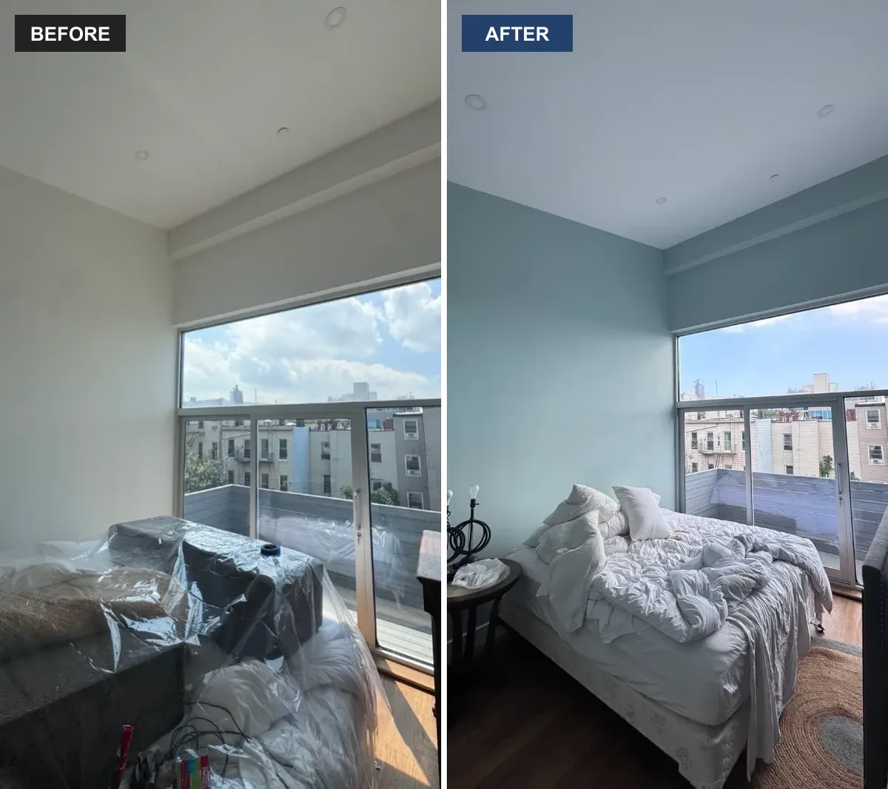
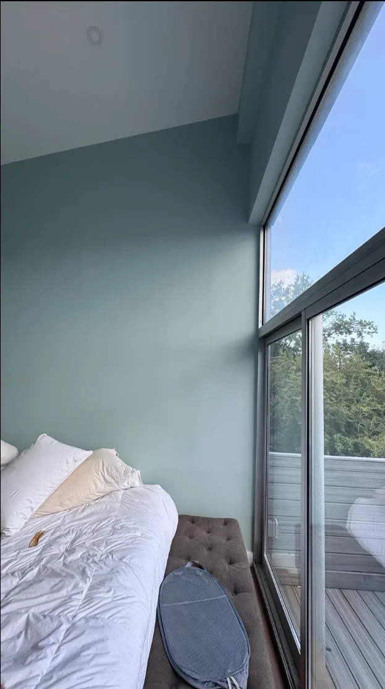
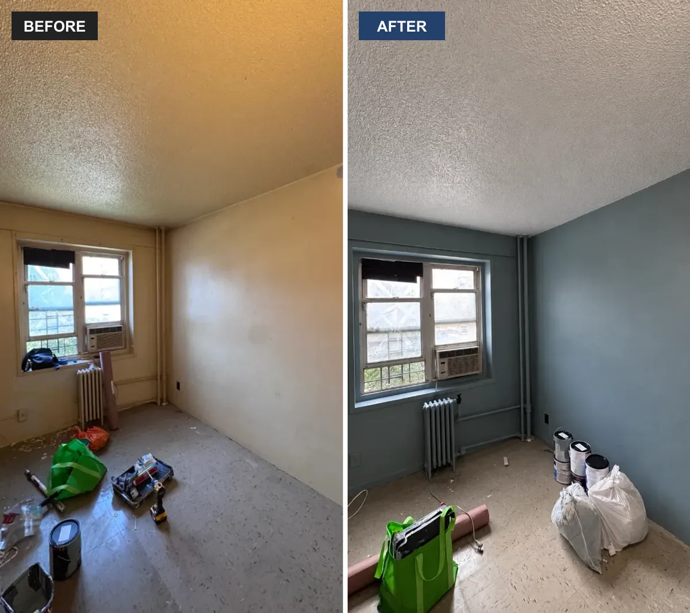
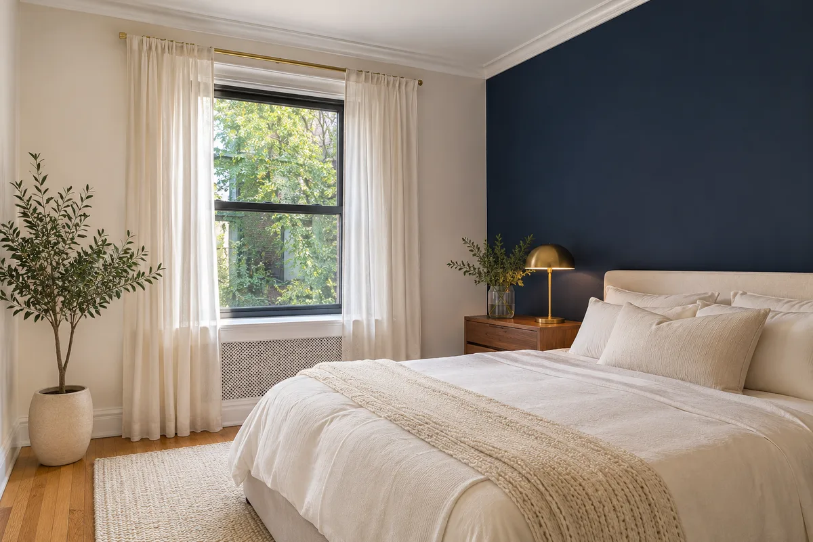
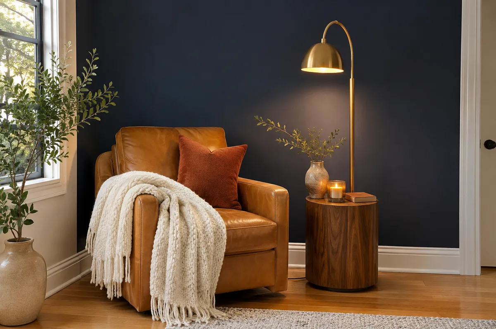
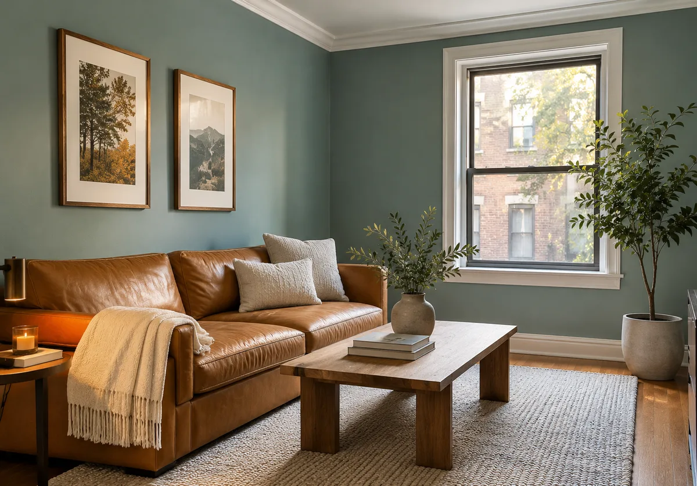

Blue is the color almost nobody hates, right up until they pick one that's too dark for the room (it looked so nice on the chip, officer). **The best blue paint colors are soft blues like Benjamin Moore Woodlawn Blue and Palladian Blue, blue-grays like Sherwin-Williams Krypton and Upward, and navy blues like Benjamin Moore Hale Navy and Sherwin-Williams Naval.** Light blues keep a room bright and calm, and navy looks best on one accent wall.

We've done 250+ jobs across NYC and Long Island, and that includes plenty of blue walls, from pale aqua to deep navy. Below are 14 blues from **Benjamin Moore and Sherwin-Williams**, three real blue rooms we painted, and the mistake we see more than any other. Grab a swatch and let's go.

## Best blue paint colors at a glance

| Color | Brand and code | Shade | Best for |
| --- | --- | --- | --- |
| **Woodlawn Blue** | Benjamin Moore HC-147 | Soft, muted light blue | Bedrooms and small rooms |
| **Palladian Blue** | Benjamin Moore HC-144 | Soft blue-green | Bedrooms, bathrooms, living rooms |
| **Ocean Air** | Benjamin Moore 2123-50 | Airy blue-green | Bedrooms and small rooms |
| **Wythe Blue** | Benjamin Moore HC-143 | Muted blue-green | Light, airy living rooms |
| **Upward** | Sherwin-Williams SW 6239 | Pale blue-gray | Bright, calm rooms |
| **Krypton** | Sherwin-Williams SW 6247 | Pale blue-gray | Rooms with good daylight |
| **Languid Blue** | Sherwin-Williams SW 6226 | Dusty light blue | Bedrooms |
| **Distance** | Sherwin-Williams SW 6243 | Mid-tone slate blue | Accent walls, home offices |
| **Refuge** | Sherwin-Williams SW 6228 | Deep dusty blue | Accent walls |
| **Hale Navy** | Benjamin Moore HC-154 | Classic deep navy | Accent walls |
| **Naval** | Sherwin-Williams SW 6244 | Deep navy | Accent walls |
| **Newburyport Blue** | Benjamin Moore HC-155 | Bold, moody blue | Accent walls |
| **Van Deusen Blue** | Benjamin Moore HC-156 | Rich dark blue | Accent walls, built-ins |
| **Gentleman's Gray** | Benjamin Moore 2062-20 | Dark, inky blue | One dramatic wall |

Paint chips and screens never show a color exactly, so treat this as a shortlist. Your walls get the final vote, and they don't take bribes.

## Light blue paint colors

Light blues are the easiest blues to live with. They feel fresh and calm, and they help a small NYC apartment feel bigger. For small or dark rooms, a light, bright color is our standard advice, and these are some of the nicest ways to follow it.

- **Woodlawn Blue HC-147:** a soft, muted blue that stays calm instead of looking like a nursery.
- **Palladian Blue HC-144:** a soft blue-green that feels fresh without feeling cold.
- **Ocean Air 2123-50:** a soft, airy blue-green and one of the colors our customers ask for most.
- **Wythe Blue HC-143:** a little deeper and more muted, great in light, airy rooms.
- **Upward SW 6239:** a pale blue-gray and Sherwin-Williams' 2024 Color of the Year.

Blues with a little green in them tend to feel warmer than pure blues. If you've ever painted a room "sky blue" and ended up in a dentist's waiting room, that's why.

*Illustration (AI-generated): a soft, muted light blue with white trim. The only thing feeling blue here is the wall.*

## Our job: a white bedroom painted soft aqua

This New York bedroom had plain white walls and one huge corner window. We covered and protected the furniture, then painted the walls and the beam above the window a soft aqua that picks up the sky outside. The white doors and trim stay crisp against it.

*Same corner, same view, new color. The sky now has some competition.*

*Soft aqua next to a wall of glass. It's the one room in New York where looking blue is a good thing.*

See more photos on the [soft aqua bedroom project page](/work/apartment-bedroom-aqua-repaint/), and for more calm colors, see our guide to the [best paint colors for bedrooms](/blog/best-paint-colors-for-bedroom/).

## Blue gray paint colors and dusty blues

Blue-grays and dusty blues are the quiet ones of the family. They have just enough gray to look soft and grown-up, which makes them easy to pair with furniture you already own. Think of them as blue after a good night's sleep and a strong coffee.

- **Krypton SW 6247:** a pale blue-gray that looks best with good daylight. No superheroes were weakened in the making of this wall.
- **Languid Blue SW 6226:** a dusty light blue for a soft, relaxed bedroom.
- **Distance SW 6243:** a mid-tone slate blue with real depth.
- **Refuge SW 6228:** a deeper dusty blue for an accent wall.

Gray-leaning blues change a lot with the light. In a dim room, they can look more gray than blue, so test them on your own wall before you commit.

*From tired beige to blue-gray, with the window trim, radiator and pipes painted to match. The radiator finally got the memo.*

## Navy blue paint colors

Navy is the classic dark blue: rich, sharp and surprisingly easy to pair. Here are the navy blue paint colors we'd look at first.

- **Hale Navy HC-154:** our pick for navy. A classic deep blue that works beautifully with white trim.
- **Naval SW 6244:** a deep navy and Sherwin-Williams' 2020 Color of the Year.
- **Newburyport Blue HC-155:** a bold, moody blue.
- **Van Deusen Blue HC-156:** a rich dark blue that also looks great on built-ins.
- **Gentleman's Gray 2062-20:** despite the name, it's a dark, inky blue. It's a bit of an identity crisis, but a handsome one.

Navy needs care to look good. Dark colors usually take an extra coat, and they show every wobbly line, so a clean cut along the ceiling and trim really matters. Our guide on [how to paint a room](/blog/how-to-paint-a-room/) walks through the steps.

*Illustration (AI-generated): navy behind the bed, everything else light. Dramatic, but it still lets you find your socks.*

## The biggest mistake with blue paint: going too dark

The mistake we see most with blue is **picking a shade that's too dark for the room.** A deep blue looks gorgeous on a 2-inch chip. On four walls of a small room with one window, it can feel like living inside a very stylish submarine.

Before you go dark, ask:

- **How much daylight does the room get?** Less light means dark colors look even darker.
- **How big is the room?** Dark colors on every wall pull the walls in.
- **Will one wall do the job?** Almost always, yes.

That's why, outside of a tiny powder room, we recommend navy on **one accent wall**, with the other walls kept light. You get all the drama with none of the submarine. (Small [bathrooms](/blog/bathroom-paint-colors/) are the one place we'd happily go dark on purpose, as long as the lighting is good.)

## Navy accent wall: our gray-to-navy job

The photo at the top of this post is one of ours. This living room had a dark gray wall full of patches, so we covered the furniture, patched the walls and painted that one wall navy. The other walls stayed light, and the rust-orange sofa looks like it was waiting for this its whole life.

Thinking about one wall? Our guide to [accent wall painting](/blog/accent-wall-painting/) covers which wall to pick and how to do it.

## What colors go with navy blue?

Navy gets along with almost everything, which is rare for something so dramatic. The best pairings:

- **Crisp white:** trim, doors and ceilings. The cleanest, easiest match.
- **Cream and warm white:** softer than pure white, and cozier.
- **Warm wood:** floors and furniture stop navy from feeling cold.
- **Brass and gold:** warm metal looks especially rich against navy.
- **Rust and burnt orange:** the opposite of blue on the color wheel, so it really pops. See exhibit A, our sofa photo.
- **Camel and tan:** leather chairs and wool rugs look great against it.
- **Blush and light gray:** for a softer, quieter look.

*Illustration (AI-generated): navy with camel leather, rust and brass. This chair knows it's the main character.*

## Sherwin-Williams and Benjamin Moore blue paint colors

Both brands make great blues, and we use both. Here's the short list by brand:

- **Sherwin-Williams blue paint colors:** Upward SW 6239, Krypton SW 6247, Languid Blue SW 6226, Distance SW 6243, Refuge SW 6228 and, for Sherwin-Williams navy blue, Naval SW 6244.
- **Benjamin Moore blue paint colors:** Woodlawn Blue HC-147, Palladian Blue HC-144, Ocean Air 2123-50, Wythe Blue HC-143, Van Deusen Blue HC-156, Gentleman's Gray 2062-20 and Newburyport Blue HC-155. For Benjamin Moore navy blue, start with Hale Navy HC-154.

Pick the color first. We've never met a wall that cared about the logo on the can.

## Light blue bedroom and blue living room ideas

- **Light blue bedroom:** soft blues and blue-greens are some of the calmest colors you can sleep in. Try Woodlawn Blue, Palladian Blue or Ocean Air.
- **Blue living room:** a muted blue like Wythe Blue keeps things relaxed, and a navy accent wall adds some drama. Warm wood and a colorful sofa keep it from feeling cold. See our guide to the [best paint colors for living rooms](/blog/best-paint-colors-for-living-room/).

*Illustration (AI-generated): a muted blue-green with warm leather and wood. Cool walls, warm couch, perfect balance.*

Keep the sheen in mind too. Shinier finishes show more wall flaws, especially in dark colors (navy is brutally honest about bumps), so we pick the finish with each customer, room by room. Our [paint finishes guide](/blog/paint-finishes/) explains each one.

## Blue in kitchens and bathrooms

Blue is a natural fit for the wettest rooms in the house. Soft blue-greens like Palladian Blue feel clean and spa-like in a bathroom, and a navy island or lower cabinets can anchor a white kitchen. If you want something bolder than a soft blue but not as deep as navy, Benjamin Moore's **Aegean Teal 2136-40** is a popular blue-green middle ground. For room-by-room picks, see our guides to [bathroom paint colors](/blog/bathroom-paint-colors/) and [kitchen paint colors](/blog/kitchen-paint-colors/). Blue and water: it's a tale as old as the ocean.

## How to choose the right blue

1. **Check your light.** North-facing rooms get cooler light, which makes blues look colder and grayer. South- and west-facing rooms are warmer and kinder to blue.
2. **Look at what's staying:** floors, furniture and trim. Warm wood floors pair nicely with soft, slightly green blues.
3. **Be honest about the room's size and daylight.** If it's small or dim, stay light, or keep navy to one wall.
4. **Test big swatches** on your own wall, at least two feet square, and look at them morning and night.

Yes, that means living with blue patches on your wall for a few days. Your guests will think you're redecorating with modern art. Let them.

For the full process, read [how to choose a paint color](/blog/how-to-choose-a-paint-color/). Open a window while you paint, too: the [EPA's indoor air page](https://www.epa.gov/indoor-air-quality-iaq/volatile-organic-compounds-impact-indoor-air-quality) explains why fresh air matters. Want it done for you? Our [interior painting service](/services/interior-painting/) includes the prep, two coats and daily cleanup.

## The bottom line

The best blue paint colors are soft blues like Woodlawn Blue and Palladian Blue, blue-grays like Krypton and Upward, and navies like Hale Navy and Naval. Go light in small or dim rooms, keep navy to one accent wall, pair it with white trim and warm wood, and test every color in your own light.

Pick the right shade and it'll look as good on four walls as it did on the chip. No need to call the officer.
