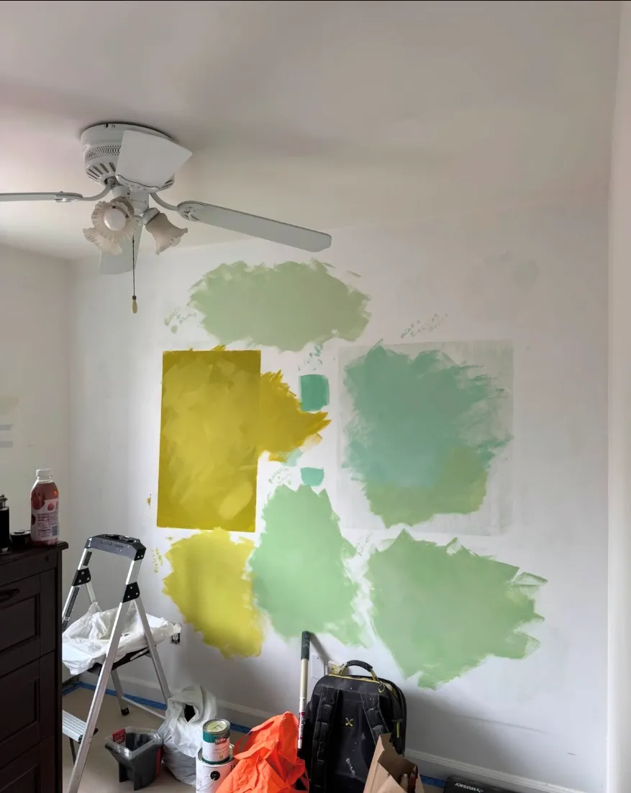
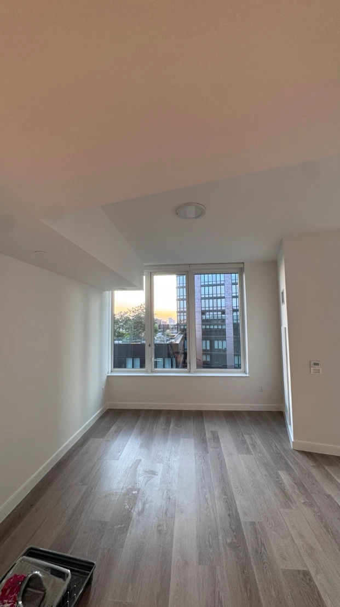
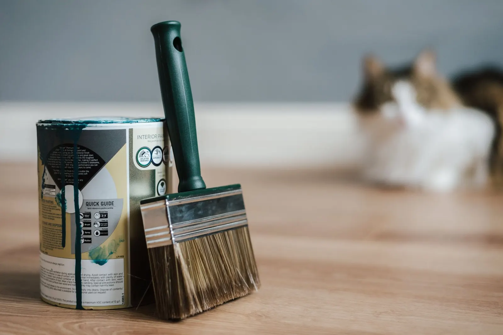
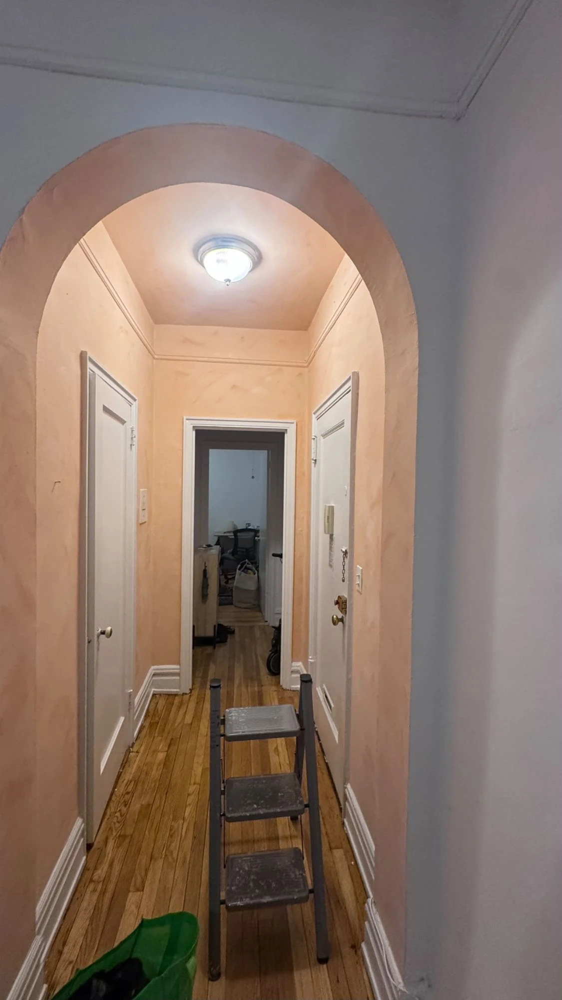

Choosing a paint color shouldn't be a gray area (unless you're going for gray, in which case, welcome, you're in good company). Here's how to choose a paint color in one sentence: **start with what's staying in the room, check your light, narrow it down to 3 to 5 colors, paint big swatches on the actual wall, and look at them morning, noon and night before you commit.**

We help customers pick colors on jobs all over NYC, and we've seen every kind of indecision. Below is the exact process we use, plus the colors our customers ask for most. Let's brush up.

*Eight shades of gray, one wall, zero arguments. (Okay, a few arguments.) Testing big swatches like this is the single best way to choose.*

## How to choose a paint color, step by step

### 1. Start with what's staying

Before you fall in love with a paint chip, look at what isn't changing: your floors, kitchen cabinets, countertops, big furniture and trim. Those have their own colors and undertones, and your paint has to get along with them. Think of it as a dinner party. The floor was invited first, so the paint has to be polite.

### 2. Check your light

Light changes color more than anything else. Look at which way your windows face:

- **North-facing rooms** get cool, steady light. Warmer colors keep them from feeling chilly.
- **South-facing rooms** get warm, bright light most of the day. Most colors look great, and cooler ones stay fresh.
- **East-facing rooms** are bright in the morning and dim later.
- **West-facing rooms** glow warm in the evening.

In NYC, plenty of apartments face a light shaft or a brick wall a few feet away. If your view is mostly "neighbor's AC unit," treat the room as a dark room (see the apartment section below).

### 3. Think about how you'll use the room

A bedroom should feel calm. A kitchen can handle more energy. An office needs focus. Softer blues and greens tend to feel restful, while warmer colors feel social and cozy. Pick a mood first, then pick a color family that matches it.

### 4. Pick a color family and check the undertone

Every color has an undertone hiding inside it. Gray can lean blue, green or purple. White can lean creamy, pink or icy. Hold your sample against your floor, trim and sofa. If something looks "off" and you can't say why, it's almost always the undertone. Colors, like people, show their true selves in the right light.

### 5. Narrow it down to 3 to 5 colors

Paint stores have thousands of colors. You need about four. More than five and every swatch starts to look the same, and you'll be standing in the aisle at closing time holding chips up to the ceiling light. We've all been there.

*A real color test from one of our jobs. Notice the swatches are big, labeled and painted right on the wall. Notice also that yellow did not make the cut.*

### 6. Test big swatches on the actual wall

This is the step people skip, and it's the one that matters most. A two-inch chip under store lighting tells you almost nothing. Instead:

- **Paint big swatches**, about two feet square, directly on the wall.
- **Do two coats**, so you see the real color, not the old wall peeking through.
- **Label each one** with a pencil.
- **Look at them in the morning, afternoon and at night** with your lamps on.
- **Don't judge them wet.** Paint looks darker and patchier while it dries.

I learned how far a color test can go on a lime wash job. My client couldn't decide between two colors, so we went back and forth to the paint store about five times, testing each one on the wall. The store was a long walk, so I borrowed her electric scooter for the trips. I'm a painter, not a delivery guy, but I'll take a scooter if it gets the color right. And it did: the final wall came out exactly how she pictured it.

### 7. Pick the finish, because it changes the color

The same color looks different in different finishes. Flat and matte look softer and slightly darker, and hide wall flaws. Eggshell and satin reflect more light, look a little brighter, and are easier to clean. Pick the finish by room: flat on ceilings, eggshell or matte on most walls, satin in kitchens, baths and kids' rooms. Trim and doors usually get satin or semi-gloss.

*Proof that a bold color can work in a NYC apartment. This deep teal [accent wall](/blog/accent-wall-painting/) is one of our favorites. The white beams and trim make it pop.*

## The best interior paint colors (according to our customers)

Lots of sites list "trending" colors. Here are the ones our customers actually ask us to put on their walls, all from Benjamin Moore:

| Color | What it's like | Where it works |
| --- | --- | --- |
| **Webster Green HC-130** | A mid-tone green with warmth, Benjamin Moore's Color of the Year 2027 | Living rooms, bedrooms, accent walls |
| **Garrison Red HC-66** | A muted, grown-up red | Dining rooms, accent walls, front doors |
| **Ocean Air 2123-50** | A soft, calming blue-green | Bedrooms, bathrooms, small rooms |
| **Coventry Gray HC-169** | A classic medium gray | Living rooms, hallways, offices |
| **White Dove OC-17** | A soft, warm white, and my personal favorite | Walls, trim and ceilings, anywhere |

Yes, my favorite color is a white. I know. But a good white is like a good bass player: you don't notice it until it's missing.

My honest take: these colors look great on walls, but not everyone wants green or red in their home, and that's fine. The best color is the one you'll love waking up to, not the one on a trend list.

*A soft aqua made this bedroom feel calmer without making it feel smaller. [See the full aqua bedroom project](/work/apartment-bedroom-aqua-repaint/).*

## What color should I paint my apartment?

If your apartment is small or dark, go **white or a very light, bright color**, like a soft blue or a fresh light green. Light colors bounce light around and make a room feel bigger. Keep the ceiling and trim white too, so the whole room works as one big reflector.

Want something bolder? Put it on one wall instead of four. An accent wall gives you the color without turning a small room into a cave. (A cozy cave is fine. An accidental cave is not.)

*The classic: a freshly painted white apartment between tenants. Bright, clean, ready to rent.*

## Apartment color schemes that flow

In an apartment, you see several rooms at once, so the colors need to get along:

- **Pick one white** for all the trim, doors and ceilings, and use it everywhere.
- **Choose wall colors from the same family**, like warm neutrals or cool blues and greens, so rooms flow into each other.
- **Use bolder colors in rooms with doors**, like bedrooms and bathrooms, where they don't clash with the rest.

And if you rent, here's a real-world note. Landlords almost always want one color: white. Sometimes a creamier white, sometimes a brighter one, but white. We call it "landlord white," and we've painted a lot of it. If your lease asks you to return the walls to the original color, keep a note of both colors.

*The color name is usually on the lid. The cat is not included in the formula. Photo: Pexels.*

## How to match a paint color

Need to touch up a wall or match a color someone else picked? Here's how:

1. **Look for leftover paint.** The color name or formula is usually printed on a sticker on the can lid. That's the easiest match there is.
2. **No can? Bring a chip.** Carefully cut a small piece of painted surface from an out-of-sight spot, like inside a closet, and take it to the paint store so they can match it.
3. **Match the finish too.** The right color in the wrong sheen still won't blend.
4. **Paint the whole wall,** corner to corner. Touch-ups often show, even with a perfect match, especially on older paint that has faded.

If you're testing lots of sample pots, don't pour the leftovers down the drain. NYC's sanitation department explains [how to get rid of leftover paint safely](https://www.nyc.gov/site/dsny/collection/get-rid-of/harmful-household-products.page). And open a window while you paint swatches: the [EPA recommends plenty of fresh air](https://www.epa.gov/indoor-air-quality-iaq/volatile-organic-compounds-impact-indoor-air-quality) around paint fumes.

*Worth the extra trips to the paint store. A warm lime wash hallway from one of our jobs.*

## Color mistakes we see all the time

After a lot of jobs, these are the mistakes that come up again and again:

- **Picking from a tiny chip.** It's like choosing a sofa from a photo of one cushion.
- **Testing on paper taped to the wall.** Better than nothing, but painting right on the wall shows the real color and sheen.
- **Testing too many colors.** By swatch number twelve, every color looks like "kind of greenish."
- **Ignoring the undertone.** The gray looked perfect at the store and purple at home? That's the undertone.
- **Rushing.** Live with your swatches for a couple of days. The right color will keep winning.

Still stuck? That's what we're here for. When we quote a job, I'll give you my honest opinion on which colors will look great in your space. See our [interior painting service](/services/interior-painting/), or check our [interior painting cost guide](/blog/interior-painting-cost/) to plan your budget.

## The bottom line

Here's how to choose a paint color without losing your mind: start with what's staying, check your light, pick a mood, narrow it to a few colors, test big swatches on the wall, and choose the right finish. Then live with it for a day or two.

The right color is out there. And if it takes five trips to the paint store, well, you know who to call. Scooter optional.
