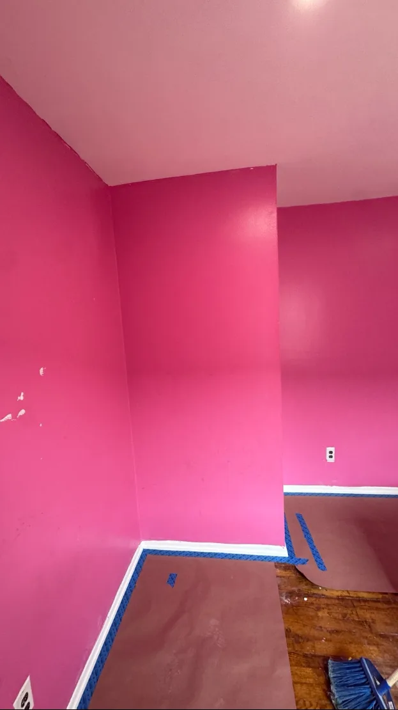
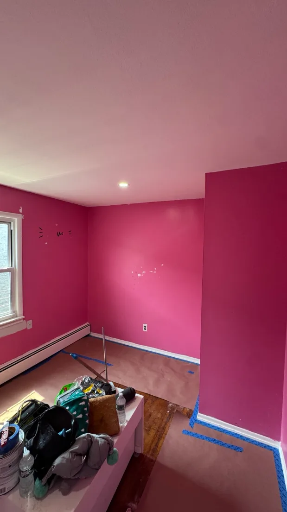
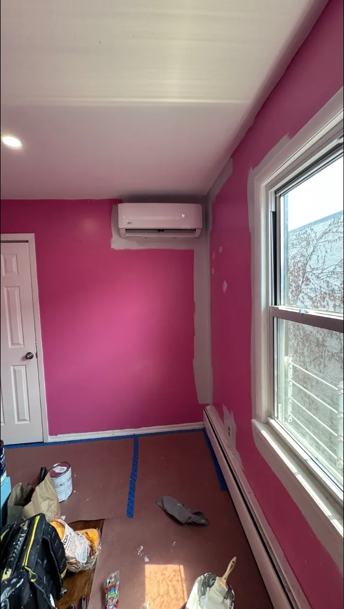
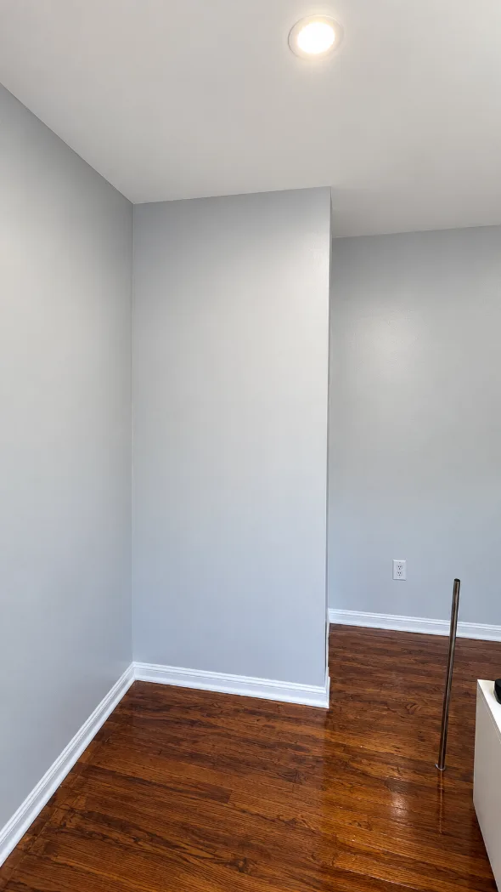

Painting a room looks easy until you're on a ladder with paint on your elbow, a crooked line on the ceiling and no idea where the stir stick went. **To paint a room, clear and cover the room, patch and sand the walls, clean them, prime where needed, paint the ceiling first, then the trim, then cut in and roll the walls, and finish with a second coat.**

We've done 250+ jobs across NYC and Long Island, and this is the same order we follow on every job. Below is each step the way we actually do it, with photos from one real job: a hot pink bedroom we repainted gray (mess included, because that's honest).

## What you need to paint a room

You don't need a truck full of gear. You do need the right few things:

- **Paint:** enough for two coats (see "How much paint do I need?" below). We use Benjamin Moore Regal Select and Aura, and Sherwin-Williams Emerald and Duration, picked per room.
- **Primer:** for patches, stains, new drywall or a big color change.
- **An angled brush** for cutting in. A 2 to 2½ inch brush is easy to control.
- **A roller frame, roller covers and a tray.** The right roller nap depends on the wall: shorter for smooth walls, thicker for textured walls or rough plaster. Tell the paint counter what your walls are like.
- **An extension pole**, so you're not doing a ladder workout on every wall.
- **Spackle, a putty knife and a sanding sponge** for holes and dents.
- **Drop cloths or rosin paper and painter's tape** to protect the floors.
- **A step ladder, rags and a bucket of water.**

Good tools pay for themselves. A cheap roller sheds fuzz into your paint, and then it's not a wall anymore, it's a sweater.

## How to paint a room in 10 steps

### 1. Clear the room and cover everything

Move furniture to the middle of the room, or out of it, and cover it with plastic. Take down curtains, art and wall hooks, and unscrew outlet and switch covers. Then cover the floor with drop cloths or rosin paper, taped down at the edges so nobody trips.

*Floors covered and taped before a single can is opened. Paint on hardwood is a souvenir nobody wants.*

### 2. Patch holes and sand the walls smooth

This is how to prep walls for painting, and it's where a good paint job is really won. Fill nail holes, dents and dings with spackle, let it dry, then sand it flush with the wall. Run your hand over each patch: if you can feel it, you'll see it after painting.

Bigger cracks and damaged drywall need more than spackle. That's a job for [drywall repair and prep](/services/drywall-repair-prep/).

*Every hole patched and ready for sanding. The pink is living its last day.*

### 3. Clean the walls

Paint doesn't stick well to dust, grease or grime. Wipe the walls down after sanding, and degrease anything near a stove. Let everything dry before you paint. A wet wall and fresh paint get along about as well as cats and bath time.

### 4. Prime where it's needed

You don't always need to prime a whole room, but you do need primer in these spots:

- **Patches and repairs:** spot-prime them, so they don't show up as dull spots (called "flashing") through the paint.
- **Big color changes:** going from dark to light, like the hot pink room above, is much easier with primer first.
- **Stains and water damage:** use a stain-blocking primer, and fix the leak first, or the stain comes right back through.
- **New drywall:** it needs a full coat of primer.

Paint-and-primer-in-one products are handy, but they don't replace a real primer in these cases.

### 5. Paint the ceiling first

Always start at the top. Cut in the ceiling edges with a brush, then roll the ceiling with an extension pole. Any drips land on walls you haven't painted yet, which is the whole point. Gravity is undefeated, so we just work with it.

Ceilings are the hardest part to DIY (neck, arms, everything). If you'd rather skip them, see our [ceiling painting](/services/ceiling-painting/) service.

### 6. Paint the trim

Next come baseboards, door frames, window trim and doors. We paint trim before walls so we can cut the wall color in against finished trim. Trim usually gets a harder, shinier paint, like Benjamin Moore Advance, in satin or semi-gloss. Our [paint finishes guide](/blog/paint-finishes/) explains which sheen goes where.

### 7. Cut in the walls

Cutting in means brushing a clean edge of wall paint along the ceiling, corners and trim, where a roller can't reach. Dip the brush about a third of the way, tap off the extra, and pull a steady line a few inches wide. Do one wall at a time.

*Edges around the window and the AC done first, before rolling. Pink, it's been nice knowing you.*

### 8. Roll the walls while the cut-in is still wet

Roll each wall right after cutting it in, while the edges are still wet, so the brushed band and the rolled area blend together. Load the roller evenly, work in sections about 3 feet wide from top to bottom, and roll back into the wet paint you just put on. Don't press hard. Let the roller do the work (it's paid to).

### 9. Apply the second coat

Let the first coat dry (most latex paints can be recoated in about 2 to 4 hours, but check the can), then repeat the cut-in and roll for coat two. We put at least two coats on every job: that's what gives full color and an even sheen. A big color change may need a third.

Don't judge the walls while they're still wet. Paint can look patchy as it dries and even out on its own.

### 10. Clean up and let it cure

Pull up the floor covering, put the outlet covers back and touch up any small misses with a brush. Paint is dry to the touch long before it's fully cured, so go easy on scrubbing the walls for the first couple of weeks (the can lists the cure time).

Got leftover paint in NYC? Small amounts can be dried out and thrown in the trash, and larger amounts have special drop-off options. See the [NYC Department of Sanitation's guide](https://www.nyc.gov/site/dsny/collection/get-rid-of/harmful-household-products.page).

*The same corner from step 1, finished in gray with two coats. The teen who lived here officially grew out of pink.*

## What order to paint a room

**Ceiling first, then trim, then walls.** Top-down keeps drips off finished work, and doing the trim before the walls means your wall color gets the last, cleanest line. Within each wall, cut in first, then roll.

## How to cut in paint (and why it matters most)

The number one mistake we see when people paint a room themselves is **sloppy cut lines**: wall color on the ceiling, on the trim and around the outlets. You can roll a wall perfectly, but a wobbly ceiling line is what everyone notices.

We cut in freehand, without tape, because a steady hand gives a sharper line on most walls. That takes a lot of practice. If you're doing it yourself, **tape is completely fine**. Press the edge down firmly, paint, then pull the tape off at an angle while the paint is still slightly wet.

A few tips for cleaner lines:

- **Don't overload the brush.** Too much paint is how you get drips and thick ridges.
- **Use the long side of the angled brush** and lead with the tip.
- **Go slow on the ceiling line.** Speed comes later, after a few hundred rooms.

## How long between coats of paint?

**Most latex wall paints can be recoated in about 2 to 4 hours**, but always follow the can. Cold rooms and humid days slow drying down. If the paint still feels tacky or cool to the touch, wait longer. Rolling over half-dry paint can pull it up and leave a rough patch.

## How long does it take to paint a room?

**Our crew paints a typical 12x12 bedroom (ceiling, walls, trim, two coats, normal prep) in about one day.** Most of that time is prep, not painting.

If you're doing it yourself for the first time, plan on a weekend. Moving furniture, patching, drying time between coats and cleanup all add up, and that's before the snack breaks.

## How much paint do I need for a room?

A gallon of paint covers about 350 to 400 square feet per coat, depending on the product and the wall (check the can). For a typical 12x12 bedroom with 8-foot ceilings:

| Surface | Area | Paint for two coats |
| --- | --- | --- |
| Walls | About 340 square feet (after doors and windows) | About 2 gallons |
| Ceiling | 144 square feet | About 1 gallon |
| Trim and doors | Varies | About 1 quart to 1 gallon |

Buy a little extra for touch-ups, and buy it all from the same batch so the color matches.

## Painting a room in an older home

Okay, jokes aside: a lot of NYC and Long Island homes are older, and **homes built before 1978 may have lead-based paint.** Sanding or scraping it creates dust that's dangerous, especially for kids and pregnant women. Before you sand old paint, read the [EPA's guide to protecting your family from lead](https://www.epa.gov/lead/protect-your-family-sources-lead). Anyone **paid** to disturb paint in those homes must be certified under the [EPA's lead-safe program](https://www.epa.gov/lead/renovation-repair-and-painting-program).

Also keep a window open while you paint. Paint gives off fumes as it dries, and the [EPA's page on indoor air](https://www.epa.gov/indoor-air-quality-iaq/volatile-organic-compounds-impact-indoor-air-quality) explains why fresh air matters.

## DIY or hire a painter?

Honestly? **One wall or a small room is a very doable DIY project**, and this guide is all you need. We'll say that even though it costs us the job.

Consider hiring a painter for ceilings, tall walls and stairwells, prewar plaster, deep or bold colors, whole apartments, or anything with a deadline like a move-in. Our [interior painting service](/services/interior-painting/) includes the prep, two coats and daily cleanup, for one flat-rate price. Not sure what it would cost? See our guide to [interior painting cost](/blog/interior-painting-cost/), and if you haven't picked a color yet, start with [how to choose a paint color](/blog/how-to-choose-a-paint-color/).

## The bottom line

To paint a room, prep first: cover the floors, patch, sand, clean and prime where needed. Then paint the ceiling, then the trim, then cut in and roll the walls, and always do two coats. Take your time on the cut lines, because that's what people see.

Do all that and you'll end up with a room you're proud of, and much less paint on your elbow.
