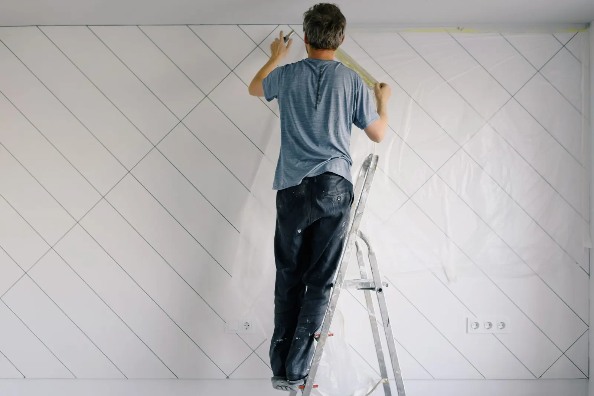
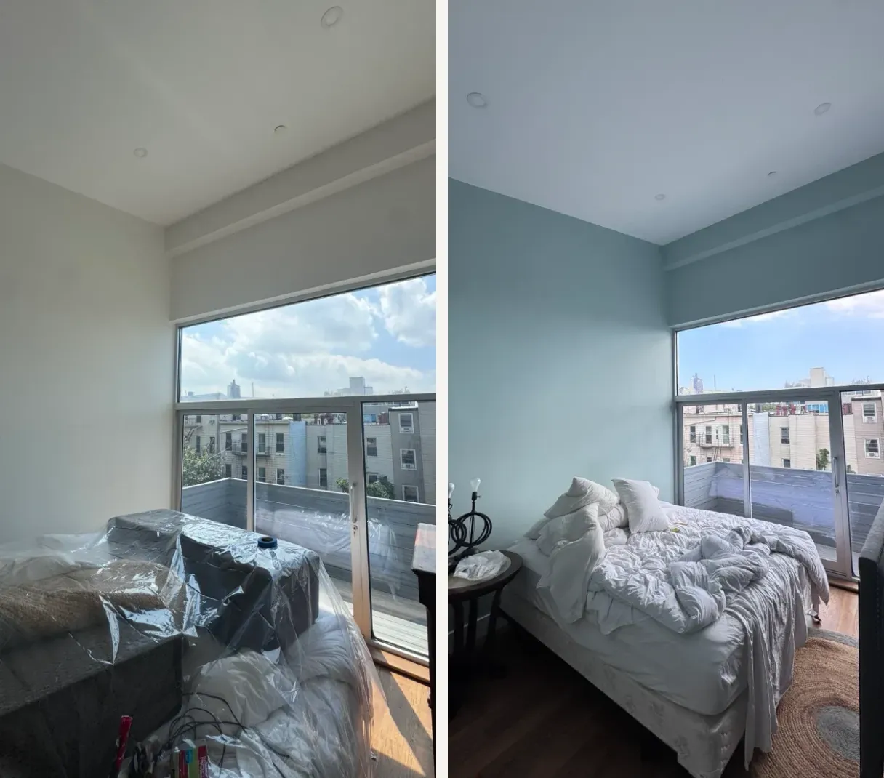
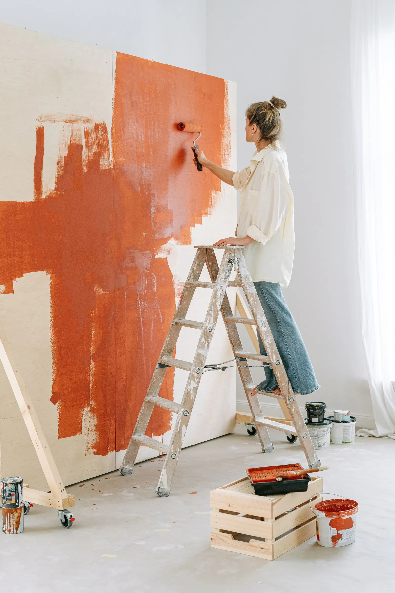
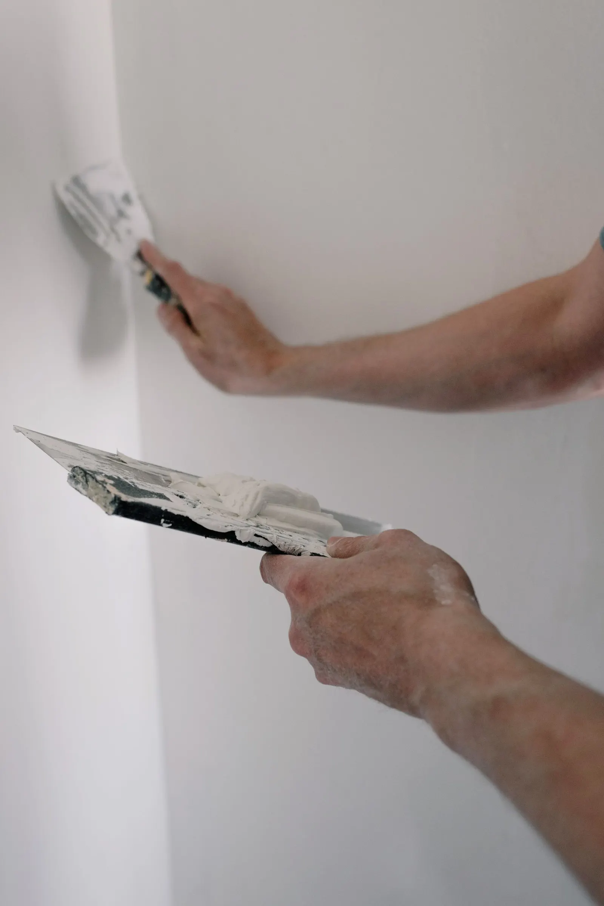
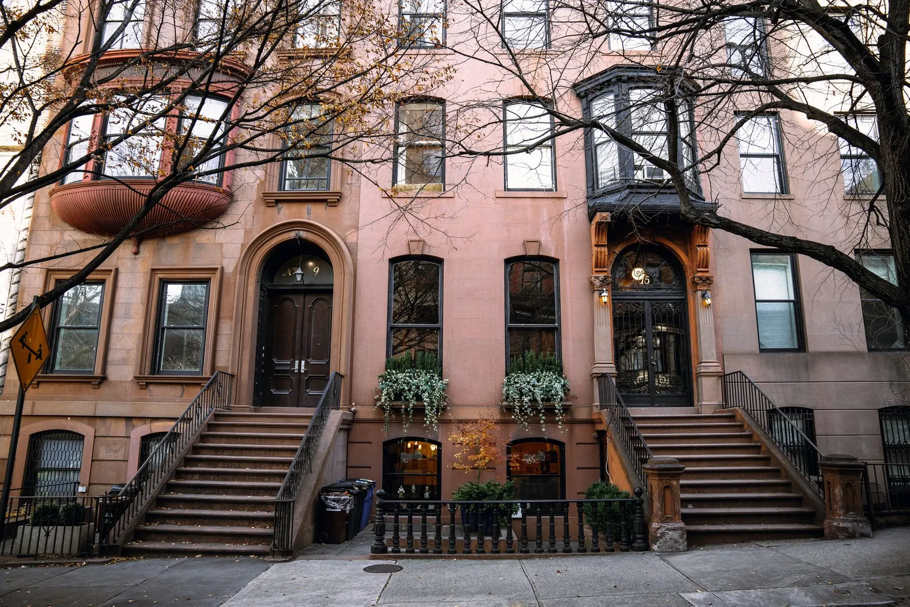
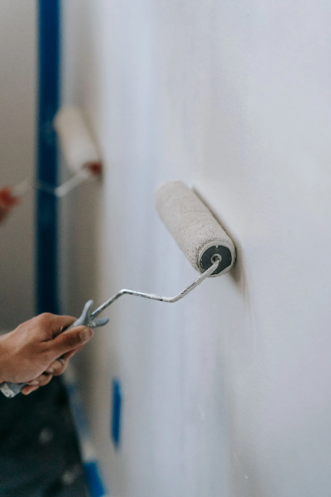
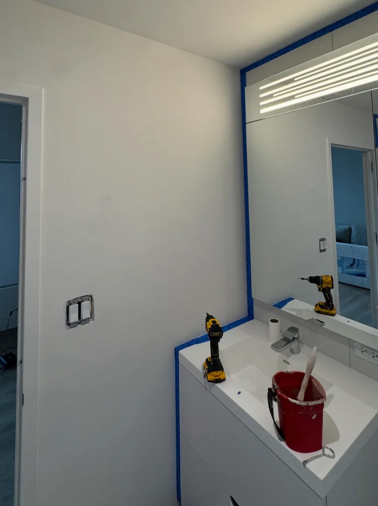

Ask a painter what interior painting costs and you'll hear "it depends" (we know, we roll our eyes at that answer too, and painters are professionally good at rolling). So let's skip the shrug and brush up on real numbers.

**Interior painting cost typically runs $2 to $6 per square foot of floor space, or about $2,000 to $6,000 for every 1,000 square feet, based on 2026 national cost data.** Most single rooms cost $400 to $1,500. In New York City, expect the higher end of those ranges.

For a real-world NYC number: at Painters Touch, a bedroom usually runs **$400 to $1,500**, and our average job, from a single room to a full home, comes to about **$3,800**.

Grab a coffee. We've got rooms to cover.

*Fun fact: painters spend so much time on ladders, we've started to look down on people. (Kidding. Mostly.)*

## Interior painting cost per square foot

The $2 to $6 per square foot range is based on your home's **floor area**, not the wall surface. It's the quick-estimate number that nearly every painter and cost guide lands on.

Think of it like ordering pizza. The size sets the base price, but the toppings decide the bill:

- **Around $2 per sq ft (plain cheese):** walls only, in good shape, same or similar color.
- **Around $4 per sq ft (a few toppings):** walls, ceilings and trim, with normal patching.
- **$6 and up per sq ft (the works):** dark color changes, high ceilings, lots of trim, damaged walls or specialty finishes.

One warning: **cheap square-foot pricing can be misleading.** A per-foot price that ignores the condition of your walls is a guess, not a quote. Guesses are free. Fixing them isn't.

*A bedroom we repainted in soft aqua. Same room, same window, whole new mood. [See the full project](/work/apartment-bedroom-aqua-repaint/).*

## How much does it cost to paint a room?

Here's what professional painting costs by room, starting with our own NYC pricing. The other rows are published ranges from other markets, so treat them as a starting point:

| Room | Typical cost | Market |
| --- | --- | --- |
| **Bedroom** | **$400–$1,500** | **NYC (our pricing)** |
| Bedroom | $400–$800 | Minnesota |
| Standard 12x12 bedroom, all-in | $700–$900 | Boston area |
| Bathroom | $300–$600 | Minnesota |
| Kitchen (walls only) | $600–$1,200 | Minnesota |
| Living room | $800–$1,500+ | Minnesota |

Why such a wide range on our bedrooms? **Condition and prep.** It's not the room, it's the baggage. Smooth walls staying a similar color sit at the low end. Cracks to fill, patches to sand and prime, or that dark purple from your college years (no judgment) sit at the high end.

On the **labor cost to paint a 12x12 room**: published Boston-area pricing puts a standard 12x12 bedroom at $700 to $900, including walls, ceiling, baseboards, doors and windows. Most of that is labor. A bedroom only needs a few gallons of paint, so you're paying for the hands, not the can.

Bathrooms are small but they punch above their weight: cutting in around every fixture, plus moisture-resistant paint. Tiny room, big personality.

## Cost to paint a 1,500 sq ft house interior

Using the national $2 to $6 per square foot range, here's what a full interior costs by home size, according to 2026 national data:

| Home size | Typical interior cost |
| --- | --- |
| 1,000 sq ft | $2,000–$6,000 |
| 1,500 sq ft | $3,000–$9,000 |
| 2,000 sq ft | $4,000–$12,000 |
| 2,500 sq ft | $5,000–$15,000 |

Big spread, we know. That's the difference between "fresh coat on good walls" and "so, we found a few surprises behind the couch."

Our own average job at Painters Touch comes to about **$3,800**, across everything from a single room to a full home. For comparison, a large national painting franchise reports an average interior project of **$4,220** over the past year, and 2026 homeowner data puts the average interior job at **$2,021**.

## What drives the cost of interior painting?

Spoiler: square footage is the least exciting part. Here's what actually moves the number:

1. **Wall condition and prep.** Holes, cracks, stains and peeling paint all get fixed before paint goes on. Prep is the coat you never see, and it's where the real money is earned. When Elena F. hired us to paint her whole apartment, every ceiling had popcorn texture. [Skim coating](/services/drywall-repair-prep/) them added work, and it's the part she raved about. (Popcorn belongs at the movies, not on your ceiling.)
2. **Color changes.** White to deep green is a bigger job than white to white. Dark over light needs a tinted primer. Light over dark needs patience. And primer.
3. **Number of coats.** Two coats is our rule on every job, because that's what it takes for full color and even sheen. If you're asking whether it needs a second coat, it needs a second coat.
4. **Ceiling height and access.** Ten-foot prewar ceilings are gorgeous. They're also tall. (We checked.) Stairwells and two-story foyers need taller ladders or scaffolding, and more time.
5. **Trim, doors and built-ins.** Old trim can take longer than the walls. Some baseboards have so many layers of paint they're practically an archaeological dig.
6. **Specialty finishes.** [Lime wash](/services/lime-wash-specialty-paint/) and decorative finishes cost more than basic painting, because they take more skill (and more arm day).
7. **Water stains and cracks.** A stain needs its moisture source fixed and a stain-blocking primer first. Paint over it without fixing the leak and it's like a houseguest who says they're leaving: it'll be back.

## Why interior painting costs more in NYC

NYC pricing reported in 2022 put the average at **$5.25 per square foot**, near the top of the national range, and prices have risen since. A gallon of paint costs about the same here as anywhere. Everything around it doesn't:

- **Building rules.** Co-op and condo buildings set work hours, require service elevator bookings, and often require painters to carry large insurance policies. Co-op boards: the only people pickier about paint than we are.
- **Walk-ups.** Every ladder, drop cloth and gallon goes up the stairs by hand. For our crew, leg day is every day.
- **Traffic.** Getting a crew and its gear across a city this busy takes time. If traffic ever makes us late, you'll hear it from us first.
- **Prewar walls.** Plaster with more layers of paint than a wedding cake has frosting needs extra patching and priming.
- **Tall ceilings and detailed trim**, common in [Manhattan](/areas/manhattan/) and [Brooklyn](/areas/brooklyn/) prewar apartments.

That's why national averages can look suspiciously low to New Yorkers.

*The cat is not included in the quote.*

## How much of the cost is paint?

Less than you'd think. Labor is most of what you pay a painter for. But the paint still matters, because **cheap paint is a false economy.** Bargain paint covers poorly, so you need more of it, plus more coats and more labor. It's the paint version of cheap socks: you end up buying them twice.

That doesn't mean buying the fanciest can on the shelf, either. We use Sherwin-Williams and Benjamin Moore and pick the product for the room, not the price tag.

## How long does interior painting take?

This is what surprises our customers most: **how long the job takes, and how much of that time is prep.** A single room is often done in a day or two. A full apartment typically takes several days.

The painting itself is the fast part. Moving and covering furniture, protecting floors, taping, filling, sanding and priming can take as long as the coats themselves, or longer. It's like Thanksgiving dinner: hours of cooking, twenty minutes of eating. Prep is also what decides how the room looks, so it's the last place to rush.

## DIY vs hiring a painter

Painting it yourself saves the labor, the biggest part of the bill. It costs you paint, primer, tools, a weekend or two, a sore neck and at least one debate about whether "Agreeable Gray" is actually agreeable.

**Worth doing yourself:** a single room, an [accent wall](/blog/accent-wall-painting/), or a refresh in the same color.
**Worth hiring out:** ceilings, tall walls and stairwells, plaster repairs, popcorn ceilings, dark color changes, whole apartments, and anything on a deadline like a move-in or listing date.

*From one of our jobs: mirror and vanity taped off, switch plate removed, all before a single drop of paint. We tape things off so you never have to patch things up.*

## How to compare painting quotes

The cheapest painting quote can become the most expensive mistake. A painter who skips sanding, primer or proper repairs saves you money up front, and then you see it in every wall.

I once got a rush call from a client whose previous painter had botched patching the holes in their walls. It was Halloween, and I dropped everything to go fix it, very nearly still in my costume. Scariest thing I saw that night? Those walls. Getting it right the first time is cheaper than paying a second painter to fix the first. Nobody wants a sequel.

When you compare quotes, check that each one spells out:

- **Prep and repairs:** what gets patched, sanded, caulked and primed.
- **Paint:** the brand, the product line and the number of coats.
- **Scope:** walls only, or ceilings, trim and doors too.
- **Protection and cleanup:** furniture, floors and daily cleanup.
- **Price type:** flat rate or hourly. Flat rate means the number doesn't change if the job runs long.

A single number with no scope is impossible to compare. It's like comparing two mystery boxes.

Here's how we quote. It starts with a phone call (an actual conversation, with an actual human), so we can get to know you and what you need, want and like. Then we look at photos of the space to make sure it's a good fit. From there, we either price it from the photos or schedule a visit to see it in person. Either way, you get one written, [flat-rate price](/services/interior-painting/) covering prep, paint, labor and cleanup. It never changes without your approval.

## The bottom line

Interior painting cost comes down to size, wall condition and what's included. Budget $2 to $6 per square foot nationally, expect the higher end in NYC, and compare quotes on scope, not just price.

So yes, it depends. But now you know exactly what it depends on. We'll stop with the paint puns now. (We won't. We never do.)
