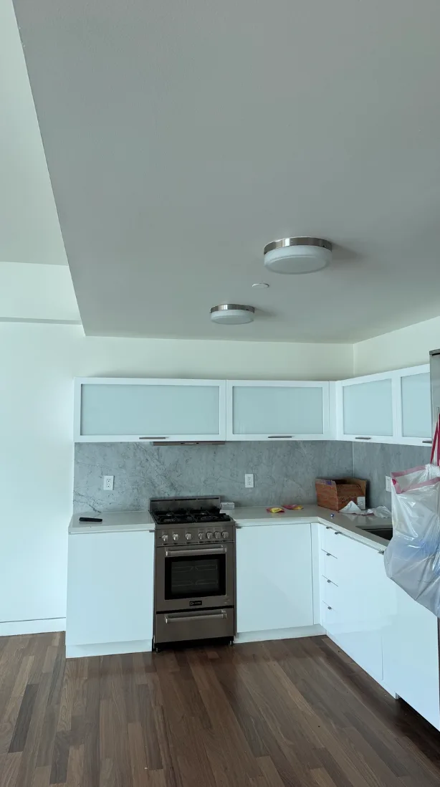
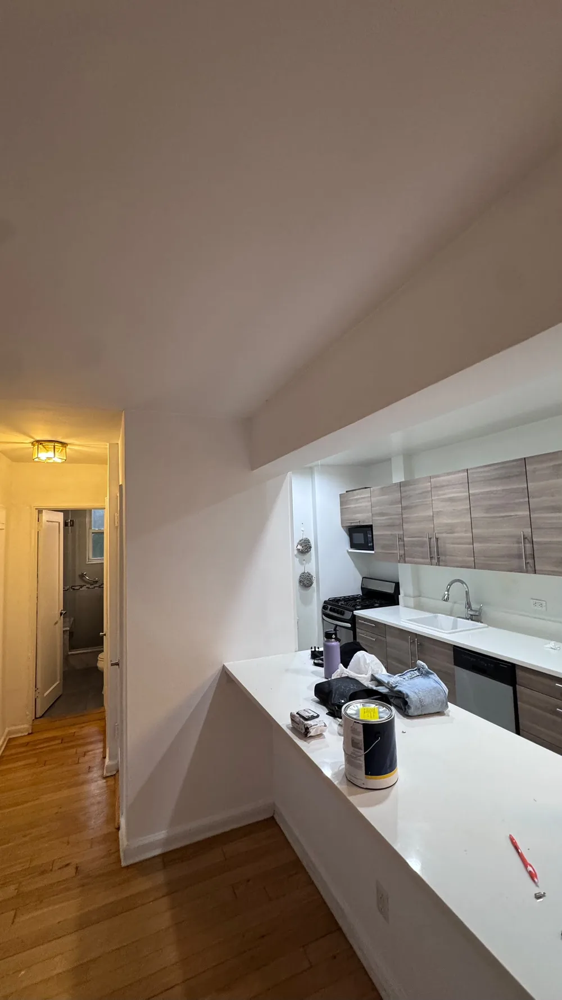
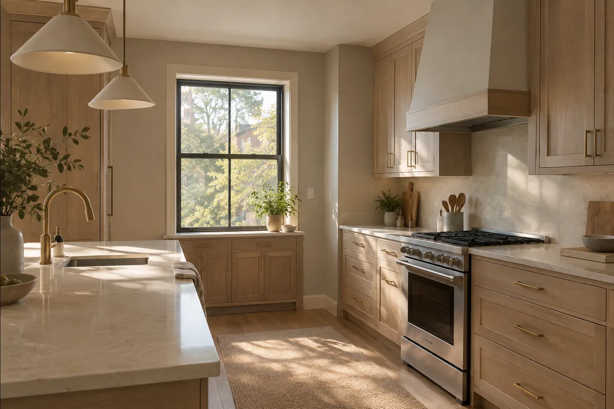
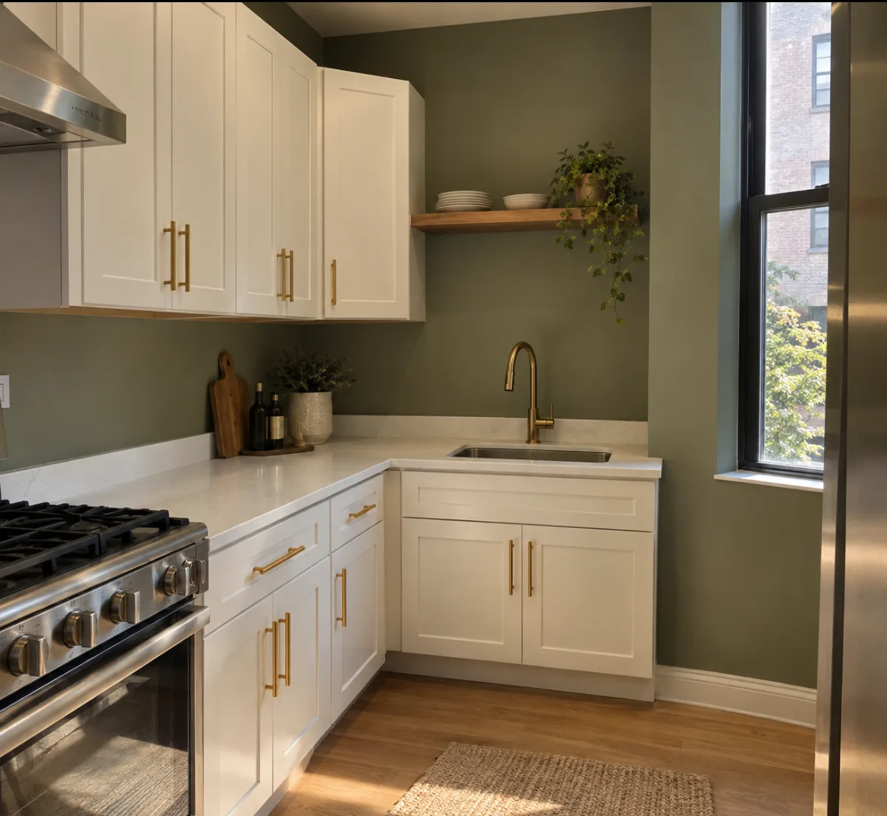
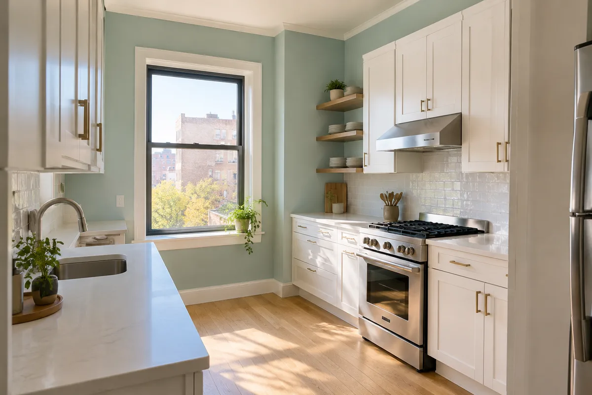
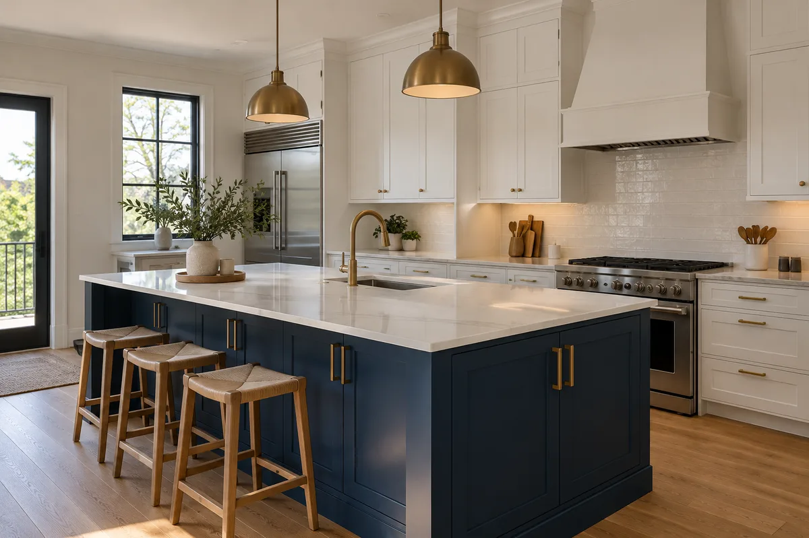
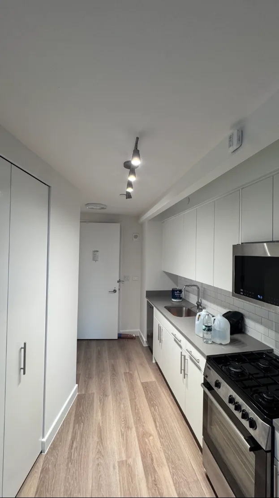
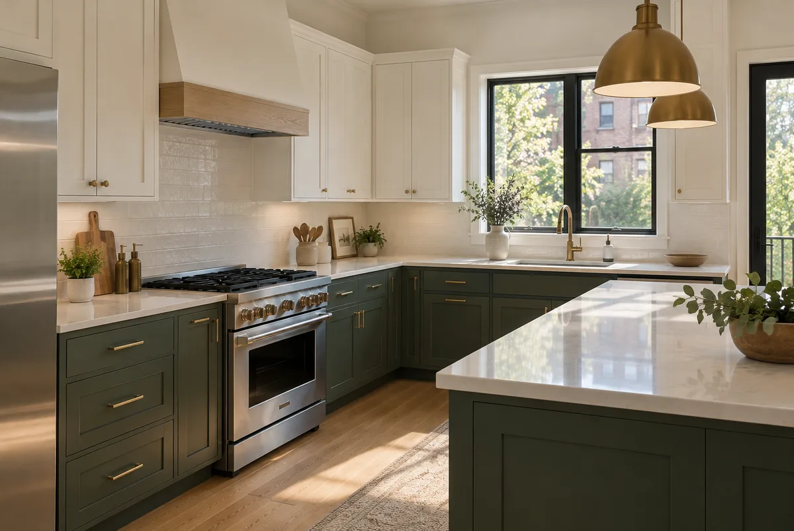
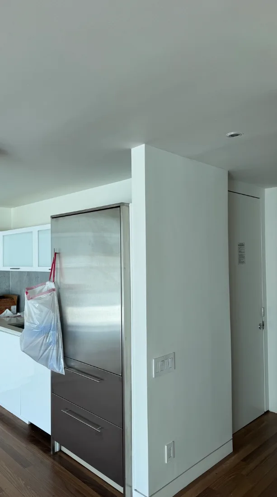

The kitchen is where everyone ends up at every party, so its walls need to look good under pressure (and under pasta sauce). **The best kitchen paint colors are clean whites like Simply White and Alabaster, soft neutrals like Gray Owl and Modern Gray, muted greens like Guilford Green, and calm blues like Wythe Blue.** Whites keep a kitchen bright and easy to match, while greens, blues and deep navy add personality.

We paint kitchens in apartments and homes all over NYC and Long Island. Below are the kitchen paint colors **Benjamin Moore and Sherwin-Williams recommend**, sorted by style, plus what we've learned about finishes, small kitchens and grease. Let's get cooking.

## Best kitchen paint colors at a glance

| Color | Brand and code | Style | Best for |
| --- | --- | --- | --- |
| **Simply White** | Benjamin Moore OC-117 | Bright, clean white | Any kitchen, any cabinets |
| **Chantilly Lace** | Benjamin Moore OC-65 | Crisp, pure white | Modern, white-on-white kitchens |
| **Alabaster** | Sherwin-Williams SW 7008 | Creamy white | Small kitchens that need warmth |
| **White Dove** | Benjamin Moore OC-17 | Soft warm white | Our favorite white, walls or cabinets |
| **Gray Owl** | Benjamin Moore OC-52 | Soft gray-green neutral | Kitchens with stainless steel |
| **Modern Gray** | Sherwin-Williams SW 7632 | Pale warm greige | Almost any kitchen style |
| **Fleur de Sel** | Sherwin-Williams SW 7666 | Light gray | Bright kitchens with stainless |
| **Hush** | Benjamin Moore AF-95 | Warm neutral | Cozy, welcoming kitchens |
| **Monroe Bisque** | Benjamin Moore HC-26 | Warm beige | Traditional kitchens with wood |
| **Philadelphia Cream** | Benjamin Moore HC-30 | Sunny pale yellow | Kitchens that need cheering up |
| **Guilford Green** | Benjamin Moore HC-116 | Warm muted green | Kitchens with wood or white cabinets |
| **Peale Green** | Benjamin Moore HC-121 | Earthy deep green | Accent walls and islands |
| **Olive Grove** | Sherwin-Williams SW 7734 | Olive green | Traditional, cozy kitchens |
| **Wythe Blue** | Benjamin Moore HC-143 | Soft blue-green | Fresh, airy kitchens |
| **Blue Note** | Benjamin Moore 2129-30 | Deep blue | Islands, lower cabinets, one wall |
| **Salty Dog** | Sherwin-Williams SW 9177 | Navy | A bold pop of color |

Paint chips and screens never show colors exactly, so use this as a shortlist. Your kitchen lights (and that one fluorescent tube over the sink) will have the final say.

## White kitchen paint colors

White is the most popular kitchen color for a reason: it makes the room bright, it works with every countertop and appliance, and it never fights with your cabinets. Every real kitchen job photo in this post is white, and that's no accident. White is the friend who's never the problem.

- **Simply White OC-117:** bright and clean, with just a hint of warmth.
- **Chantilly Lace OC-65:** a crisp, pure white for a modern look.
- **Alabaster SW 7008:** a creamy white that keeps small kitchens from feeling cold.
- **White Dove OC-17:** our favorite white, soft and warm, great on walls and cabinets.

*A white-on-white kitchen we painted. So clean, even the stove looks like it's on its best behavior.*

## White on white kitchen paint colors

A white-on-white kitchen (white walls, white cabinets, sometimes a white backsplash) looks clean and modern, but it only works if the whites get along. Two whites with different undertones can make one look dirty next to the other.

- **Pick one main white** and use it on the walls, and keep the cabinets in the same family (warm with warm, cool with cool).
- **Use different sheens** to add depth: satin on the walls, semi-gloss on the trim.
- **Bring in texture** with wood, stone or brass so the room doesn't feel like a hospital.

*White walls with wood cabinets: the classic combo. The paint can on the counter is just admiring its work.*

## Warm neutral and greige kitchen colors

If bright white feels too stark, soft neutrals and greige (gray + beige) keep a kitchen calm and warm. They're also great at hiding the occasional splash between cleanings. We're not saying you should leave it there. We're just saying.

- **Gray Owl OC-52:** a soft gray with a hint of green, lovely with stainless steel.
- **Modern Gray SW 7632:** a pale, warm greige that suits most kitchen styles.
- **Fleur de Sel SW 7666:** a light gray for kitchens with plenty of daylight.
- **Hush AF-95** and **Monroe Bisque HC-26:** warm, welcoming neutrals for traditional kitchens with wood.
- **Philadelphia Cream HC-30:** a sunny pale yellow for kitchens that need a mood boost (and a lot of people's mornings do).

*Illustration (AI-generated): warm greige with wood cabinets. So cozy, even the toaster wants a blanket.*

## Green kitchen paint colors

Green is one of the most popular kitchen colors right now, and it's easy to see why: it feels fresh, natural and pairs beautifully with wood, brass and white cabinets. It's also the only green most of us can keep alive in a NYC apartment.

- **Guilford Green HC-116:** a warm, muted green that works with almost any cabinet.
- **Olive Grove SW 7734:** an olive green that feels cozy and traditional.
- **Peale Green HC-121:** an earthy deep green for an accent wall or island.

*Illustration (AI-generated): muted green walls with white cabinets and brass. The plants are just there for moral support.*

## Blue kitchen paint colors

Blues range from fresh and airy to deep and dramatic. Lighter blues keep a kitchen bright, while navy works best in small doses.

- **Wythe Blue HC-143:** a soft blue-green that looks fresh with white trim. Benjamin Moore pairs it with White Dove.
- **Blue Note 2129-30:** a deep blue for an island, lower cabinets or one wall.
- **Salty Dog SW 9177:** a bold navy for a real pop of color.

*Illustration (AI-generated): a soft blue-green with crisp white trim. Fresh enough to make Monday feel like Saturday.*

Our honest take: in most NYC kitchens, **save the dark blues and greens for one wall, the island or the lower cabinets.** A whole kitchen in navy can feel like a cave, and nobody wants to cook in a cave (except maybe a caveman, and his kitchen reviews are terrible).

*Illustration (AI-generated): navy on the island, white everywhere else. The island gets all the attention, and it knows it.*

## Small kitchen paint colors

NYC kitchens are small. Some of them are "you can open the oven or the fridge, but not both" small. For a small kitchen:

- **Go light.** Whites, creams and pale neutrals bounce light around and make the room feel bigger.
- **Paint the ceiling the same light color** (or white) so the room feels taller.
- **Skip busy contrast.** One calm wall color keeps a tiny kitchen from feeling chopped up.
- **Add color in small doses:** a painted backsplash wall, open shelves or a colorful door.

*A small galley kitchen we painted white. Narrow? Yes. Cramped? Not anymore.*

## Kitchen cabinet paint colors

Painted cabinets can transform a kitchen without a full remodel. Benjamin Moore says **Chantilly Lace OC-65** and **White Dove OC-17** are among its most popular cabinet whites, and for color, deep blues like **Blue Note** and greens like **Peale Green** look great on lower cabinets or an island.

Cabinets need a hard, wipeable finish. Benjamin Moore recommends its **Advance** paint for cabinets, in a pearl/satin, semi-gloss or high-gloss finish. And they need real prep: cleaning off years of grease, sanding and priming. Painting cabinets without degreasing is like frosting a cake that's still in the box.

*Illustration (AI-generated): deep green lowers, white uppers. Two-tone cabinets are for people who can never pick just one.*

We paint kitchen cabinets on request, so if you're thinking about it, [send us photos](/contact/) and we'll tell you honestly whether paint is the right move.

## Best paint finish for kitchen walls

Kitchens see more grease, steam and splatter than any room except maybe a teenager's bathroom. That's why the finish matters as much as the color:

- **Walls:** **satin** is the go-to because it wipes clean. Eggshell works on walls away from the stove and sink.
- **Trim and doors:** **semi-gloss**, which stands up to hands, kicks and cleaning.
- **Ceilings:** **flat**, unless the ceiling is right above the stove and gets greasy. Then a washable finish helps.
- **Skip flat paint on kitchen walls.** It's hard to clean, and grease loves it a little too much.

*A white kitchen wall and ceiling from one of our jobs. The trash bag was not part of the color scheme.*

One more thing: **grease has to come off before paint goes on.** New paint won't stick well to a greasy wall, especially around the stove. That's why degreasing is part of proper kitchen prep, before any primer or paint. For more on sheens, see our guide to [paint finishes](/blog/paint-finishes/).

## How to choose your kitchen color

1. **Start with what's staying:** cabinets, countertops, backsplash and floors. Your wall color has to get along with all of them.
2. **Match the undertones.** Warm wood and cream counters want warm colors. Cool gray stone and stainless want cooler ones.
3. **Check your light.** Kitchens often have mixed lighting (window, ceiling lights, under-cabinet lights), so test colors with every light on.
4. **Paint big swatches** on the wall, at least two feet square, and look at them morning and night.

For the full process, read our guide on [how to choose a paint color](/blog/how-to-choose-a-paint-color/). Fresh paint fumes linger in small kitchens, so open a window and see the [EPA's tips on indoor air and paint](https://www.epa.gov/indoor-air-quality-iaq/volatile-organic-compounds-impact-indoor-air-quality). Ready to hand it off? Our [interior painting service](/services/interior-painting/) covers kitchens, prep included.

## The bottom line

The best kitchen paint colors are bright whites, soft neutrals, muted greens and calm blues. Keep small kitchens light, save deep colors for an accent wall, island or lower cabinets, use satin on the walls, and always degrease before you paint.

Your kitchen walls can finally handle the pressure. The pasta sauce is still on you.
