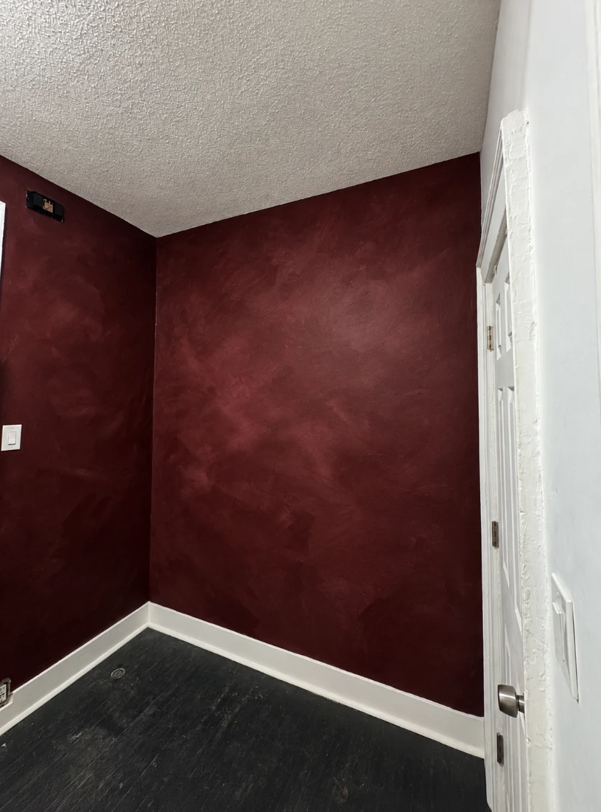
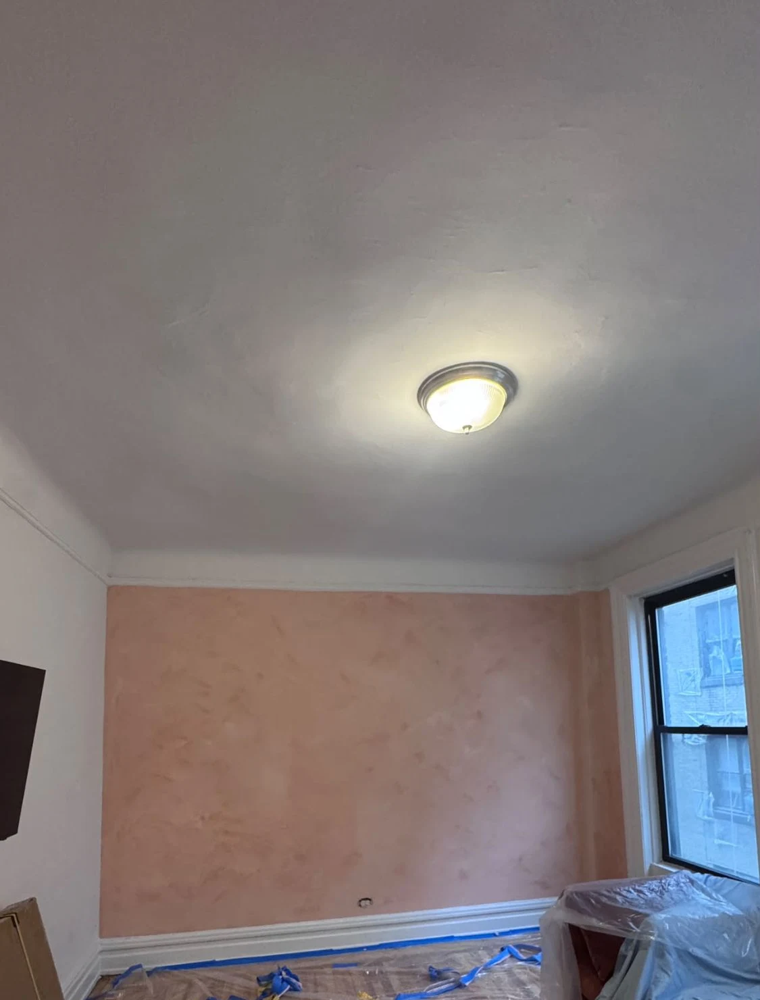
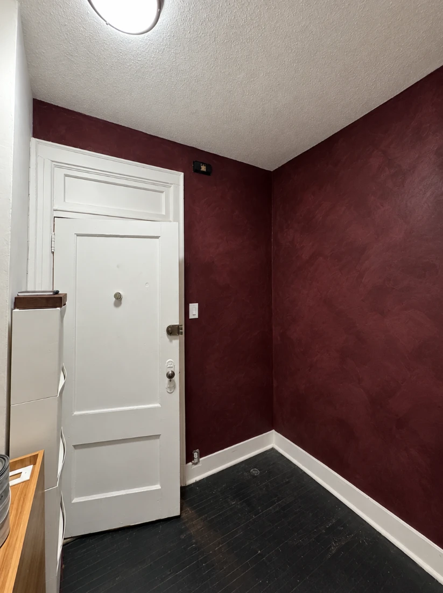
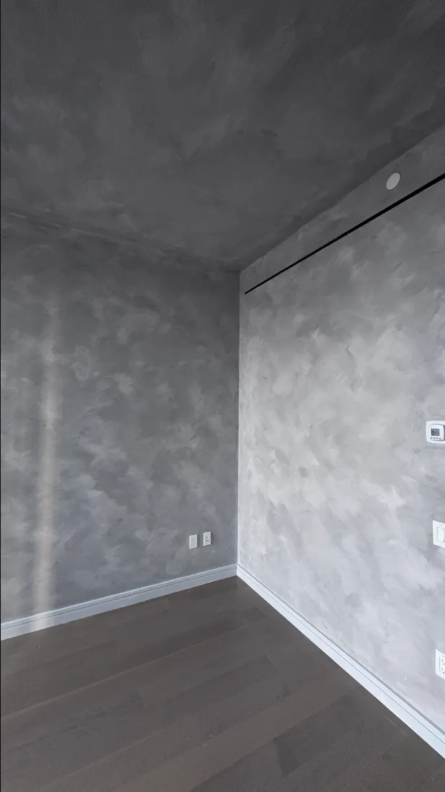
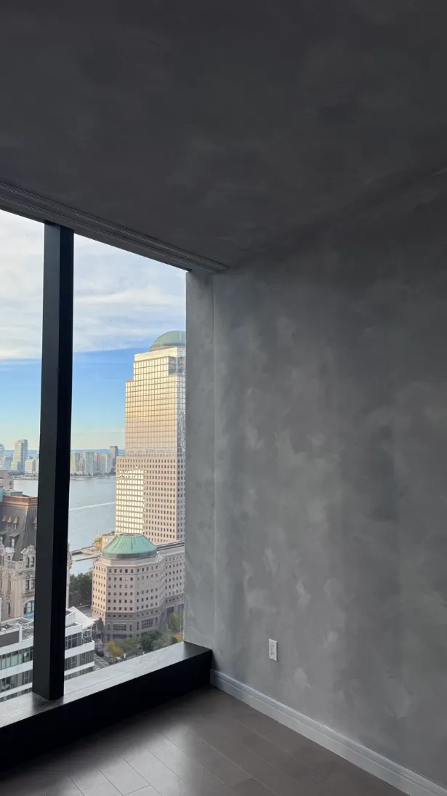

Limewash walls are the paint world's version of a vintage leather jacket: they look better the more character they have (and nobody can quite explain why they're so cool). **Limewash is a mineral finish made from lime and water that soaks into the wall and dries to a soft, cloudy, textured look. For a professional job in NYC, limewash walls cost about $4 to $6 per square foot, or roughly $400 to $700 for a typical wall.**

We do a lot of limewash in NYC apartments, and it's one of our favorite finishes to put on a wall. Here's everything you need to know before you try it, from what it is to what it costs. Let's get the lime-light on it.

*Deep burgundy limewash from one of our jobs. Up close, it looks like suede. From across the room, it looks like money (it isn't, but it looks like it).*

## What is limewash?

Limewash is one of the oldest wall finishes there is. It's made from slaked lime (lime mixed with water) plus natural pigments for color. As it dries, it slowly hardens back into something close to limestone, right on your wall.

What makes limewash walls special is the **movement**. Instead of one flat, even color, you get soft clouds of lighter and darker tones, like a watercolor painting or an old Italian villa. No two walls ever come out exactly the same. That's not a bug, it's the whole point.

*A dusty pink limewash wall in a prewar Manhattan apartment, caught right after we finished. The plastic comes off; the cloud effect stays.*

**Yes, you can limewash the ceiling too.** Carrying the same color over the walls and ceiling wraps the whole room in texture. Our gray job at the top of this page is a good example. It's like living inside a cloud, minus the turbulence.

## Limewash vs paint

| | Limewash | Regular paint |
| --- | --- | --- |
| **Look** | Soft, cloudy, textured, with depth | Solid, even color |
| **Finish** | Very matte and chalky | Flat to high gloss |
| **Cleaning** | Gentle wiping only; no hard scrubbing | Scrubbable, especially satin and up |
| **Touch-ups** | A light new coat blends in | Touch-ups can show |
| **Application** | Large brush, layered strokes | Roller and brush |
| **Best for** | Feature walls, living rooms, bedrooms, hallways | Anywhere, including busy, high-wear rooms |

The short version: limewash is for the walls you want people to notice. Paint is for the walls that need to survive your toddler with a juice box.

*A warm peach limewash hallway with an arched doorway. Even a hallway can have main-character energy.*

## How much do limewash walls cost?

Here are our real NYC prices:

- **$4 to $6 per square foot** of wall
- **About $400 to $700 for a typical wall**

For example, a wall that's 12 feet wide with 9-foot ceilings is about 108 square feet, so it runs roughly $430 to $650. A whole room or a long hallway costs more, of course, because there's more wall.

**What moves the price:**

- **Wall size and ceiling height**
- **Wall condition:** cracks and patches need fixing first, because limewash shows the wall underneath
- **The color and the look:** deeper colors and stronger movement can take more coats
- **How many walls:** one accent wall, a whole room or a full apartment

Why does limewash cost more than regular paint? Because it's a specialty finish. It's applied by hand with a big brush, layer by layer, and the painter has to control the movement so the wall looks intentional. It's more art class than assembly line. For comparison, see our [interior painting cost guide](/blog/interior-painting-cost/).

*Deep color, white trim, zero regrets. Burgundy limewash looks rich without feeling heavy.*

## How to limewash walls (the way we do it)

Here's our process, start to finish:

1. **Protect everything.** Floors get covered and trim gets taped. Limewash is runny, and it loves to travel.
2. **Fix the wall.** Cracks and holes get patched and sanded smooth. Limewash is honest: it will show every flaw you skipped.
3. **Prime painted walls.** Most NYC walls are painted drywall or plaster. Painted walls usually need a special primer so the limewash can grip instead of sliding around.
4. **Brush it on in layers.** We use a big, wide brush and work in random, overlapping strokes, never straight lines. This builds the soft, cloudy movement.
5. **Add the next coats.** The first coat almost always looks blotchy. That's normal, so don't panic. Each coat adds depth until the wall looks rich and even.
6. **Let it dry and judge it in your light.** Limewash looks much darker while wet and lightens as it dries.

**A safety note if you try it yourself:** limewash is made from hydrated lime, which can irritate and burn skin and eyes. The CDC's [guide on hydrated lime](https://www.cdc.gov/niosh/npg/npgd0092.html) recommends preventing skin and eye contact, so wear gloves and eye protection. And open a window: the [EPA recommends plenty of fresh air](https://www.epa.gov/indoor-air-quality-iaq/volatile-organic-compounds-impact-indoor-air-quality) whenever you're painting indoors.

## Limewash colors

Limewash looks best in earthy, natural colors: warm whites, sandy beiges, terracotta, blush and peach, sage and olive greens, and deep tones like burgundy and charcoal. Because it's layered, the color looks a little different in every part of the wall.

Two tips we tell every customer:

- **Test a big sample on the wall.** A tiny swatch won't show the movement. A limewash sample can look great at 12 inches and completely different across a 15-foot wall.
- **Check it in your lighting.** Limewash looks soft and dreamy in daylight and very different under strong spotlights. Lighting can make or break it.

*Gray is one of the most popular limewash colors, and for good reason: it looks calm, modern and never boring.*

Choosing colors can take a while. On one limewash job, my client and I went back and forth to the paint store about five times before we found the right two colors. (I rode her electric scooter. Highly recommend.) The wall came out exactly how she pictured it. More on that, and how to pick colors, in our guide on [how to choose a paint color](/blog/how-to-choose-a-paint-color/).

*A peach limewash living room. The walls look different every hour of the day, which is the best kind of wall drama.*

## Limewash accent walls and bathrooms

**Limewash accent walls** are the easiest way to try it. One wall behind a bed, a sofa or a dining table gives you all the texture without committing a whole room. If you're new to limewash, start here. (Read our [accent wall guide](/blog/accent-wall-painting/) for picking the right wall.)

**Limewash in a bathroom** can work, especially on walls away from the shower and with a good exhaust fan. Right next to the shower or a splashing sink, a more washable finish or a protective sealer is the safer choice. We'll tell you honestly what fits your bathroom.

## How long does limewash last?

Indoors, limewash can last for years with gentle care. It's not a scrubbable finish, so treat it like a nice sweater, not a gym towel. The good news: small marks can often be refreshed with a light new coat, which blends in more easily than touching up regular paint.

**Can you paint over limewash later?** Yes, with the right prep. The wall needs to be cleaned and primed first, so the new paint sticks.

*Gray limewash in a high-rise overlooking the Hudson River. Honestly, the walls held their own against that view.*

## Limewash painters near you

Limewash isn't just regular paint with a different brush. The layering, the brush movement and the color balance are what make it look beautiful instead of randomly stained. That takes practice.

We're based in Queens and do limewash walls across [Manhattan](/areas/manhattan/), Brooklyn, Queens and Long Island. See our [limewash and specialty paint service](/services/lime-wash-specialty-paint/), or send us a photo of your wall for a free, flat-rate quote.

## The bottom line

Limewash walls give you texture, depth and a one-of-a-kind finish that regular paint just can't fake. Expect about $4 to $6 per square foot, or roughly $400 to $700 for a typical wall, test a big sample in your own light, and save it for the walls you want people to notice.

Limewash: because some walls deserve a little more than plain vanilla. (Unless you pick vanilla. It's a great limewash color.)
