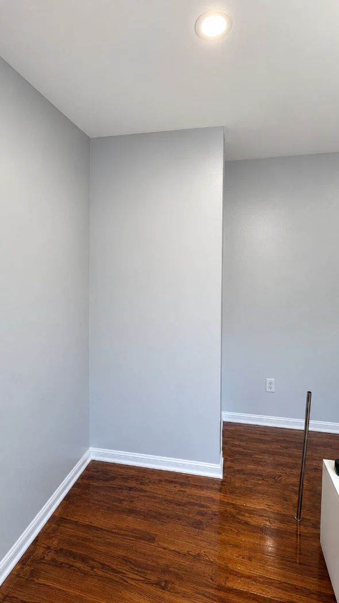
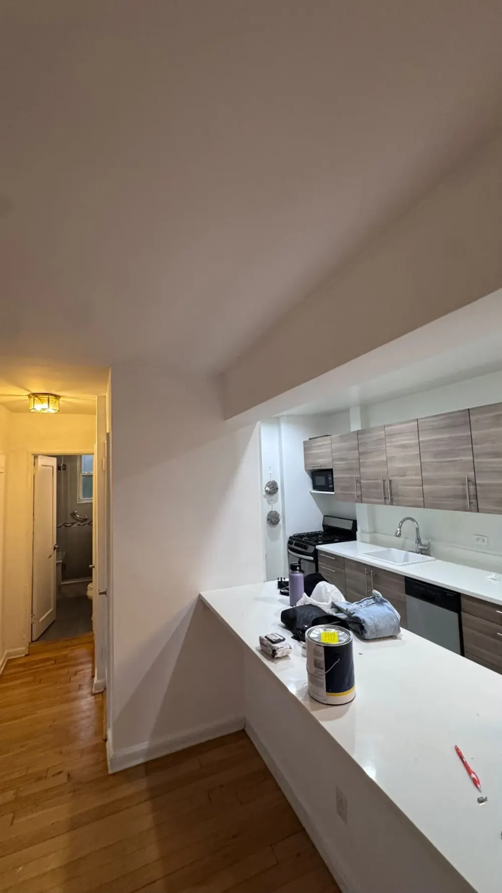
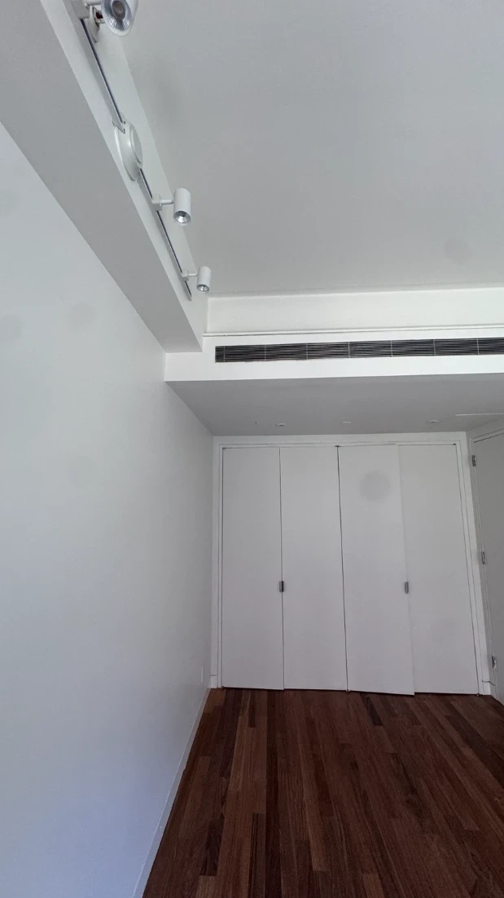
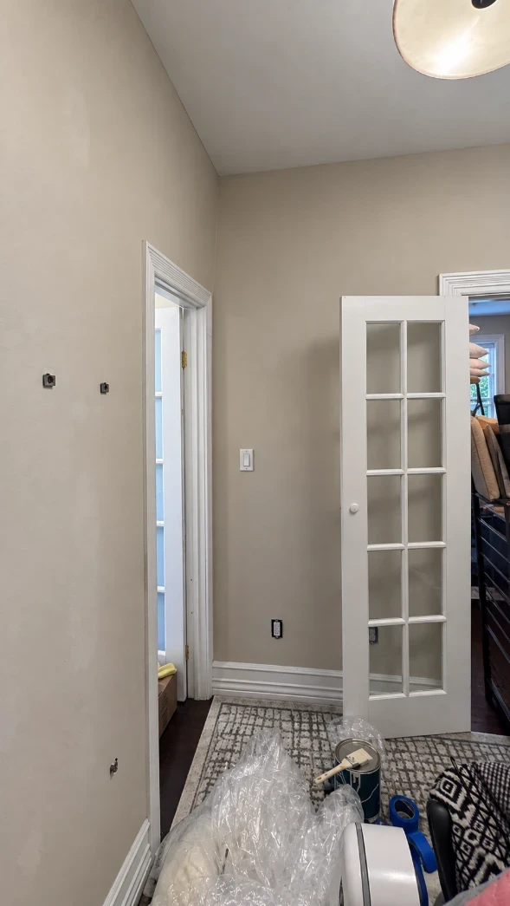
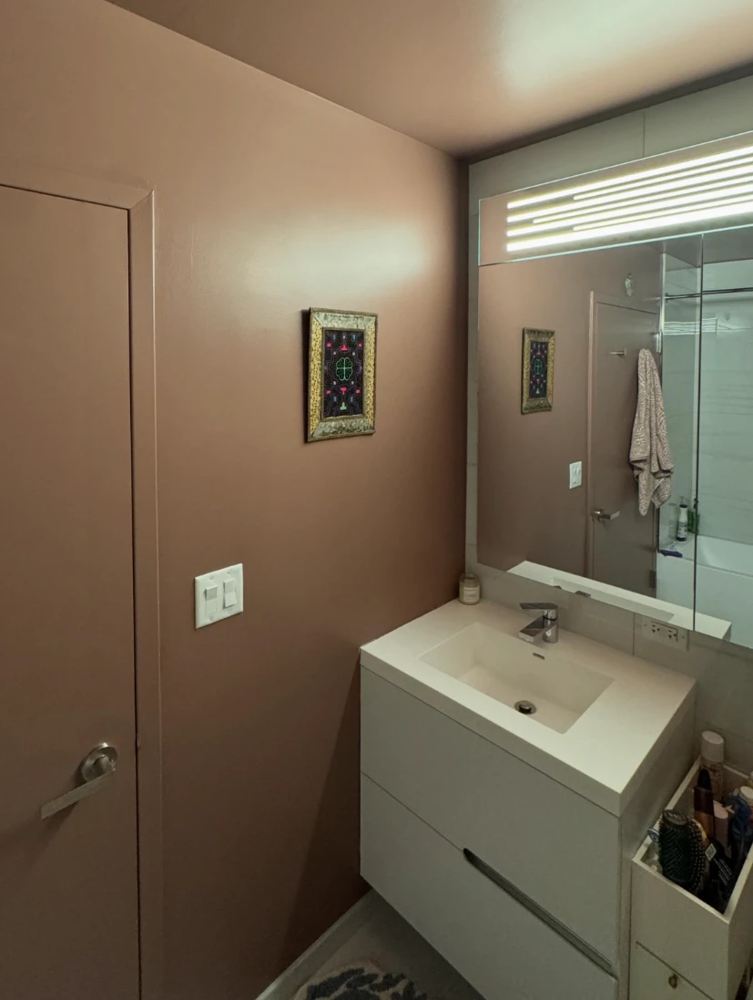

Picking a paint color gets all the attention, but the finish is the quiet partner that decides how it all turns out (we'd bring this up at parties, but we've learned not to). **The main paint finishes, from least to most shiny, are flat, matte, eggshell, satin, semi-gloss and high-gloss. Flatter finishes hide wall flaws, and shinier ones are tougher and easier to clean.** For most homes: flat on ceilings, matte or eggshell on walls, satin in kitchens, bathrooms and kids' rooms, and satin or semi-gloss on trim and doors.

We paint apartments and homes all over NYC and Long Island, and we choose a finish with every customer, room by room. Here's how each paint sheen looks, where it works and how we decide. Let's get to the shiny bits.

## Paint sheen chart: types of paint finishes at a glance

| Finish | Shine | Hides wall flaws | Easy to clean | Best for |
| --- | --- | --- | --- | --- |
| **Flat** | None | Best | Least | Ceilings, low-traffic walls, older plaster walls |
| **Matte** | Very low | Very good | Fair to good | Living rooms, bedrooms, dining rooms |
| **Eggshell** | Low | Good | Good | Most walls, hallways, home offices |
| **Satin / pearl** | Medium | Fair | Very good | Kitchens, bathrooms, kids' rooms, trim |
| **Semi-gloss** | High | Poor | Excellent | Trim, doors, baseboards, door frames |
| **High-gloss** | Highest | Worst | Excellent | Statement doors, furniture, small details |

The rule of thumb: **the more shine, the more durable, and the more honest.** A shiny wall tells on every bump, patch and roller mark underneath it. That's why prep matters so much more as you move down this chart.

*Smooth walls with a soft, low sheen. The only thing shining in this room is the floor, and honestly, it earned it.*

## Flat and matte paint

**Flat paint** has almost no shine. It soaks up light instead of bouncing it back, so it's the best finish for hiding dents, patches and wavy old walls. That makes it a favorite for ceilings and prewar plaster. The catch: older and cheaper flat paints scuff and don't love scrubbing. Many premium flat paints are now made to be wiped clean, though, so don't rule it out.

**Matte paint** has a touch more sheen than flat, which usually makes it a bit tougher and easier to wipe. It gives that soft, velvety, high-end look in living rooms and bedrooms. Flat or matte paint? If your walls are rough or patched, lean flat. If people actually live in the room (and touch the walls), lean matte.

Flat paint is the forgiving friend. It doesn't mention the dent you made moving the couch.

## Eggshell paint

**Eggshell** has a low, soft glow, about like (you guessed it) an eggshell. It's the most popular choice for walls because it balances everything: it hides flaws well, cleans up better than flat, and looks good in almost any room. Hallways, living rooms, bedrooms and home offices are its home turf.

No eggs were harmed in the making of this finish. We get asked. (Okay, nobody asks. We just like to be thorough.)

## Satin paint (and pearl)

**Satin finish paint** has a noticeable, pearly sheen. It's tougher than eggshell and stands up to scrubbing, so it's great in kitchens, bathrooms, kids' rooms and busy hallways. It's also a popular finish for trim when you want something less shiny than semi-gloss.

Benjamin Moore calls a similar sheen **pearl** in some of its paint lines. Same idea: the middle child of finishes, gets along with everyone, rarely causes trouble.

The trade-off: satin shows wall flaws and roller marks more than eggshell, and touch-ups can show as shiny patches. On satin walls, even coats and good prep are not optional.

*Kitchens see more splatter than a toddler's birthday party, so the walls need a finish that wipes clean.*

## Semi-gloss and high-gloss paint

**Semi-gloss** is shiny, hard and very easy to clean. It's the classic finish for trim, doors, baseboards and door frames, which get kicked, bumped and grabbed all day. It's usually too shiny for whole walls, because it shows every flaw.

**High-gloss** is the shiniest finish there is, almost like glass. It looks stunning on a front door or a piece of furniture, but it needs near-perfect prep. Every speck of dust under it turns into a little mountain.

Baseboards get kicked more than a vending machine that ate your dollar. Give them a finish that can take it.

## Eggshell vs flat paint

**Eggshell vs flat paint** comes down to cleaning vs hiding. Flat hides more flaws and touches up more easily. Eggshell has a soft glow and handles wiping and light scrubbing better. For most living spaces, eggshell is the safer pick. For ceilings, low-traffic rooms or walls with a lot of patching, flat wins.

## Eggshell vs satin

**Eggshell vs satin** is the most common question we get about finishes. Satin is shinier and more durable, so use it where walls get wet, splashed or touched a lot: kitchens, bathrooms, kids' rooms. Eggshell is softer and more forgiving, so use it in living rooms, bedrooms and hallways. If you're torn, look at both samples on the wall in your own light.

## Matte vs satin

**Matte vs satin** is the biggest jump of the three comparisons. Matte gives a calm, almost chalky, modern look and hides more. Satin is noticeably shinier and much easier to clean. They look very different side by side, so this one is less about durability and more about the look you want.

## Best paint finish for each room

| Room | Walls | Trim and doors |
| --- | --- | --- |
| **Living room** | Matte or eggshell | Satin or semi-gloss |
| **Bedroom** | Matte or eggshell | Satin or semi-gloss |
| **Kids' room** | Satin (washable matte also works) | Semi-gloss |
| **Kitchen** | Satin or eggshell | Semi-gloss |
| **Bathroom** | Satin, or a paint made for bathrooms | Semi-gloss |
| **Hallway and entry** | Eggshell or satin | Semi-gloss |
| **Ceiling** | Flat | n/a |
| **Rental apartment** | Flat or matte (easiest to touch up) | Semi-gloss |

A few notes from our jobs:

- **Ceilings go flat**, almost always. Shine on a ceiling shows every seam and roller line, and nobody wants to look up and see a ceiling with a glare problem. Our [ceiling painting](/services/ceiling-painting/) is done in flat unless a customer asks otherwise.
- **Bathrooms are basically a steam room with a mirror.** Satin handles moisture and wiping well. Run the fan, too. No finish beats a bathroom that never dries out.
- **Kids' rooms:** kids treat walls like a canvas, and they never ask for a quote first. Pick something you can scrub.
- **Rentals and tenant turnovers:** flat and matte make touch-ups between tenants easy. That's why landlords love them for [tenant turnover painting](/services/tenant-turnover-painting/).

*Flat ceilings hide the seams, so the only thing that gets the spotlight is the track lighting.*

## Benjamin Moore and Sherwin-Williams paint finishes

Here's a heads-up most guides skip: **finish names are not the same from brand to brand.** One brand's eggshell can look closer to another brand's matte, and some paint lines skip a sheen entirely. Brand finish names are like coffee sizes. One shop's "tall" is another shop's small.

These are the lines we use most, and the sheens they come in:

| Paint line | Sheens | Where we like it |
| --- | --- | --- |
| **Benjamin Moore Regal Select** | Flat, matte, eggshell, pearl, semi-gloss | Walls in most rooms; washable even in matte |
| **Benjamin Moore Aura** | Matte, eggshell, satin, semi-gloss | Premium jobs and deep colors |
| **Benjamin Moore Advance** | Satin, semi-gloss, high-gloss | Trim, doors and baseboards; it levels out smooth like old-school oil paint |
| **Sherwin-Williams Emerald** | Flat, matte, satin, semi-gloss | Premium walls and ceilings |
| **Sherwin-Williams Duration Home** | Check the label for current sheens | Busy rooms that need washable walls |

Notice that Regal Select has no satin (pearl fills that spot) and Emerald jumps from matte straight to satin. So "eggshell" isn't always on the menu. Always look at a sample in the actual sheen, not just the color chip.

*Soft walls, crisp shiny trim. The French door is just showing off at this point.*

## Can you paint flat over semi-gloss?

Yes, you can paint any finish over any other finish, but **glossy paint is slippery, and new paint doesn't like slippery surfaces** (think ice on a sidewalk). Here's how we do it:

1. **Clean the wall** to remove grease and grime, especially in kitchens.
2. **Scuff-sand the glossy surface** so the new paint has something to grip.
3. **Prime with a bonding primer** if the old paint is very slick, or if you're switching from oil paint to water-based paint.
4. **Apply two full coats** of the new finish. Two coats is what gives an even sheen.

One safety note: in NYC, lots of buildings were painted before 1978, when lead paint was still used. **Sanding old paint in those buildings can release lead dust**, so it should be tested first. The [EPA's lead renovation rules](https://www.epa.gov/lead/lead-renovation-repair-and-painting-program) explain what's required.

Going the other way, painting semi-gloss or satin over flat, is easier: clean the wall and paint. Just remember the shinier coat will show every flaw the flat paint was hiding.

*A bathroom repaint in dusty rose. Moisture-friendly walls, rosy outlook.*

## How we choose a finish with our customers

There's no single "right" finish for every home, so we decide with each customer. When we look at the space (in person or from your photos), we check:

- **How the room is used:** a quiet bedroom and a busy kitchen need different things.
- **The wall condition:** old plaster, patches and uneven walls look best in flat or matte. Shine only makes them louder.
- **The light:** low, sideways light from a window shows every bump on a shiny wall.
- **Who lives there:** kids, pets and roommates who lean on walls all push us toward a tougher finish.
- **The look you like:** some people love a velvety matte, and others like a little glow. Both are right.

Whatever the finish, the same two rules apply. **Prep comes first**, because shine shows everything underneath. And **two coats is the minimum**, because one coat leaves patchy sheen that looks blotchy in daylight. Paint in the right order, too: ceiling first, then walls, then trim. It keeps drips off finished work.

Also worth knowing: whatever finish you choose, low-VOC paint makes a big difference to the smell in a small apartment. The [EPA explains how paint fumes affect indoor air](https://www.epa.gov/indoor-air-quality-iaq/volatile-organic-compounds-impact-indoor-air-quality), and why airing out the room matters.

Still choosing the color itself? Read our guides on [how to choose a paint color](/blog/how-to-choose-a-paint-color/) and the [best paint colors for living rooms](/blog/best-paint-colors-for-living-room/). If you'd rather hand the whole thing off, our [interior painting service](/services/interior-painting/) includes help choosing colors and finishes, and our [trim painting](/services/trim-painting/) gives doors and baseboards that crisp, durable finish.

## The bottom line

The right paint finish depends on the room, the walls and how you live. Go flat on ceilings, matte or eggshell on most walls, satin where things get wet or messy, and satin or semi-gloss on trim and doors. Test the actual sheen in your own light, and give the walls the prep they deserve.

And now you know enough about paint finishes to bring them up at parties. We just don't recommend it. Trust us.
