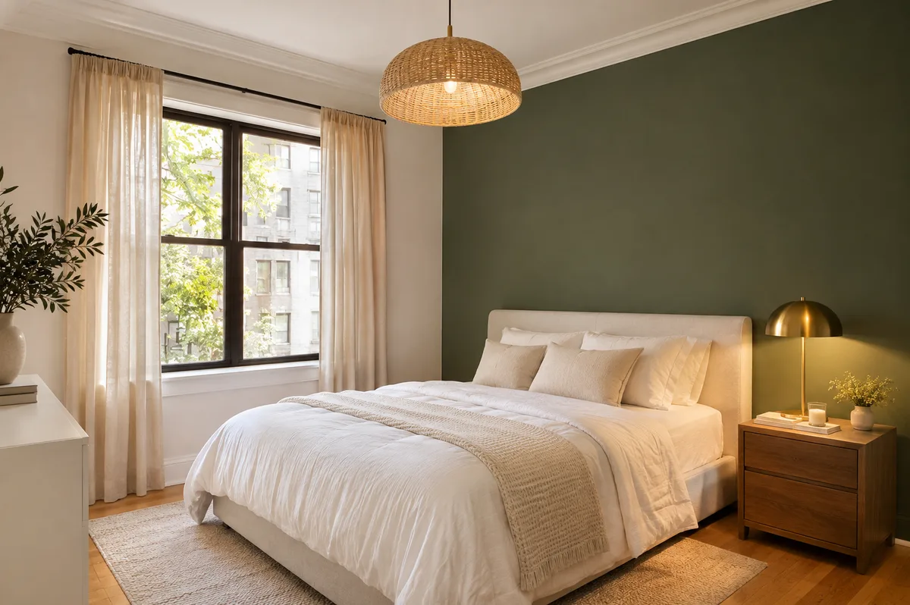
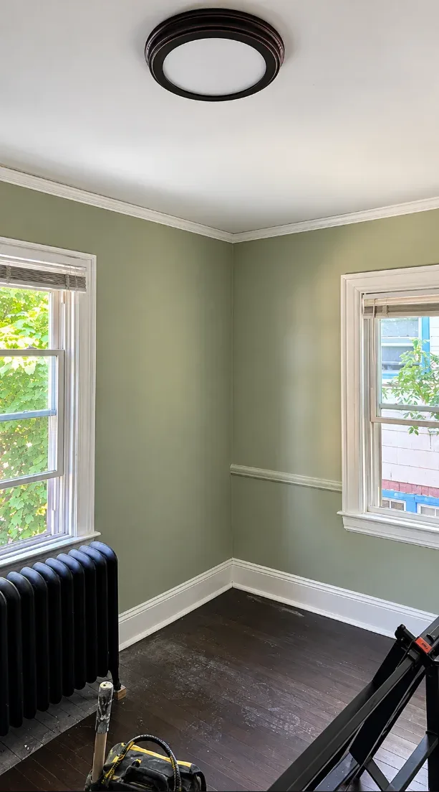
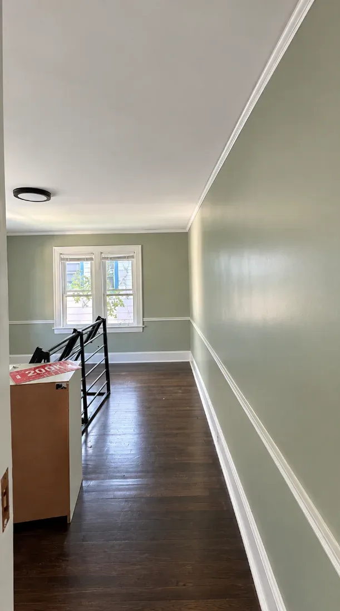
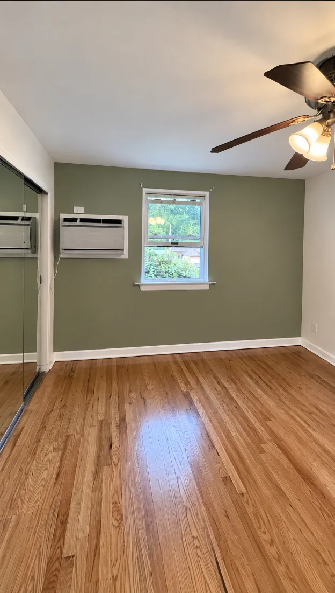
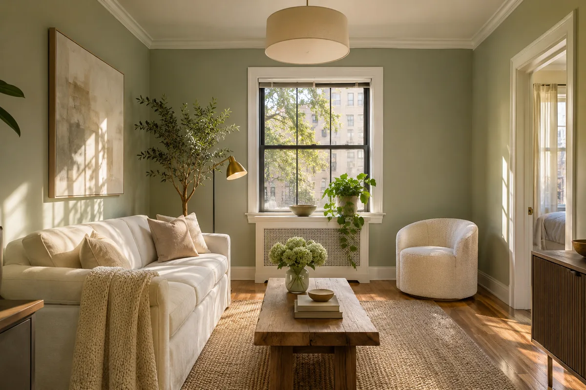
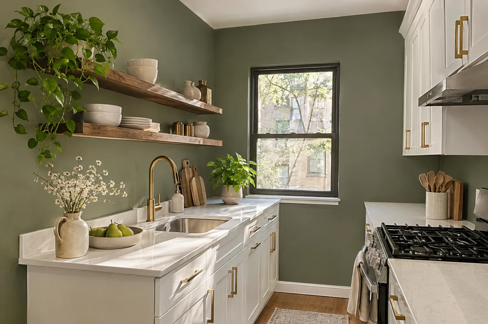
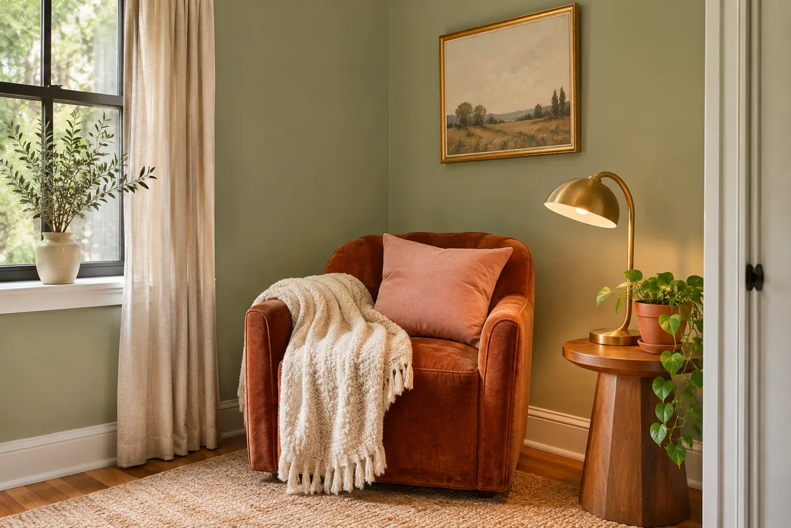

Sage green is the color for people who want color, just not too much of it (it's green that went to a yoga class). **The best sage green paint colors are soft, gray-green shades like Benjamin Moore October Mist and Saybrook Sage, and Sherwin-Williams Evergreen Fog and Clary Sage.** Lighter sages keep a room bright and calm, mid-tones add more color, and dark sages make a cozy accent wall.

We've done 250+ jobs across NYC and Long Island, and sage is one of the greens we'd happily put on almost any wall. Below are our 14 favorite sage greens from **Benjamin Moore and Sherwin-Williams**, a real sage room we painted in Queens, and what to pair with it. Let's get into the green stuff.

## Best sage green paint colors at a glance

| Color | Brand and code | Shade | Best for |
| --- | --- | --- | --- |
| **October Mist** | Benjamin Moore 1495 | Light, soft sage | Bedrooms, living rooms, any room |
| **Hollingsworth Green** | Benjamin Moore HC-141 | Pale, fresh green | Small or dark rooms |
| **Softened Green** | Sherwin-Williams SW 6177 | Light sage | Bedrooms and bathrooms |
| **Saybrook Sage** | Benjamin Moore HC-114 | Warm, earthy sage | Traditional rooms with wood |
| **Guilford Green** | Benjamin Moore HC-116 | Warm muted green | Living rooms and kitchens |
| **Evergreen Fog** | Sherwin-Williams SW 9130 | Gray-green sage | Modern, calm rooms |
| **Clary Sage** | Sherwin-Williams SW 6178 | Earthy sage | Rooms with good daylight |
| **Svelte Sage** | Sherwin-Williams SW 6164 | Light olive sage | Warm, sunny rooms |
| **Louisburg Green** | Benjamin Moore HC-113 | Deeper sage | Dining rooms, accent walls |
| **Retreat** | Sherwin-Williams SW 6207 | Dark sage | Accent walls, cabinets |
| **Pewter Green** | Sherwin-Williams SW 6208 | Deep gray-green | Moody accent walls |
| **Liveable Green** | Sherwin-Williams SW 6176 | Light, muted green | Small rooms and hallways |
| **Soft Fern** | Benjamin Moore 2144-40 | Pale gray-green sage | Bedrooms |
| **Webster Green** | Benjamin Moore HC-130 | Mid-tone green | Living rooms, bedrooms |

Paint chips and screens never show color exactly, so treat this as a shortlist, not a final answer. Your walls will have their own opinion.

## Light sage green paint

Light sages are the easiest way to bring color into a room without it taking over. They feel calm, they work with almost any furniture, and they keep a small NYC apartment bright. Think of them as a white that decided to have a little fun.

- **October Mist 1495:** one of our favorites. Soft, gentle and easy to live with.
- **Hollingsworth Green HC-141:** a pale, fresh green that brightens small or dark rooms.
- **Softened Green SW 6177:** a light sage that stays soft in most light.
- **Soft Fern 2144-40:** a pale green misted with gray. Benjamin Moore suggests it for bedrooms, and we agree.
- **Liveable Green SW 6176:** a light, muted green that lives up to its name.

For small or dark apartments, a light, bright color like these makes the room feel bigger. That's one of our standard tips, and light sage is one of the nicest ways to follow it.

## Mid-tone sage green paint colors

Mid-tone sages have more color and more personality. This is where sage really looks like sage: a soft gray-green that feels earthy and calm.

- **Saybrook Sage HC-114:** a warmer, earthier sage that loves wood floors and traditional trim.
- **Evergreen Fog SW 9130:** a gray-green that feels modern and calm.
- **Clary Sage SW 6178:** an earthy sage with a bit more warmth, best with good daylight.
- **Guilford Green HC-116:** a warm, muted green that's easy to pair with wood and white.
- **Svelte Sage SW 6164:** a light olive sage that glows in sunny rooms.

Not quite sage, but worth a mention: **Webster Green HC-130** is the green our customers ask for most. It's a deeper, warmer mid-tone green, for when sage feels a little too shy.

## Dark sage green paint

Dark sages are rich, cozy and a little dramatic. They're beautiful, but they take over a room fast. In bedrooms, we recommend dark colors on **one accent wall** (usually behind the bed), not every wall.

- **Louisburg Green HC-113:** a deeper sage that's still soft and earthy.
- **Retreat SW 6207:** a dark sage that looks great on an accent wall or cabinets.
- **Pewter Green SW 6208:** a deep gray-green for a moody, cozy wall.

Dark colors usually need an extra coat and very clean cut lines, because every mistake shows. Going dark green is like adopting a houseplant: worth it, but it needs some attention.

*Illustration (AI-generated): one dark sage wall behind the bed, everything else light. The wall does the talking so you can get some sleep.*

## Sherwin-Williams and Benjamin Moore sage greens

People often ask which brand's sage is "the one." Honestly, both make great sage greens, and we use both. Here are the short lists by brand:

- **Sherwin-Williams sage greens:** Evergreen Fog SW 9130, Clary Sage SW 6178, Softened Green SW 6177, Svelte Sage SW 6164, Liveable Green SW 6176, Retreat SW 6207 and Pewter Green SW 6208.
- **Benjamin Moore sage greens:** October Mist 1495, Saybrook Sage HC-114, Hollingsworth Green HC-141, Soft Fern 2144-40, Guilford Green HC-116, Louisburg Green HC-113 and Webster Green HC-130.

Pick the color first, not the brand. The paint quality matters more than the logo on the can, and that's coming from people who carry a lot of cans.

## Our job: a gray room painted sage green in Forest Hills

This upstairs room in a Forest Hills home was a light gray with dents and dings all over the walls. We covered and taped the floors, patched and sanded every hole, then painted the walls a soft sage green. The white crown molding, chair rail and baseboards really stand out against it now.

*Sage green with white trim and an old cast-iron radiator. The radiator has never looked so fashionable.*

Look at the hero photo at the top of this post: same corner, same window, before and after. In the sunlight, the sage reads warm and soft. In the shade, it leans a little grayer. That's sage being sage.

*A long sage wall with crown molding and chair rail. All that trim finally has something to show off against.*

See more photos on the [sage green room project page](/work/sage-green-room-crown-molding-chair-rail/).

## Sage green bedroom and accent wall

Sage is one of the calmest bedroom colors there is. A light or mid-tone sage works on every wall. A darker sage looks great as an **accent wall** behind the bed, while the other walls stay lighter.

*A sage green accent wall in a bedroom we painted. Calm enough to sleep in, green enough to brag about.*

For more bedroom ideas, see our guide to the [best paint colors for bedrooms](/blog/best-paint-colors-for-bedroom/), and if you're thinking about one wall only, read [accent wall painting](/blog/accent-wall-painting/).

## Sage green living room

In a living room, sage feels relaxed and natural without being boring. It's great with wood furniture, linen, leather and plants (real or very convincing fake ones, we don't judge). A light or mid-tone sage on all the walls is the easiest way to do it. For more living room picks, see our guide to the [best paint colors for living rooms](/blog/best-paint-colors-for-living-room/).

*Illustration (AI-generated): soft sage, cream and wood. That throw blanket has never had a stressful day in its life.*

## Sage green kitchen

Sage is one of the most popular kitchen greens right now, and it's easy to see why: it's fresh, natural and looks great with white or wood cabinets and brass hardware. Use a wipeable finish like satin on kitchen walls. For more, see our full guide to [kitchen paint colors](/blog/kitchen-paint-colors/).

*Illustration (AI-generated): a deeper sage with white cabinets and brass. Finally, a green in the kitchen nobody has to eat.*

## What colors go with sage green?

Sage green is easygoing. It gets along with most colors, but these are the best pairings:

- **White trim.** The classic. Crisp white makes sage look clean and fresh, and a warmer white keeps it cozy. We choose the trim with each customer, based on the room and the light.
- **Wood.** Dark floors (like the Forest Hills room) make sage feel rich. Light oak (like the accent wall bedroom) keeps it light and fresh.
- **Brass and gold.** Warm metals bring out sage's warmth.
- **Cream, beige and warm neutrals** for a soft, earthy look.
- **Terracotta, rust and blush pink** for a warm contrast.
- **Navy or deep blue** in small doses, like pillows or a rug.

The one to watch: cool, stark grays next to sage can make it look muddy. Sage likes warm friends.

*Illustration (AI-generated): sage with rust, blush, brass and wood. This chair is sitting pretty.*

## Best paint finish for sage green walls

- **Bedrooms and living rooms:** matte or eggshell. The soft finish makes sage look velvety and hides small wall flaws.
- **Kitchens, bathrooms and kids' rooms:** satin, so the walls can be wiped down.
- **Trim and doors:** satin or semi-gloss.

Our [paint finishes guide](/blog/paint-finishes/) explains each sheen in more detail.

## How to choose the right sage green

1. **Check your light.** North-facing rooms get cooler light, which makes sage look grayer. South- and west-facing rooms are warmer, and sage looks greener.
2. **Decide how much color you want.** Light sage for calm, mid-tone for more personality, dark sage for one dramatic wall.
3. **Look at what's staying:** floors, furniture and trim. Warm wood wants a warmer sage.
4. **Test big swatches** on your own wall, at least two feet square, and look at them morning and night.

Read our full guide on [how to choose a paint color](/blog/how-to-choose-a-paint-color/) for more. Open a window while you paint, too: the [EPA's indoor air page](https://www.epa.gov/indoor-air-quality-iaq/volatile-organic-compounds-impact-indoor-air-quality) explains why fresh air matters with fresh paint. Want it done for you? Our [interior painting service](/services/interior-painting/) includes the prep, two coats and daily cleanup.

## The bottom line

The best sage green paint colors are October Mist, Saybrook Sage, Evergreen Fog and Clary Sage. Go light for a calm, bright room, mid-tone for more personality, and dark for one cozy accent wall. Pair sage with white trim, wood and brass, and test it in your own light first.

Sage green: proof that you can be green without being envious.
